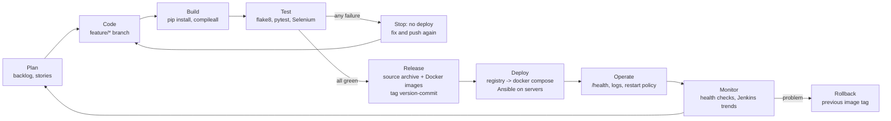

# 2. Agile Planning and DevOps Workflow (Task 2)

## User stories and acceptance criteria

| ID | User story | Acceptance criteria (all automated - see test names) |
|---|---|---|
| US1 | As a guest I want to **register and log in** so that my bookings are private to me. | Valid email, name, password >= 8 chars creates an account and logs in. Duplicate email refused (case-insensitive). Wrong password refused with a message that does not reveal whether the email exists. Passwords stored only as salted hashes. *(test_auth_service.py, test_journey_1, test_journey_2)* |
| US2 | As a guest I want to **see which rooms are free for my dates**. | Search with check-in/check-out shows every room as Available/Booked. Past check-in, check-out <= check-in, > 30 nights rejected with a message. Cancelled bookings do not block. *(TestSearchRooms, test_availability_search_shows_booked_room)* |
| US3 | As a guest I want to **request a booking** for a free room. | Creates a PENDING booking with total = nights x price. Refused if the room was taken meanwhile; never two active bookings overlap, even with simultaneous requests. *(TestRequestBooking, test_simultaneous_requests_create_only_one_booking, test_trigger_*)* |
| US4 | As a guest I want to **confirm my booking**. | PENDING -> CONFIRMED. Cannot confirm twice or confirm a cancelled booking. *(TestConfirmBooking, test_journey_3)* |
| US5 | As a guest I want to **cancel a booking**. | PENDING/CONFIRMED -> CANCELLED; room becomes free. Cannot cancel twice. *(TestCancelBooking, test_journey_4)* |
| US6 | As a guest I want to **track the status** of all my bookings. | "My bookings" lists only my bookings with current status. Other users' bookings return 404 and cannot be changed. *(test_list_shows_only_own_bookings..., test_other_users_cannot_see_confirm_or_cancel_my_booking)* |
| US7 | As a developer I want **every commit tested automatically** so that bugs are found before guests see them. | Jenkins runs lint + 90 tests on each build; any failure marks the build failed and skips packaging and deployment. *(Jenkins builds #2, #9)* |
| US8 | As an operator I want **one-command deployment** of a tested version. | Pipeline publishes images tagged `<version>-<commit>` and deploys them; `/health` must report that exact version. Ansible deploys to a fresh server. |
| US9 | As an operator I want to **roll back** a bad release. | `ansible-playbook rollback.yml` (or `IMAGE_TAG=<old> docker compose up -d`) restores the previous release; verified by `/health` and Selenium. |

## Product backlog (prioritised) and the 15 course tasks

GitHub issue numbers do not exist yet because the repository has not been
pushed to GitHub. After pushing, create one issue per row (the
`.github/ISSUE_TEMPLATE/feature_request.md` template) and replace "HB-xx"
with the real issue number.

| ID | Backlog item | Course task | Story | Status |
|---|---|---|---|---|
| HB-01 | Problem definition and scope | 1 | - | Done |
| HB-02 | Backlog, sprint plan, DoD, lifecycle diagram | 2 | - | Done |
| HB-03 | SRS, architecture, schema, route list | 3 | - | Done |
| HB-04 | Repository skeleton, templates, branching policy | 4 | - | Done |
| HB-05 | Feature branch + PR flow for the MVP | 5 | US1-US6 | Done (local merges; PR texts prepared) |
| HB-06 | Complete MVP, merge conflict, version tag | 6 | US1-US6 | Done |
| HB-07 | Jenkins job: checkout, install, lint, tests, reports, artifact | 7 | US7 | Done |
| HB-08 | Jenkinsfile with deploy + parameter + health check | 8 | US8 | Done |
| HB-09 | Selenium journeys with screenshots on failure | 9 | US1-US6 | Done |
| HB-10 | Tests in Jenkins, quality gate, defect experiment | 10 | US7 | Done |
| HB-11 | Dockerfile, compose, lifecycle demo | 11 | US8 | Done |
| HB-12 | Jenkins -> registry -> deploy with version/SHA tags | 12 | US8 | Done |
| HB-13 | Ansible inventory and playbook | 13 | US8 | Done |
| HB-14 | Idempotency + rollback | 14 | US9 | Done |
| HB-15 | Final release, report, viva preparation | 15 | - | Done |

## Kanban board (final state)

| Backlog | To do | In progress | Review | Done |
|---|---|---|---|---|
| Payment integration *(out of scope)* | - | - | - | HB-01 ... HB-15 |
| Admin UI *(out of scope)* | | | | |
| Auto-expire PENDING bookings *(future)* | | | | |

During the project each card moved left -> right; a card reached **Review**
when its feature branch was ready to merge, and **Done** when it met the
Definition of Done below.

## Sprint plan (10 working days, 3 short sprints)

| Sprint | Days | Goal | Backlog items |
|---|---|---|---|
| 1 - Foundation | 1-3 | Repo, layered app, all 6 workflows, unit tests | HB-01..HB-06, HB-09 |
| 2 - Automation | 4-6 | Jenkins pipeline, Docker images, registry, quality gate | HB-07, HB-08, HB-10..HB-12 |
| 3 - Operations & release | 7-10 | Ansible, rollback, releases v1.0.0/v1.1.0, report, viva | HB-13..HB-15 |

Each sprint ends with a short review (demo of the working increment) and a
retrospective (what to keep / improve). Example improvement carried into
sprint 3: "release-footer" and "contact-footer" were built in parallel and
conflicted; resolution documented in [04-git-workflow.md](04-git-workflow.md).

## Definition of Done

A backlog item is **Done** only when:

1. Code is on a `feature/*` (or `fix/*`) branch with Conventional-Commit messages.
2. New behaviour has automated tests (unit/integration, Selenium for UI journeys).
3. `flake8` is clean and **all** tests pass locally.
4. The Jenkins pipeline is green for the branch.
5. Merged into `develop` with `--no-ff` (PR checklist in
   `.github/pull_request_template.md` completed).
6. Documentation (README / docs) updated.
7. No secrets in the repository.

## DevOps lifecycle

