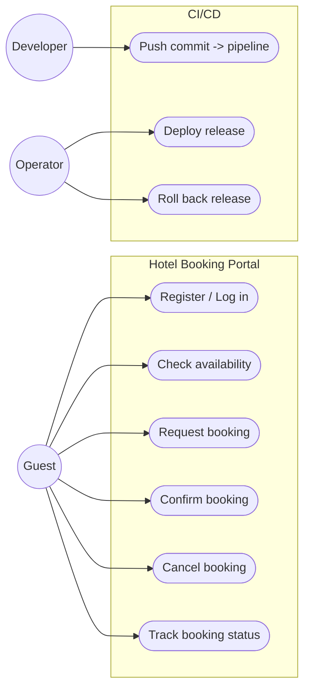
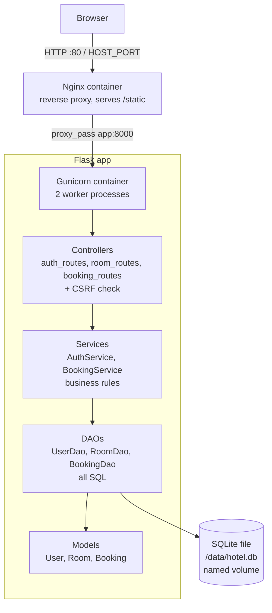
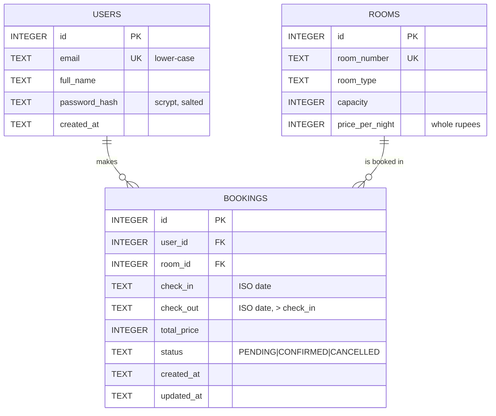
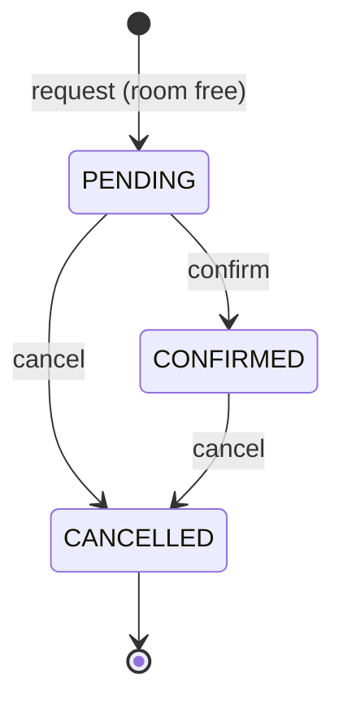

# 3. Requirements, Architecture and Technology (Task 3)

## SRS summary

### Functional requirements

| ID | Requirement | Implemented in |
|---|---|---|
| FR1 | Register with email, full name, password (>= 8 chars); email unique, case-insensitive | `AuthService.register` |
| FR2 | Log in / log out; same error for unknown email and wrong password | `AuthService.login`, `auth_routes.py` |
| FR3 | Show all rooms; for a date range show each room as Available/Booked | `BookingService.search_rooms` |
| FR4 | Validate stays: valid ISO dates, check-in not in the past, check-out after check-in, max 30 nights | `BookingService.validate_stay` |
| FR5 | Request a booking -> PENDING, total = nights x price per night | `BookingService.request_booking` |
| FR6 | Reject a booking that overlaps an active (PENDING/CONFIRMED) booking of the same room | `BookingDao.create_if_room_free` + DB triggers |
| FR7 | Confirm: PENDING -> CONFIRMED only | `BookingService.confirm_booking` |
| FR8 | Cancel: PENDING/CONFIRMED -> CANCELLED only; frees the room | `BookingService.cancel_booking` |
| FR9 | "My bookings": only the user's own bookings with current status | `BookingService.list_bookings` |
| FR10 | Another user's booking behaves as "not found" (404) for view/confirm/cancel | `BookingService.get_booking` |
| FR11 | `GET /health` reports status, environment, version, commit | `app/__init__.py` |

### Non-functional requirements

| ID | Requirement | How |
|---|---|---|
| NFR1 Security | Salted password hashes; CSRF tokens on every form; HttpOnly + SameSite session cookie; no open redirects; secrets only from environment/Jenkins credentials | Werkzeug scrypt, `controllers/csrf.py`, `config.py` |
| NFR2 Integrity | No double booking even under concurrent requests | `BEGIN IMMEDIATE` transaction + SQLite triggers + CHECK constraints |
| NFR3 Reliability | Container health checks, automatic restart, rollback to earlier image | `HEALTHCHECK`, `restart: unless-stopped`, `rollback.yml` |
| NFR4 Maintainability | Layered architecture; flake8 clean; 90 automated tests | see below |
| NFR5 Portability | Same Docker image in every environment; config via env vars | 12-factor config |
| NFR6 Traceability | Every deployment identifies its version and commit | `/health`, footer, image labels |
| NFR7 Performance | Pages respond well under 1 s for one hotel (target; no load test was run) | SQLite + indexes; Gunicorn 2 workers |

## Use-case diagram

## Application architecture

Rules of the layers: controllers never contain SQL, services never touch
HTTP, DAOs are the only place with SQL. Services get their DAOs through the
constructor (dependency injection), so unit tests give them a test database.

## Database schema and relationships

Database-level rules (`app/schema.sql`):

- `CHECK (check_out > check_in)` and `CHECK (status IN (...))`.
- Foreign keys enforced (`PRAGMA foreign_keys = ON`).
- Triggers `bookings_no_overlap_insert` / `bookings_no_overlap_update`:
  refuse an active booking that overlaps another active booking of the
  same room - a guarantee even for code that bypasses the service.
- Indexes on `bookings(room_id, status)` and `bookings(user_id)`.
- `CREATE ... IF NOT EXISTS` + `INSERT OR IGNORE` seeds: safe on every start
  (tested by `test_init_db_can_run_repeatedly_without_duplicating_rooms`).

### Booking state machine

Status changes use a conditional `UPDATE ... WHERE status IN (allowed)`, so
"check the current status" and "change it" are one atomic statement.

## Data model (Python)

`app/models.py`: `User`, `Room`, `Booking` dataclasses (data only, no SQL);
`Booking` adds derived properties `nights`, `can_confirm`, `can_cancel`;
`BookingStatus` holds the three states and `ACTIVE = (PENDING, CONFIRMED)`.

## Route list

| Method | URL | Login | Purpose |
|---|---|---|---|
| GET | `/` | - | Redirect to `/rooms` |
| GET | `/rooms?check_in=&check_out=` | - | Room list / availability (FR3) |
| GET, POST | `/register` | - | Registration (FR1) |
| GET, POST | `/login?next=` | - | Login; `next` only to same-site paths (FR2) |
| POST | `/logout` | - | Log out (POST so links cannot log you out) |
| GET | `/bookings` | yes | My bookings + status (FR9) |
| POST | `/bookings` | yes | Request booking (FR5, FR6) |
| GET | `/bookings/<id>` | yes, owner | Booking detail (FR10) |
| POST | `/bookings/<id>/confirm` | yes, owner | Confirm (FR7) |
| POST | `/bookings/<id>/cancel` | yes, owner | Cancel (FR8) |
| GET | `/health` | - | JSON health/version (FR11) |
| GET | `/static/...` | - | CSS, served directly by Nginx |

Every POST must include the form's `csrf_token`, otherwise HTTP 400.

## Local development setup

See [README.md](../README.md#getting-started-local-development): create a venv,
`pip install -r requirements-dev.txt`, `python wsgi.py`, open
http://127.0.0.1:5000. Tests: `pytest` (all), `pytest -m "not e2e"` (no browser).

## Technology choices and rationale

| Area | Choice | Why |
|---|---|---|
| Language / web | Python 3.11, Flask 3.1, Jinja2 templates | Team already knows Python; Flask is small and explicit - the whole request flow is visible |
| Database | SQLite | Built in, zero setup, one file; enough for one hotel. Limitation: single writer |
| Unit/integration tests | pytest | Fixtures give each test a fresh database; parametrised tests |
| Browser tests | Selenium 4 + pytest, headless Chrome | Real browser journeys; explicit waits; screenshots on failure |
| Lint | flake8 | Catches unused imports, undefined names, style problems |
| WSGI server | Gunicorn | Production server with multiple worker processes |
| Reverse proxy | Nginx | Single public entry point; serves static files; app port stays private |
| Packaging | `git archive` source tarball + Docker images | Reproducible artifacts named `<version>-<commit>` |
| Containers | Docker, Docker Compose | Same image everywhere; health checks; volumes |
| Registry | `registry:2` locally (Docker Hub supported) | No account needed for the demo |
| CI/CD | Jenkins (declarative Jenkinsfile) | Pipeline as code, required by the course |
| Config management | Ansible (built-in modules only) | Agentless, idempotent, readable YAML |

### Note on Maven / Gradle / Ant and Tomcat

The course brief lists Maven/Gradle/Ant and Tomcat/Nginx as example tools.
Those are **Java** tools: Maven builds `.jar/.war` files and Tomcat runs Java
servlets. This project is Python, so they would have nothing to build or run.
The Python equivalents used here, and **not** labelled as Maven:

| Java world | This project |
|---|---|
| `pom.xml` dependencies | `requirements.txt` / `requirements-dev.txt` (pinned versions) |
| `mvn compile` | `python -m compileall` + `flake8` |
| `mvn test` (JUnit/Surefire) | `pytest` with JUnit-XML reports |
| `.war` artifact | source tarball + Docker images |
| Tomcat | Gunicorn (WSGI server) behind **Nginx** (Nginx is in the brief) |
| Servlet | Flask route (controller function) |

**To confirm with the professor:** if Maven/Gradle/Ant or Tomcat is
*mandatory* rather than an example, the smallest honest change would be a
thin wrapper (e.g. a Maven `exec-maven-plugin` calling `pytest`) - but it
would add a Java toolchain without building anything Java, so it was not
done without confirmation.
