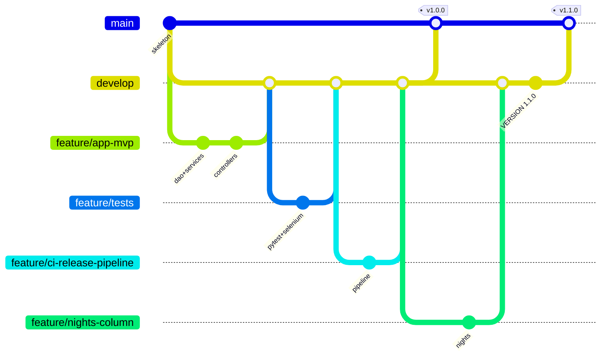

# 4. Git Workflow, Feature Branches, Merge Conflict and Releases (Tasks 4-6)

## Honest status of GitHub

The repository is complete **locally** (git history, branches, tags), but it
has **not been pushed to GitHub yet** - pushing and opening PRs needs your
GitHub account. Therefore:

- Merges below are **real local `git merge --no-ff` merges** (visible in `git log --graph`).
- GitHub **Pull Requests do not exist yet**. The PR descriptions are
  prepared in [pull-requests/](pull-requests/) so you can open them, or
  show them as the review record.

How to publish (when you decide to):

```powershell
git remote add origin https://github.com/<you>/<repo>.git
git push -u origin main develop
git push origin --tags
git push origin feature/release-footer feature/contact-footer   # any branch you want to show
```

## Repository structure (Task 4)

| Item | Where |
|---|---|
| README | `README.md` |
| Ignore rules | `.gitignore` (venv, databases, reports, `.env`, credentials, `certs/*.crt`) |
| Line endings | `.gitattributes` (LF in the repo) |
| Issue templates | `.github/ISSUE_TEMPLATE/bug_report.md`, `feature_request.md` |
| PR template + review checklist | `.github/pull_request_template.md` |
| Branch and commit policy | `CONTRIBUTING.md` |
| Initial baseline | commit `08702db chore: initialise repository skeleton` |

## Branching model



(Simplified - the full graph: `git log --graph --oneline --all`.)

- `main`: released code only; every commit on it is a tagged release.
- `develop`: integration branch; Jenkins builds it and deploys to staging.
- `feature/*`, `fix/*`: one per change, merged into `develop` with `--no-ff`
  so the history shows each feature as a unit.
- `experiment/*`: throw-away branches (deliberate-defect demo). **Never merged.**

## Feature branches and merges (Task 5)

| Feature branch | Merge commit on develop | What it delivered |
|---|---|---|
| feature/app-mvp | 1677565 | Layered Flask app, all 6 workflows |
| feature/tests | 1ebec7c | pytest unit tests + Selenium journeys |
| feature/docker | 0602c39 | Dockerfile, Nginx, compose |
| feature/jenkins-pipeline | 9c6fcf4 | First Jenkinsfile, local Jenkins |
| feature/ansible | d670fad | Inventory + playbook |
| feature/security-hardening | 37a4663 | CSRF, cookie flags, audit log, DB triggers, integration tests |
| feature/ci-release-pipeline | f4d0b26 | Lint, versioned images, registry, verified deploy |
| feature/contact-footer | cfeacef | Contact footer |
| feature/release-footer | 8728b62 | Release footer - **merge conflict, see below** |
| feature/ansible-rollback | 224384f | Versioned Ansible deploys, rollback.yml, lab |
| feature/nights-column | 9969df6 | Nights column (release 1.1.0) |
| fix/jenkins-stale-reports | 848d710 | Pipeline bug fix found from evidence |

Worked example for the viva - `feature/security-hardening`:

1. `git checkout -b feature/security-hardening develop`
2. Commit `65c41cb feat: add CSRF protection, secure cookies, audit logs and DB overlap guard`
3. Commit `388c47b test: add route-level integration tests and database rule tests`
4. Run `flake8` + `pytest` locally (87 passed at that point).
5. Review with the PR checklist ([pull-requests/feature-security-hardening.md](pull-requests/feature-security-hardening.md)).
6. `git merge --no-ff feature/security-hardening` into `develop` -> `37a4663`.

## Real merge conflict and its resolution (Task 6)

Two features were developed **in parallel from the same `develop` commit**
(`f4d0b26`), and both added a page footer in the same place:

- `feature/contact-footer` (`65ad990`): hotel contact details.
- `feature/release-footer` (`c24148f`): the running release and environment.

`feature/contact-footer` merged cleanly first. Merging
`feature/release-footer` then produced a real conflict in **three files**
(full, unedited output: [evidence/git/merge-conflict.txt](evidence/git/merge-conflict.txt)):

```
CONFLICT (content): Merge conflict in app/static/style.css
CONFLICT (content): Merge conflict in app/templates/base.html
CONFLICT (content): Merge conflict in tests/integration/test_routes.py
Automatic merge failed; fix conflicts and then commit the result.
```

Resolution (merge commit `8728b62`): both features were wanted, so **both
were kept** - contact line first, release line below it; one combined
`.site-footer` CSS rule; both new tests kept. Then `flake8` was clean and
all 89 tests passed before committing the merge. Check it yourself:

```powershell
git show 8728b62            # the merge commit and its message
git log --graph --oneline cfeacef^..8728b62
```

## Version tags and releases (Task 6 / 15)

| Tag | Commit on main | Contents | Pipeline evidence |
|---|---|---|---|
| `v1.0.0` | `661751d` | MVP + CI/CD + security hardening + footers | Jenkins #4 (develop, staging) and #5 (main, prod) green |
| `v1.1.0` | `d07929b` | + Nights column in My bookings | Jenkins #6/#7 (develop) and #8 (main, prod) green |

Release procedure (as performed):

```powershell
# develop is green in Jenkins
git checkout main
git merge --no-ff develop          # "release: vX.Y.Z" merge commit
git tag -a vX.Y.Z -m "..."
# Jenkins: Build with Parameters -> BRANCH=main, APP_ENV=prod
git checkout develop
```

The version number lives in the `VERSION` file; it is baked into the image
and shown by `/health` and in the page footer.
