# 5. Jenkins CI/CD Pipeline (Tasks 7, 8, 10, 12)

## Setup (Task 7)

Jenkins runs in Docker on the developer machine, together with a private
image registry. Everything is created from the repository:

```powershell
cd deploy\jenkins
copy .env.example .env            # set JENKINS_ADMIN_PASSWORD and HOTEL_SECRET_KEY
docker compose up -d --build      # Jenkins http://localhost:8090 (user admin), registry localhost:5000
```

| Piece | File | What it does |
|---|---|---|
| Jenkins image | `deploy/jenkins/Dockerfile` | Jenkins LTS + Python 3.11 + Chromium/chromedriver + Docker CLI + plugins |
| Plugins | `deploy/jenkins/plugins.txt` | pipeline, git, junit, credentials-binding, stage view, timestamper |
| Auto-configuration | `deploy/jenkins/init.groovy.d/01-setup.groovy` | admin user, `hotel-secret-key` credential, `hotel-booking` job ("Pipeline script from SCM") |
| Pipeline | `Jenkinsfile` | all stages below |
| Registry | `deploy/jenkins/docker-compose.yml` (service `registry`) | stores every published image (kept for rollback) |

**Trigger:** `pollSCM('H/5 * * * *')` - Jenkins checks the repository
every ~5 minutes and builds new commits. A **GitHub webhook** would be
better (instant), but GitHub cannot reach a Jenkins on `localhost`. To use
one later: expose Jenkins (public server or a tunnel such as ngrok), add the
"GitHub" plugin, and in GitHub *Settings -> Webhooks* add
`http://<jenkins>/github-webhook/` for push events. Builds in this project
were started with **Build with Parameters** (and the REST API equivalent).

## Pipeline stages (Tasks 7 + 8)

```mermaid
flowchart LR
    A[Checkout<br/>+ clean old reports<br/>+ version = VERSION-sha] --> B[Install dependencies<br/>venv + pinned pip]
    B --> C[Static checks<br/>compileall + flake8]
    C --> D[Unit & integration<br/>tests 85]
    D --> E[E2E Selenium<br/>tests 5]
    E --> F[Package source<br/>git archive + sha256]
    F --> G[Build images<br/>app + nginx]
    G --> H[Publish images<br/>registry]
    H --> I[Deploy<br/>pull + compose up --wait]
    I --> J[Health check<br/>version + commit match]
```



| Stage | Command (shortened) | Fails when |
|---|---|---|
| Checkout | `checkout scm`, `rm -rf reports dist`, read `VERSION`, `git rev-parse --short HEAD` | repo/branch missing |
| Install dependencies | `python3.11 -m venv .venv; pip install -r requirements-dev.txt` | a pinned package cannot be installed |
| Static checks | `python -m compileall -q app wsgi.py; flake8 app tests ...` | syntax error, unused import, undefined name, long line |
| Unit & integration tests | `pytest tests/unit tests/integration --junitxml=reports/unit-integration-tests.xml` | any test fails |
| E2E tests (Selenium) | `pytest -m e2e --junitxml=reports/e2e-tests.xml` | any journey fails (screenshot saved) |
| Package source | `git archive ... -o dist/hotel-booking-<tag>.tar.gz HEAD` + `sha256sum` | - |
| Build images | `docker build -t <registry>/hotel-booking-app:<tag> --build-arg APP_VERSION --build-arg GIT_COMMIT .` (+ nginx) | Dockerfile error |
| Publish images | `docker push ...` (Docker Hub: `docker login --password-stdin` with `registry-creds`) | registry unreachable / auth |
| Deploy | `withCredentials(hotel-secret-key)`: `docker compose pull; docker compose up -d --no-build --wait` | containers never become healthy |
| Health check | `wget /health` through Nginx; `grep` the expected version AND commit | wrong version running / app down |

**Post actions (always):** publish JUnit XML (`junit 'reports/*.xml'`) and
archive `reports/**` (test XML, failure screenshots, `health.json`,
`deployment.txt`) and `dist/**` (source tarball + checksum).

### Parameters and configuration (Task 8)

| Parameter | Values | Effect |
|---|---|---|
| `APP_ENV` | `staging` / `prod` | APP_ENV inside the container, host port **8081** / **8082**, compose project `hotel-staging` / `hotel-prod` (separate containers **and** separate database volumes) |
| `BRANCH` | e.g. `develop`, `main`, `experiment/defect-demo` | which branch the job checks out (SCM branch spec `*/${BRANCH}`) |
| `REGISTRY` | `localhost:5000` (default) or `docker.io/<user>` | where images are pushed and pulled from |

Secrets are **never** in the repository: `SECRET_KEY` is the Jenkins
credential `hotel-secret-key` (injected only in Deploy/Health check, masked
in logs); a remote registry password would be the credential
`registry-creds`. Build logs were checked: the key does not appear.

### Versioning and traceability (Task 12)

`IMAGE_TAG = <VERSION file>-<short commit>`, e.g. `1.1.0-d07929b`. The same
tag is used for the source archive, both images, the build name in Jenkins
(`#8 1.1.0-d07929b`), and is verified in `/health` after deploy. Each build
archives `reports/deployment.txt`:

```
environment=prod
branch=main
version=1.1.0
commit=d07929b
image_tag=1.1.0-d07929b
app_image=localhost:5000/hotel-booking-app:1.1.0-d07929b
...
```

**Only tested, committed code is deployed:** images are built after all
test stages, from a clean checkout of a commit (uncommitted changes cannot
reach Jenkins), and the health check refuses a deployment whose commit
differs from the one built.

**Docker Hub instead of the local registry:** in Jenkins add credentials ->
*Username with password*, ID `registry-creds` (Docker Hub user + access
token), then build with `REGISTRY=docker.io/<your-docker-id>`. This path is
implemented but **was not run** (no Docker Hub account was available).

## Build history (real runs, 2026-10-11)

| Build | Branch | Env | Result | Tests | Notes |
|---|---|---|---|---|---|
| #1 | feature/ci-release-pipeline | staging | SUCCESS | 87/87 | first full green run; images 1.0.0-64351fe in registry |
| #2 | experiment/defect-demo | staging | **FAILURE** | 86 + 1 failed* | deliberate defect caught; deploy skipped |
| #3 | experiment/defect-demo | staging | SUCCESS | 87/87 | corrective commit 30c6a05 |
| #4 | develop | staging | SUCCESS | 89/89 | before release v1.0.0 |
| #5 | main (v1.0.0) | prod | SUCCESS | 89/89 | v1.0.0 live on :8082 |
| #6 | develop | staging | SUCCESS | 90/90 | 1.1.0 candidate |
| #7 | develop | staging | SUCCESS | 90/90 | duplicate of #6 (triggered by mistake) |
| #8 | main (v1.1.0) | prod | SUCCESS | 90/90 | v1.1.0 live on :8082 |
| #9 | experiment/defect-demo-2 | staging | **FAILURE** | 81 + 1 failed | defect re-run after the stale-report fix |
| #10 | develop (2e4c93a) | staging | SUCCESS | 90/90 | final check: report fix + docs + linting `scripts/` |

\* Build #2's report also listed 5 E2E tests although that stage was
skipped: a stale `e2e-tests.xml` from build #1 in the reused workspace. Found
from the screenshot, fixed in `fix/jenkins-stale-reports` (Checkout now
deletes `reports/` and `dist/`), verified by build #9, which reports only
the 82 tests that actually ran.

Logs: [evidence/jenkins/](evidence/jenkins/). Screenshots:
[evidence/screenshots/](evidence/screenshots/) (`jenkins-*.png`).

## Continuous testing and the quality gate (Task 10)

**Failure propagation:** every stage is a shell command; pytest/flake8 exit
non-zero on a problem; Jenkins marks the stage failed and **skips every
later stage** ("skipped due to earlier failure(s)"). Deploy is the second to
last stage, so a failing test can never reach a running environment.

### Deliberate-defect experiment

Done on a separate branch, `experiment/defect-demo`, never merged into
`develop` or `main`.

1. **Baseline:** staging runs `1.0.0-64351fe` (build #1).
2. **Defect** - commit `554cad3`: in `app/dao/booking_dao.py` the overlap
   rule `check_in < :check_out` became `check_in <= :check_out` - a realistic
   off-by-one that wrongly blocks a guest from checking in on the day the
   previous guest checks out.
3. **Build #2 failed** in "Unit & integration tests":
   ```
   FAILED tests/unit/test_booking_service.py::TestSearchRooms::test_overlap_rules[2030-01-08-2030-01-10-True]
   ======================== 1 failed, 81 passed in 11.65s =========================
   Stage "E2E tests (Selenium)" skipped due to earlier failure(s)
   ...
   Stage "Deploy" skipped due to earlier failure(s)
   ```
   Staging afterwards still answered `{"commit":"64351fe", ...}` - the defect was not deployed.
4. **Corrective commit** `30c6a05 fix: restore strict overlap comparison in booking DAO`.
5. **Build #3 succeeded** (87/87), and staging moved to `1.0.0-30c6a05`.

Evidence: `evidence/jenkins/build-02-defect-fails.log`,
`build-03-fix-green.log`, screenshots `jenkins-04-build2-defect.png`,
`jenkins-05-build2-failed-test.png`.

## How to run it yourself

1. Start Jenkins (above), log in as `admin`.
2. Job **hotel-booking** -> **Build with Parameters** -> `BRANCH=develop`,
   `APP_ENV=staging` -> Build. Watch **Stage View**.
3. Open http://localhost:8081 and http://localhost:8081/health.
4. Release: merge to `main`, tag, build with `BRANCH=main`, `APP_ENV=prod`
   -> http://localhost:8082.
5. Registry contents: http://localhost:5000/v2/hotel-booking-app/tags/list
