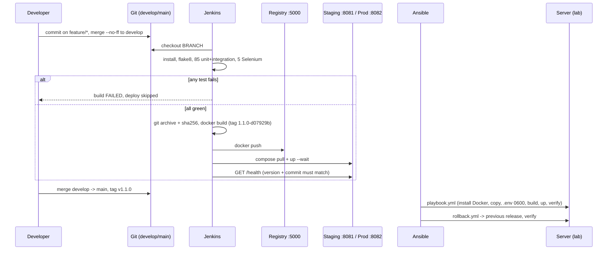

# Project Report - CI/CD Pipeline for a Hotel Room Booking Portal

## 1. Summary

A Flask web portal lets hotel guests register, check room availability,
request, confirm and cancel bookings, and track their status. Around it, a
complete delivery pipeline was built and **run**: every commit is linted
and tested (90 automated tests incl. 5 Selenium journeys) in Jenkins; only
if everything passes is it packaged as a source archive and Docker images
tagged `<version>-<commit>`, pushed to a registry, deployed with Docker
Compose behind Nginx, and verified by a health check that checks the exact
version. Ansible provisions a fresh Ubuntu server and deploys the same
stack idempotently, and can roll back to the previous release.

Two releases were made: **v1.0.0** and **v1.1.0**, both deployed by the
pipeline to "prod", and rollback was demonstrated with Docker Compose and
with Ansible.

## 2. Document map

| Topic | Document |
|---|---|
| Problem, users, objectives, success criteria (Task 1) | [01-problem-definition.md](01-problem-definition.md) |
| User stories, backlog, board, sprints, DoD, lifecycle (Task 2) | [02-agile-plan.md](02-agile-plan.md) |
| SRS, use cases, architecture, ER diagram, routes, tech choices (Task 3) | [03-srs-architecture.md](03-srs-architecture.md) |
| Git setup, branches, PRs, merge conflict, tags (Tasks 4-6) | [04-git-workflow.md](04-git-workflow.md) |
| Jenkins pipeline, parameters, registry, defect experiment (Tasks 7, 8, 10, 12) | [05-ci-cd-pipeline.md](05-ci-cd-pipeline.md) |
| Test plan, Selenium, reports (Tasks 9, 10) | [06-test-plan.md](06-test-plan.md) |
| Docker image + container lifecycle + rollback (Task 11) | [container-lifecycle.md](container-lifecycle.md) |
| Ansible, idempotency, rollback (Tasks 13, 14) | [07-ansible.md](07-ansible.md) |
| User interface design + before/after screenshots | [09-ui-design.md](09-ui-design.md) |
| Viva questions and answers | [viva-notes.md](viva-notes.md) |
| Deliverable checklist for all 15 tasks | [15-task-checklist.md](15-task-checklist.md) |
| Raw evidence (logs, screenshots, test reports) | [evidence/](evidence/README.md) |

## 3. End-to-end release workflow (as executed)



## 4. Setup and deployment guide

Prerequisites: Git, Python 3.11+ (3.13 also works locally), Docker Desktop,
Google Chrome (for Selenium locally).

```powershell
# 1. Local development
python -m venv .venv; .venv\Scripts\Activate.ps1
pip install -r requirements-dev.txt
python wsgi.py                                   # http://127.0.0.1:5000
pytest                                           # 90 tests

# 2. Docker (Nginx + Gunicorn + SQLite volume)
copy .env.example .env                           # set SECRET_KEY
docker compose up -d --build                     # http://localhost:8080

# 3. Jenkins + registry
cd deploy\jenkins; copy .env.example .env        # set both values
docker compose up -d --build                     # http://localhost:8090 (admin)
# Job hotel-booking -> Build with Parameters

# 4. Ansible (lab)
cd ..\ansible\lab
docker compose up -d --build target
docker compose run --rm controller ansible-playbook -i lab/inventory.ini playbook.yml
```

Details: [README.md](../README.md).

## 5. Troubleshooting

| Symptom | Cause | Fix |
|---|---|---|
| `SSL: CERTIFICATE_VERIFY_FAILED` during `docker build` / plugin install | Antivirus (Avast/AVG "HTTPS scanning") or a company proxy re-signs HTTPS; Linux containers don't trust its root certificate | Turn off HTTPS scanning, **or** export the root certificate to `certs/<name>.crt` (see [certs/README.md](../certs/README.md)) and rebuild |
| `failed to connect to the docker API ... dockerDesktopLinuxEngine` | Docker Desktop not running (e.g. after a reboot) | Start Docker Desktop and wait until it says "running" |
| `RuntimeError: SECRET_KEY must be set when APP_ENV=prod` | Started prod/staging without a real key | Put `SECRET_KEY=<random>` in `.env` / Jenkins credential |
| Compose: `SECRET_KEY is not set` | No `.env` next to `docker-compose.yml` | `copy .env.example .env` and edit |
| HTTP 400 "Your form has expired" | CSRF token missing/old (e.g. page open across a restart with a new key) | Reload the page and submit again |
| Selenium: `SessionNotCreatedException` | Chrome/driver mismatch or no Chrome | Install/update Chrome; Selenium Manager downloads the matching driver. In Jenkins, `CHROME_BIN`/`CHROMEDRIVER` point to Chromium |
| Jenkins build can't see my change | Jenkins checks out **commits** from the repo | Commit first; uncommitted changes are never built |
| Jenkins: `permission denied ... docker.sock` (Linux host) | jenkins user not in the socket's group | Set `DOCKER_GID` in `deploy/jenkins/.env` to `stat -c %g /var/run/docker.sock` |
| Port 8080/8081/8082/8090/5000 already in use | Another program uses the port | Change `HOST_PORT` (app) or the port mapping in the compose file |
| Ansible: "Missing sudo password" | Real server needs become password | Add `--ask-become-pass` (and `--ask-pass` without SSH keys) |
| Ansible ignores `ansible.cfg` on Windows folders | World-writable mount | The controller image sets `ANSIBLE_CONFIG` explicitly |
| `rollback.yml` fails "No such image" | That release was never deployed on this server | Deploy it first, or pass an existing `-e rollback_to=` |

## 6. Known limitations

- SQLite: one writer at a time, one server only; no horizontal scaling.
- PENDING bookings never expire; there is no staff/admin UI; no payments or e-mails.
- Plain HTTP in the demo (set `SESSION_COOKIE_SECURE=1` behind HTTPS).
- Rollback re-creates containers: a few seconds' downtime (no zero-downtime claim); database changes are not rolled back.
- Local Jenkins polls the repository (no public URL for a GitHub webhook).
- Docker Hub publishing is implemented but was not run (no account); the local registry was used.
- Ansible was verified against a privileged container standing in for a server, not a real VM.
- Not pushed to GitHub yet, so issues/PRs exist as prepared documents, not GitHub objects.
- No load/performance testing.

## 7. Future enhancements

- PostgreSQL instead of SQLite for multiple app servers.
- HTTPS with Let's Encrypt in Nginx; Secure cookies on.
- Auto-expire PENDING bookings after N hours (scheduled job).
- Staff dashboard: all bookings, check-in/check-out.
- E-mail confirmation of bookings.
- GitHub webhook + multibranch pipeline (one job per branch, PR builds).
- Blue/green deployment for zero downtime; database migrations (Alembic).
- Monitoring: Prometheus metrics + alerting on `/health`.
- Image vulnerability scanning (e.g. Trivy) as a pipeline stage.

## 8. Screenshots and demo recording checklist

Genuine screenshots already captured (`python scripts/capture_screenshots.py ...`):
see [evidence/README.md](evidence/README.md). For the demo video, record in this order (~8 min):

1. [ ] `git log --graph --oneline --all` - branches, merges, tags `v1.0.0`, `v1.1.0`.
2. [ ] `git show 8728b62` - the merge-conflict resolution.
3. [ ] App at http://localhost:8082: register, search, book, confirm, cancel, My bookings; point at the footer version.
4. [ ] `pytest -m "not e2e"` and `pytest -m e2e` (HEADLESS=0 to show the browser).
5. [ ] Jenkins: Build with Parameters (develop, staging) -> Stage View turns green; open Tests and Artifacts (`deployment.txt`).
6. [ ] Jenkins build #2: red stage, failed test, "skipped due to earlier failure".
7. [ ] Registry tags: http://localhost:5000/v2/hotel-booking-app/tags/list
8. [ ] `docker compose ps`, `docker logs`, `/health`.
9. [ ] Ansible lab: first run, second run `changed=0`, `rollback.yml`, footer shows 1.0.0.
10. [ ] Close with the 15-task checklist.
