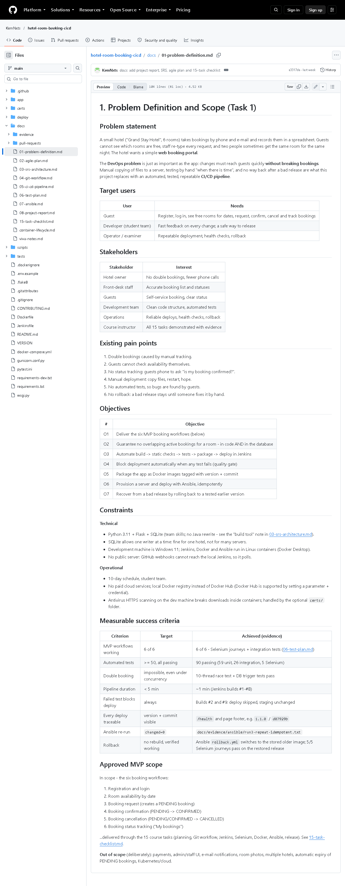

# Task 1 - Problem Definition and Scope

## A. Task title and objective

**Task 1: Problem Definition and Scope**

**Objective:** state clearly *what problem* the project solves, *for whom*, *what
is in and out of scope*, and *how success will be measured* - before any
code is written.

**Professor's required deliverables**

- Problem statement and real-world need
- Target users and stakeholders
- Existing pain points
- Objectives
- Technical and operational constraints
- Measurable success criteria
- The approved MVP scope (15 tasks)

**What this task demonstrates:** that the project is driven by a real need
and has a fixed, measurable scope, so later work (code, tests, pipeline) can
be checked against it.

**Current status: Implemented and verified.** The document
[`docs/01-problem-definition.md`](../01-problem-definition.md) exists, covers
every deliverable, and is published on GitHub (Figure 1.1). Its success
criteria were re-checked against fresh results on 2026-10-20 (90 tests
passed, Jenkins build #11 green, Ansible re-run `changed=0`).

Honest note: the stakeholders and pain points are a reasoned description of a
small hotel. **No real hotel staff or guests were interviewed.**

## B. Explanation for a complete beginner

**An everyday picture.** Before building a house you agree with the owner how
many rooms it needs, what the budget is and when it counts as "finished".
Without that, builders argue forever about whether the job is done. Task 1 is
that agreement for software.

**Problem statement** - one short paragraph that says what is wrong today.
*Why needed:* everyone works on the same problem. *In this project:* a small
hotel takes bookings by phone and spreadsheet, so guests cannot see free rooms
and the same room is sometimes given to two people.

**Stakeholders** - everyone affected by the system: the hotel owner, front-desk
staff, guests, the development team, operations, and the course instructor.
*Why needed:* each group wants something different (owner: no double bookings;
guest: self-service; operator: safe deployments).

**Scope and MVP** - *scope* is the list of what will and will not be built.
An **MVP** (Minimum Viable Product) is the smallest version that is genuinely
useful. *Why needed:* it stops "scope creep" (endless extra features). *In this
project:* the MVP is six booking workflows; payments, an admin screen and
e-mails are deliberately **out of scope**.

**Measurable success criteria** - targets that can be checked with a yes/no
answer or a number, e.g. "at least 50 automated tests, all passing". *Why
needed:* "it works well" cannot be proven; "90 of 90 tests pass" can.

**Why DevOps is part of the problem.** DevOps (Development + Operations) is the
practice of building, testing and releasing software automatically and
safely. The hotel needs not only an app but also a safe way to change it: if a
new version breaks bookings, guests suffer. So the project has two halves -
the **booking portal** and the **automated delivery pipeline** (CI/CD:
Continuous Integration / Continuous Delivery) that tests and deploys it.

## C. What was actually implemented

The deliverable is the document `docs/01-problem-definition.md`. Its sections
map one-to-one to the professor's list:

| Professor's item | Section in `docs/01-problem-definition.md` |
|---|---|
| Problem statement and need | "Problem statement" (manual bookings, double bookings, manual deployments) |
| Target users | "Target users": Guest, Developer, Operator/examiner |
| Stakeholders | "Stakeholders": owner, front desk, guests, dev team, operations, instructor |
| Pain points | "Existing pain points": 6 items (double bookings ... no rollback) |
| Objectives | "Objectives": O1-O7 (6 workflows, no overlap, Jenkins, quality gate, Docker, Ansible, rollback) |
| Constraints | "Constraints": Python/Flask/SQLite, Windows + Docker Desktop, no public server, 10-day schedule, antivirus HTTPS scanning |
| Success criteria | "Measurable success criteria": a table with target **and** achieved evidence |
| MVP scope | "Approved MVP scope": six workflows in, list of out-of-scope items |

**The six MVP workflows** (all implemented in `app/`):

1. Registration and login - `app/services/auth_service.py`
2. Room availability by date - `BookingService.search_rooms`
3. Booking request (creates `PENDING`) - `BookingService.request_booking`
4. Booking confirmation (`PENDING -> CONFIRMED`) - `confirm_booking`
5. Booking cancellation (`-> CANCELLED`) - `cancel_booking`
6. Booking status tracking ("My bookings") - `list_bookings`

**Success criteria compared with fresh results (2026-10-20)**

| Criterion (from the document) | Target | Result today |
|---|---|---|
| MVP workflows | 6 of 6 | 6 of 6 - Selenium journeys 5/5 passed |
| Automated tests | >= 50, all passing | 90 passed (59 unit, 26 integration, 5 Selenium) |
| No double booking | impossible, even concurrently | 10-thread race test + database trigger tests pass |
| Pipeline duration | < 5 minutes | Jenkins build #11: 103 seconds |
| Failed test blocks deploy | always | builds #2 and #9 failed, Deploy stage skipped |
| Deploy traceable | version + commit visible | staging `/health` = `{"commit":"1c2103c",...,"version":"1.1.0"}` |
| Ansible re-run | `changed=0` | run 3 on 2026-10-20: `changed=0` |
| Rollback works | verified | rollback to 1.0.0, then 5/5 Selenium journeys passed |

## D. Screenshots and evidence



*Figure 1.1 - `docs/01-problem-definition.md` as published on the public GitHub repository (captured 2026-10-20).*
**What to notice:** the sections Problem statement, Target users, Stakeholders,
Pain points, Objectives O1-O7, Constraints, the success-criteria table with
an "Achieved (evidence)" column, and the in/out-of-scope lists.
**Why it proves the task:** every deliverable of Task 1 is present in one
published, version-controlled document.

Supporting evidence used by the criteria (in other task folders):
`assets/task-09/full-test-suite.png` (90 tests),
`assets/task-14/ansible-run3-repeat-idempotent.png` (`changed=0`).

## E. How to demonstrate this task to the professor (about 2 minutes)

**Before the demo:** open the project folder in VS Code, or open
https://github.com/KemNxts/hotel-room-booking-cicd/blob/main/docs/01-problem-definition.md in a browser.

1. **Open the document** (VS Code: `docs/01-problem-definition.md`, press
   `Ctrl+Shift+V` for the preview).
   *Say:* "Task 1 is the problem definition. A small hotel manages bookings
   by phone and spreadsheet, which causes double bookings and manual, risky
   software releases."
2. **Scroll to "Stakeholders" and "Existing pain points".**
   *Say:* "Each stakeholder wants something different - the owner wants no
   double bookings, the operator wants safe deployments."
3. **Scroll to "Objectives" and "Measurable success criteria".**
   *Say:* "Every objective has a measurable target. For example: at least 50
   tests - we have 90; a re-run of Ansible must report zero changes - it does."
4. **Prove one criterion live** (PowerShell, in `D:\DevOPS\CICD_FOR_HOTEL_ROOM_BOOKING`):
   ```powershell
   .venv\Scripts\python -m pytest -q -m "not e2e"
   ```
   *Expected:* `85 passed, 5 deselected` in about 15 seconds.
5. **Scroll to "Approved MVP scope".** *Say:* "Six workflows are in scope;
   payments and an admin screen are deliberately out of scope."

**If something fails:** if `.venv` is missing, run
`python -m venv .venv` then `.venv\Scripts\pip install -r requirements-dev.txt`.
The document itself needs nothing running.

## F. Expected screenshots for the final submission

1. `assets/task-01/github-doc-01-problem-definition.png` - the published problem definition - **exists, captured 2026-10-20**.
2. (Optional, cross-reference) `assets/task-09/full-test-suite.png` - proves the "90 tests" criterion - **exists, captured 2026-10-20**.

## G. Probable viva questions and answers

1. **What problem does your project solve?**
   Two problems: hotel guests cannot book rooms themselves and double bookings
   happen; and the software is released manually without tests. The portal
   solves the first, the CI/CD pipeline the second.
2. **Who are your stakeholders?**
   Hotel owner, front-desk staff, guests, the development team, operations
   (who deploy and roll back), and the course instructor.
3. **What is an MVP and what is yours?**
   The smallest useful version. Ours is six workflows: register/login,
   availability, booking request, confirmation, cancellation, status tracking.
4. **Why did you leave payments out?**
   Payments add security and legal requirements (card data) that do not help
   demonstrate DevOps; they are listed as future work.
5. **What makes your success criteria "measurable"?**
   Each has a number or yes/no check: 90 tests passing, pipeline under 5
   minutes (build #11 took 103 s), `changed=0` on a repeat Ansible run.
6. **Did you interview real hotel staff?**
   No. The stakeholders and pain points are a reasoned model of a small
   hotel; that is a limitation, and real interviews would be the next step.
7. **Which constraint affected the design most?**
   SQLite: one writer at a time, so double-booking prevention uses a locking
   transaction and a database trigger; and the lack of a public server, which
   is why Jenkins polls Git instead of using a webhook.
8. **(Project-specific) Where is the scope written down and how is it versioned?**
   In `docs/01-problem-definition.md`, committed in Git and published on
   GitHub, so changes to scope are tracked like code changes.
9. **(Project-specific) How do you know objective O2 (no overlapping bookings) is met?**
   Tests prove it: `test_simultaneous_requests_create_only_one_booking` (10
   threads, exactly 1 booking) and `test_trigger_rejects_overlapping_insert`.
10. **Why is the delivery pipeline part of the problem definition?**
    Because a broken release would break bookings for real guests; the
    hotel's need includes "change the system safely", not just "have a website".

## H. Common mistakes and troubleshooting

| Symptom | Likely cause | Inspect | Safe fix | Confirm |
|---|---|---|---|---|
| The document title does not render as a heading in some viewers | Leading spaces before `#` (the working copy currently has two) | first line of `docs/01-problem-definition.md` | remove the spaces before `# 1. Problem...` | preview shows a large heading |
| Examiner asks for numbers that differ from the document | Numbers changed since the document was written | `pytest -q` output, Jenkins build page | quote today's numbers and say the document is a snapshot | rerun the command live |
| "Scope creep" question: why no admin page? | Scope not explained | "Approved MVP scope" section | point to the out-of-scope list | - |
| Success criterion cannot be shown live | Service (Jenkins/Docker) not running | Docker Desktop tray icon | start Docker Desktop, wait ~1 minute | `docker ps` lists `hotel-jenkins-jenkins-1` |

## I. Quick revision notes

**Five key points**

1. Problem: manual bookings cause double bookings; manual releases are risky.
2. Two deliverables: a booking portal **and** an automated CI/CD pipeline.
3. MVP = 6 workflows; payments/admin/e-mail out of scope.
4. Every objective has a measurable target and is met with evidence.
5. Stakeholders are modelled, not interviewed - say so honestly.

**30-60 second spoken explanation**
"Task 1 defines the problem. A small hotel takes bookings by phone and
spreadsheet, so guests can't see availability and rooms get double-booked.
We also need to change the software safely, so the project has two parts: a
web portal with six booking workflows, and a CI/CD pipeline that tests and
deploys it automatically. The scope is fixed in `docs/01-problem-definition.md`
with measurable success criteria - for example at least 50 automated tests;
today 90 pass - and anything else, like payments, is explicitly out of scope."

**Caveat:** stakeholder needs are assumed, not gathered from real users.

**Readiness checklist**
- [ ] I can name the 6 workflows from memory.
- [ ] I can name 4 stakeholders and what each wants.
- [ ] I can quote 3 success criteria and today's result.
- [ ] I can open `docs/01-problem-definition.md` quickly.
