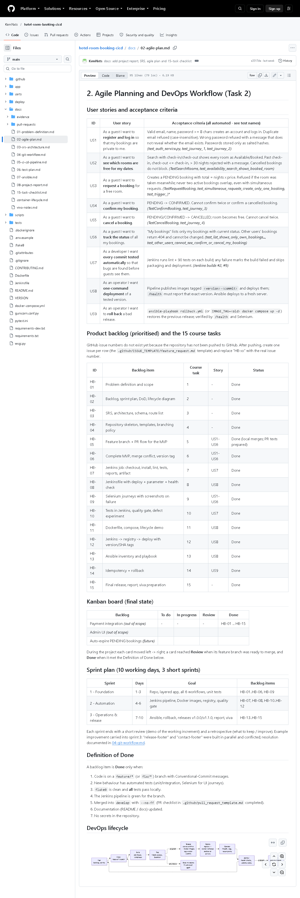
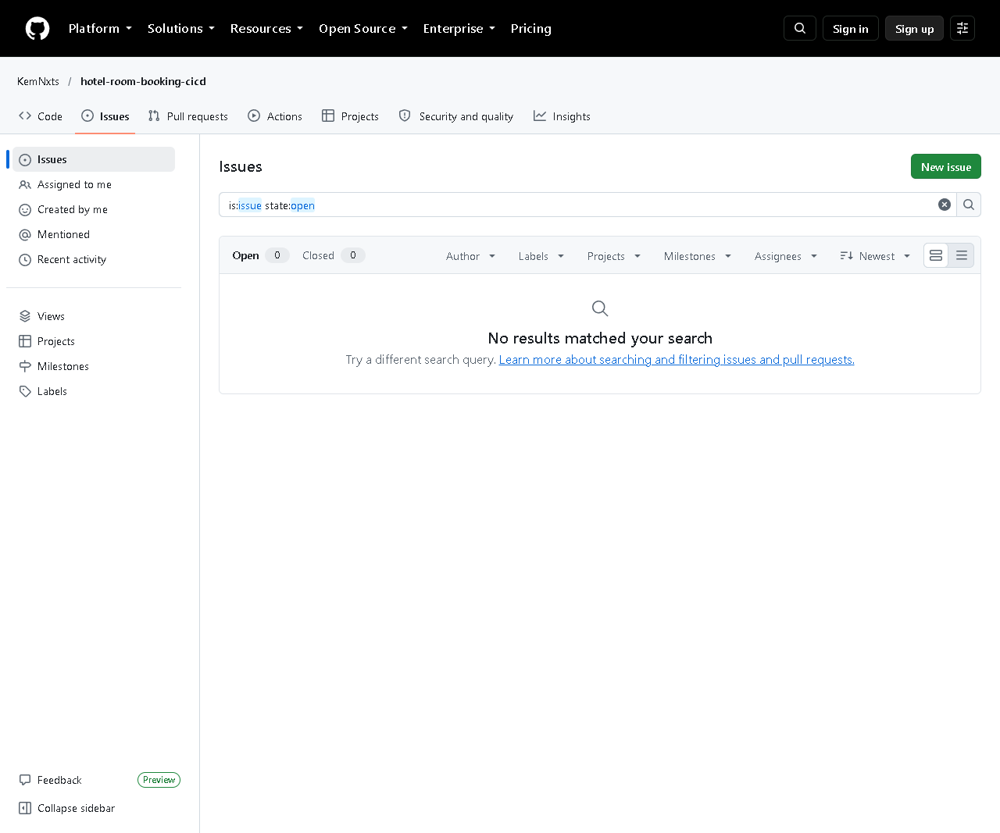

# Task 2 - Agile Planning and DevOps Workflow

## A. Task title and objective

**Task 2: Agile Planning and DevOps Workflow**

**Objective:** plan the work in small, testable pieces (user stories), order
them (backlog), schedule them (sprints), agree when a piece is finished
(Definition of Done), and show the full DevOps flow from code to operations.

**Professor's required deliverables**

- User stories with acceptance criteria
- Product backlog
- A 15-task Kanban/Scrum board
- Sprint plan
- Definition of Done
- DevOps lifecycle diagram (development to operations)
- Backlog linked to repository issues where possible

**Current status: Partially completed.**

| Part | Status |
|---|---|
| Stories, acceptance criteria, backlog, board, sprints, DoD, diagram | Implemented and verified - `docs/02-agile-plan.md`, published on GitHub |
| Backlog items as **GitHub issues** | **Pending external action** - the GitHub API reports **0 issues** (checked 2026-10-20); see Figure 2.2 |

## B. Explanation for a complete beginner

**An everyday picture.** Planning a wedding: you write every job on a sticky
note ("book the hall", "send invitations"), put them in order of importance,
and move each note across a whiteboard from *To do* to *Doing* to *Done*. Agile
planning is exactly that, for software.

**Agile** - a way of working in short cycles, delivering a small working piece
each time and adjusting the plan as you learn. *Problem it solves:* big
"deliver everything at the end" projects discover problems too late.

**User story** - a requirement written from the user's point of view:
"*As a guest I want to cancel a booking so that the room is released.*"
*Why:* it keeps the focus on what the user gets, not on technical details.

**Acceptance criteria** - the conditions that must be true for a story to be
accepted, e.g. "a cancelled booking cannot be cancelled again". In this
project every criterion is checked by an **automated test**, and the test
names are written next to the story.

**Product backlog** - the ordered list of all work items. Here: HB-01 to HB-15,
one per course task.

**Kanban board** - columns (Backlog, To do, In progress, Review, Done) that
show where each item is. **Scrum** - work in fixed periods called **sprints**
(here 3 short sprints), each ending with a review and a retrospective.

**Definition of Done (DoD)** - one checklist that applies to every item, so
"done" means the same thing to everyone (tests pass, pipeline green, merged...).

**DevOps lifecycle** - the loop Plan -> Code -> Build -> Test -> Release ->
Deploy -> Operate -> Monitor -> back to Plan. In this project each step has a
real tool (Git, pip, pytest/Selenium, Docker, Jenkins, Ansible, `/health`).

**GitHub issue** - a ticket on GitHub that tracks one backlog item. Linking
items to issues lets commits and pull requests say "Closes #12".

## C. What was actually implemented

File: [`docs/02-agile-plan.md`](../02-agile-plan.md).

**User stories (9).** US1-US6 cover the six booking workflows, US7 automatic
testing, US8 one-command deployment, US9 rollback. Each row lists the
acceptance criteria and the tests that check them, for example:

| Story | Acceptance criterion (excerpt) | Automated check |
|---|---|---|
| US3 request a booking | never two active bookings overlap, even simultaneously | `test_simultaneous_requests_create_only_one_booking` |
| US5 cancel | cannot cancel twice | `TestCancelBooking::test_cannot_cancel_twice` |
| US7 every commit tested | any failure skips packaging and deployment | Jenkins builds #2, #9 |

**Backlog.** HB-01 ... HB-15, one per course task, with the related story and
status.

**Kanban board (final state).** All HB items in *Done*; out-of-scope ideas
(payments, admin UI, auto-expiry of PENDING bookings) stay in *Backlog*.

**Sprint plan.** Sprint 1 Foundation (days 1-3), Sprint 2 Automation (4-6),
Sprint 3 Operations & release (7-10).

**Definition of Done** (7 points): feature/fix branch with conventional
commits; automated tests; flake8 clean and all tests pass; Jenkins green;
merged with `--no-ff` using the PR checklist; docs updated; no secrets.

**DevOps lifecycle diagram.** A Mermaid diagram (text that GitHub draws as a
picture). It shows the **failure loop**: if tests fail, nothing is
released and the developer fixes the code.

**How the DoD is enforced in this repository**

| DoD point | Real mechanism |
|---|---|
| tests pass | `pytest` stages in `Jenkinsfile` |
| flake8 clean | "Static checks" stage |
| pipeline green | Deploy runs only after every test stage |
| PR checklist | `.github/pull_request_template.md` |
| no secrets | `.gitignore` excludes `.env`, `credentials/`, `*.key`, `certs/*.crt` |

**GitHub issues - what is missing.** The repository is public, but no issues
were created (Figure 2.2). The backlog text says so: "replace HB-xx with the
real issue number" after creating them.

## D. Screenshots and evidence



*Figure 2.1 - `docs/02-agile-plan.md` on GitHub (captured 2026-10-20).*
**What to notice:** the user-story table with test names, backlog HB-01-HB-15,
the Kanban table, sprint plan, the Definition of Done, and at the bottom the
DevOps lifecycle diagram drawn by GitHub from Mermaid text.
**Why it proves the task:** all planning deliverables exist in one versioned document.



*Figure 2.2 - The repository's Issues page (all states) shows no issues (captured 2026-10-20).*
**What to notice:** zero open and zero closed issues.
**Why it matters:** this honestly shows the remaining step; the backlog is
local (in the document), not yet on GitHub Issues.

## E. How to demonstrate this task to the professor (about 3 minutes)

**Before the demo:** open `docs/02-agile-plan.md` (VS Code preview with
`Ctrl+Shift+V`, or on GitHub - GitHub draws the diagram).

1. **User stories.** *Say:* "Each requirement is a user story with
   acceptance criteria, and next to each criterion I wrote the automated test
   that checks it."
2. **Prove one story live** (PowerShell, project folder):
   ```powershell
   .venv\Scripts\python -m pytest -q tests/unit/test_booking_service.py -k "cancel"
   ```
   *Expected:* `7 passed, 31 deselected` (the cancellation tests, e.g. `test_cannot_cancel_twice`).
   *Say:* "US5 says a booking cannot be cancelled twice - this test proves it."
3. **Backlog and Kanban board.** *Say:* "The 15 course tasks are backlog items
   HB-01 to HB-15. The board shows their final state."
4. **Definition of Done.** *Say:* "An item is done only when tests pass, the
   Jenkins pipeline is green and it is merged - the pipeline enforces most of this."
5. **Lifecycle diagram** (bottom of the page on GitHub). Trace it with the
   mouse: "Plan, code, build, test - if any test fails we stop - release,
   deploy, operate, monitor, roll back if needed."
6. **Be honest about issues:** open
   https://github.com/KemNxts/hotel-room-booking-cicd/issues - "The backlog is
   in the repository; creating GitHub issues for it is the remaining step."

**To complete the pending part (needs your GitHub login):** on GitHub click
*Issues -> New issue -> Feature request*, create one issue per HB item (title
e.g. "HB-07 Jenkins job"), then edit the backlog table to show the issue
numbers and commit the change.

## F. Expected screenshots for the final submission

1. `assets/task-02/github-doc-02-agile-plan.png` - planning document incl. diagram - **exists, captured 2026-10-20**.
2. `assets/task-02/github-issues-empty.png` - honest state of GitHub issues - **exists, captured 2026-10-20**.
3. `assets/task-02/github-issues-created.png` - issues HB-01..HB-15 on GitHub - **requires manual capture after the issues are created** (open the Issues page, all states, screenshot).

## G. Probable viva questions and answers

1. **What is a user story?** A short requirement from the user's viewpoint:
   "As a <user> I want <goal> so that <reason>."
2. **What are acceptance criteria?** The conditions that make a story
   accepted. Ours are checked automatically by named tests.
3. **Difference between a backlog and a sprint?** The backlog is the whole
   ordered to-do list; a sprint is a short time-box in which a chosen part of
   the backlog is completed.
4. **Kanban or Scrum - which did you use?** A light mix: a Kanban board to
   show status and three short Scrum-style sprints with a review each.
5. **What is your Definition of Done?** Branch + conventional commits, tests,
   flake8 clean, all tests pass, Jenkins green, `--no-ff` merge with the PR
   checklist, docs updated, no secrets.
6. **How is the DoD enforced, not just written?** Jenkins runs flake8 and all
   90 tests; deployment happens only if they pass (shown by failed build #2).
7. **(Project-specific) Where are your GitHub issues?** None exist yet
   (0 issues on GitHub). The backlog is in `docs/02-agile-plan.md`; creating
   the issues needs my GitHub account and is the remaining step.
8. **(Project-specific) Which story covers rollback and how is it proven?**
   US9; proven by `deploy/ansible/rollback.yml` runs where `/health` showed
   1.0.0 again and 5/5 Selenium journeys passed.
9. **What does the DevOps lifecycle diagram show that a simple list does not?**
   The feedback loops: failed tests go back to Code, and problems in
   operation lead to rollback and new planning.
10. **What happened in your sprint retrospective?** Two features built in
    parallel (two footers) caused a merge conflict; the lesson was to agree on
    shared files earlier. The conflict and its resolution are documented.

## H. Common mistakes and troubleshooting

| Symptom | Cause | Inspect | Fix | Confirm |
|---|---|---|---|---|
| Diagram shows as code text in VS Code | VS Code preview does not draw Mermaid by default | `docs/02-agile-plan.md` | show it on GitHub, or install a Mermaid preview extension | the boxes and arrows appear |
| Examiner asks to see the issues | Issues not created | GitHub Issues page | explain the pending step; create them if allowed | Issues page lists HB items |
| `pytest -k cancel` selects 0 tests | wrong folder/typo | command | run from the project folder exactly as written | "passed" count > 0 |
| Story says a test name that no longer exists | test renamed | `grep -rn "def test_" tests` | update the story table | names match |

## I. Quick revision notes

**Five key points**

1. 9 user stories; every acceptance criterion maps to an automated test.
2. Backlog HB-01..HB-15 = the 15 course tasks.
3. 3 sprints: foundation, automation, operations & release.
4. Definition of Done is enforced by Jenkins (lint + 90 tests before deploy).
5. GitHub issues are **not created yet** - pending.

**30-60 second explanation**
"I planned the work with nine user stories, for example 'as a guest I want to
cancel a booking'. Each has acceptance criteria, and each criterion is checked
by a named automated test. The 15 course tasks form the backlog HB-01 to
HB-15, shown on a Kanban board and split into three sprints. Our Definition of
Done says tests pass, Jenkins is green and the work is merged - and Jenkins
enforces that. The DevOps diagram shows the loop from planning to monitoring.
The one missing piece is that the backlog isn't yet entered as GitHub issues."

**Caveat:** no GitHub issues exist; the board is a table in a document.

**Readiness checklist**
- [ ] I can explain story vs. acceptance criterion vs. test.
- [ ] I can recite the Definition of Done.
- [ ] I can trace the lifecycle diagram including the failure loop.
- [ ] I can explain honestly why there are no GitHub issues.
