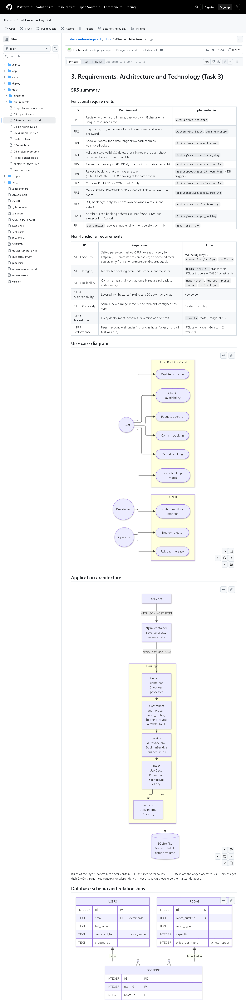
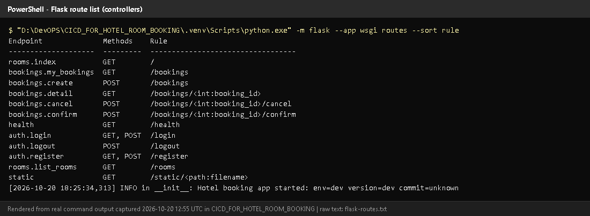
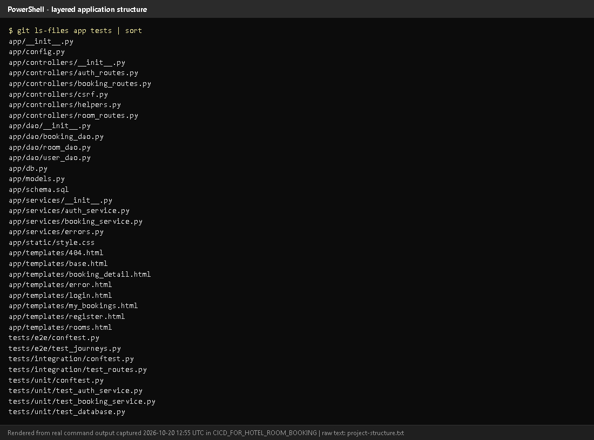
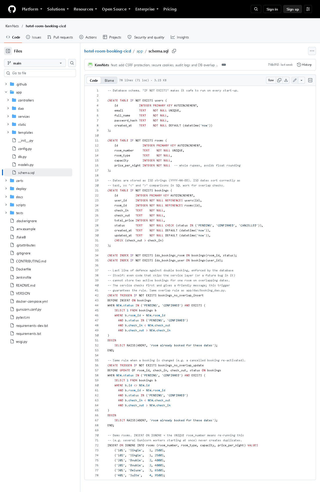
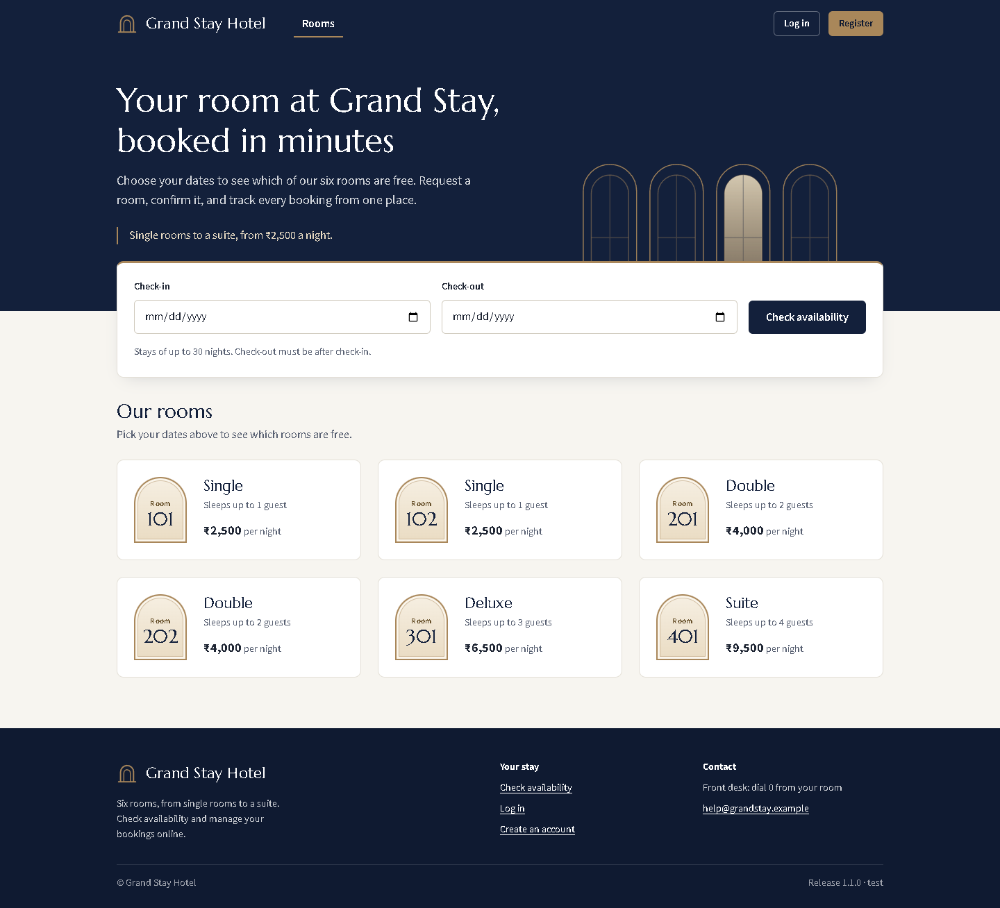

# Task 3 - Requirements, Architecture and Technology Setup

## A. Task title and objective

**Task 3: Requirements, Architecture and Technology Setup**

**Objective:** write down what the system must do (requirements), design how
its parts fit together (architecture), choose the technologies, set up the
development environment, and prove the booking rules work.

**Professor's required deliverables**

- SRS summary (Software Requirements Specification)
- Use-case diagram
- Application architecture diagram
- Database schema, relationships and data model
- API / route list
- Local development setup
- Technology choices with reasons
- Working registration, login, availability, request, confirmation, cancellation, status tracking
- Booking rules that block invalid dates, overlaps, unauthorised cancellation and inconsistent states

**Current status: Implemented and verified.** Re-checked 2026-10-20: the route
list was printed from the real app (Figure 3.2), 59 unit + 26 integration
tests passed, and the app started locally. Technology note: build and test use
**Python tools (pip, pytest, flake8)**, not Maven - see section C.

## B. Explanation for a complete beginner

**An everyday picture.** A restaurant has a waiter (takes your order), a chef
(decides how to cook it, following the recipes) and a store-room keeper
(fetches ingredients). Each does one job. Our application is organised the
same way.

**Requirements / SRS** - a list of what the system must do (*functional*: "a
guest can cancel a booking") and how well (*non-functional*: "no double
bookings even with simultaneous requests", "passwords never stored in plain
text").

**Use case** - one goal a user achieves with the system ("Request booking").
A **use-case diagram** shows the users and their goals.

**Architecture** - how the code is split into parts and how they talk.

**Layers in this project**

| Layer | Folder | Restaurant role | Job |
|---|---|---|---|
| Controller | `app/controllers/` | waiter | reads the web request, calls a service, returns a page |
| Service | `app/services/` | chef | business rules (dates valid? room free? may this user cancel?) |
| DAO (Data Access Object) | `app/dao/` | store-room keeper | the **only** place with SQL |
| Model | `app/models.py` | the plate | plain data objects (User, Room, Booking) |

*Why layers?* Each part can be changed and tested alone. The rules can be
tested without a browser; the database could be replaced by changing only the DAOs.

**Flask** - a small Python web framework: it maps a URL like `/bookings` to a
Python function. **Route** - that mapping. **SQLite** - a database stored in a
single file, built into Python. **Schema** - the definition of the tables.

**Virtual environment (venv)** - a private folder of Python packages for this
project, so versions don't clash with other projects. **pip** installs the
pinned versions listed in `requirements.txt`.

## C. What was actually implemented

**Documents:** [`docs/03-srs-architecture.md`](../03-srs-architecture.md) -
11 functional requirements (FR1-FR11), 7 non-functional (NFR1-NFR7), a
use-case diagram, architecture diagram, ER (Entity-Relationship) diagram,
booking state machine, route list and technology table.

**Route list (printed from the running code, Figure 3.2)**

| Method | URL | Controller function | Purpose |
|---|---|---|---|
| GET | `/rooms?check_in=&check_out=` | `rooms.list_rooms` | rooms / availability |
| GET, POST | `/register`, `/login` | `auth.register`, `auth.login` | accounts |
| POST | `/logout` | `auth.logout` | log out |
| GET / POST | `/bookings` | `my_bookings` / `create` | list / request |
| GET | `/bookings/<id>` | `detail` | one booking (owner only) |
| POST | `/bookings/<id>/confirm`, `/cancel` | `confirm`, `cancel` | change status |
| GET | `/health` | `health` | status + version for Docker/Jenkins/Ansible |

**How one request travels (example: "Book room 201")**

1. Browser sends `POST /bookings` with `room_id`, `check_in`, `check_out`, `csrf_token`.
2. `app/controllers/csrf.py` `check_csrf()` (line 25) rejects the request with HTTP 400 if the token is missing or wrong.
3. `app/controllers/booking_routes.py` `create()` (line 22) calls the service.
4. `app/services/booking_service.py` `request_booking()` (line 48) runs `validate_stay()` (line 19): valid dates, check-in not in the past, check-out after check-in, at most 30 nights.
5. It calls `BookingDao.create_if_room_free()` in `app/dao/booking_dao.py` (line 34), which inside a locked transaction checks for an overlap and inserts a `PENDING` row.
6. SQLite triggers in `app/schema.sql` (lines 42 and 56) refuse any overlapping active booking even if code above had a bug.
7. The controller redirects to `/bookings/<id>`, which shows status `PENDING`.

**The core rule - overlap - in SQL** (`app/dao/booking_dao.py`, from line 9;
the `#` explanations are added here for the reader and are not in the file):

```python
_OVERLAP_SQL = """
    check_in < :check_out          # existing stay starts before the new one ends
    AND check_out > :check_in      # and ends after the new one starts
    AND status IN ('PENDING', 'CONFIRMED')   # cancelled bookings never block
"""
```

A guest may check in on the day the previous guest checks out (strict `<`).

**Database (`app/schema.sql`)** - tables `users`, `rooms` (6 seeded rooms:
101, 102 Single; 201, 202 Double; 301 Deluxe; 401 Suite), `bookings`
(foreign keys to both). Constraints: `CHECK (check_out > check_in)`, `CHECK
(status IN ('PENDING','CONFIRMED','CANCELLED'))`, two overlap triggers.

**Booking rules and the tests that prove them**

| Rule | Test |
|---|---|
| invalid / past dates, > 30 nights | `TestValidateStay::test_invalid_stays_are_rejected` |
| no overlap for one room | `test_overlapping_booking_is_rejected` |
| concurrency: 10 simultaneous requests -> 1 booking | `test_simultaneous_requests_create_only_one_booking` |
| only the owner can view/confirm/cancel | `test_other_users_cannot_see_confirm_or_cancel_my_booking` |
| no cancel twice / no confirm of cancelled | `test_cannot_cancel_twice`, `test_cannot_confirm_a_cancelled_booking` |
| database blocks overlaps directly | `test_trigger_rejects_overlapping_insert` |

**Technology choices and the Maven/Tomcat question**

| Brief mentions (Java world) | This project (Python) | Same purpose |
|---|---|---|
| Maven/Gradle/Ant `pom.xml` | `requirements.txt` + pip | pinned dependencies |
| `mvn compile` | `python -m compileall` + `flake8` | catch syntax/style errors |
| `mvn test` (JUnit) | `pytest` with JUnit-XML reports | run tests, report to Jenkins |
| WAR file | source tarball + Docker images | deployable artifact |
| Tomcat | Gunicorn behind Nginx | serve the app |

pip and pytest are **not** Maven and are not presented as Maven. Whether the
Python equivalents satisfy the brief **must be confirmed with the professor**.

**Local setup (Windows PowerShell)**

```powershell
python -m venv .venv
.venv\Scripts\pip install -r requirements-dev.txt
.venv\Scripts\python -m flask --app wsgi run --port 5001   # 5000 is taken by the local Docker registry
```

## D. Screenshots and evidence



*Figure 3.1 - `docs/03-srs-architecture.md` on GitHub with diagrams rendered (captured 2026-10-20).*
**Notice:** the FR/NFR tables, the use-case diagram, the layered architecture
diagram, the ER diagram and the booking state machine.
**Proves:** SRS, use cases, architecture, data model and route list exist.



*Figure 3.2 - `python -m flask --app wsgi routes` run on 2026-10-20 (rendered from real output).*
**Notice:** every URL with its HTTP method and controller function.
**Proves:** the route list in the document matches the real code.



*Figure 3.3 - Files under `app/` and `tests/` (from `git ls-files`, rendered from real output).*
**Notice:** separate `controllers/`, `services/`, `dao/` folders and `models.py`.
**Proves:** the layered architecture is real, not only drawn.



*Figure 3.4 - `app/schema.sql` on GitHub.* **Notice:** three tables, CHECK
constraints, the two `bookings_no_overlap_*` triggers, the six seeded rooms.



*Figure 3.5 - Rooms page served by the local development server (redesigned
UI from the working tree, captured 2026-10-20).* **Notice:** the six seeded rooms with type, capacity and price.

## E. How to demonstrate this task to the professor (about 4 minutes)

**Before the demo:** PowerShell open in `D:\DevOPS\CICD_FOR_HOTEL_ROOM_BOOKING`; VS Code open on the same folder.

1. **Show the document** `docs/03-srs-architecture.md` (or on GitHub to see diagrams).
   *Say:* "These are the functional and non-functional requirements, the use cases and the architecture."
2. **Start the application** (PowerShell):
   ```powershell
   .venv\Scripts\python -m flask --app wsgi run --port 5001
   ```
   *Expected:* `Running on http://127.0.0.1:5001`. Leave this window open.
3. **Open http://127.0.0.1:5001** in the browser - the six rooms appear.
   Open http://127.0.0.1:5001/health - `{"status": "ok", ...}`.
4. **Show the route list** in a second PowerShell window:
   ```powershell
   .venv\Scripts\python -m flask --app wsgi routes
   ```
5. **Trace one request in VS Code:** open `app/controllers/booking_routes.py`
   (`create`), then `app/services/booking_service.py` (`request_booking`), then
   `app/dao/booking_dao.py` (`create_if_room_free`). *Say:* "Controller,
   service, DAO - only the DAO has SQL."
6. **Prove the rules:**
   ```powershell
   .venv\Scripts\python -m pytest -q tests/unit tests/integration
   ```
   *Expected:* `85 passed`. Point at the overlap and concurrency tests.
7. Stop the server with `Ctrl+C` in its window.

**Recovery:** "An attempt was made to access a socket..." means the port is
taken - use another port (`--port 5002`). "No module named flask" means the
venv is missing: `python -m venv .venv` and `.venv\Scripts\pip install -r requirements-dev.txt`.

## F. Expected screenshots for the final submission

1. `assets/task-03/github-doc-03-srs-architecture.png` - SRS + diagrams - **exists, 2026-10-20**.
2. `assets/task-03/flask-routes.png` - real route list - **exists, 2026-10-20**.
3. `assets/task-03/project-structure.png` - layered folders - **exists, 2026-10-20**.
4. `assets/task-03/github-file-app_schema.sql.png` - schema - **exists, 2026-10-20**.
5. `assets/task-03/app-desktop-01-home.png` - running app - **exists, 2026-10-20**.

## G. Probable viva questions and answers

1. **What is an SRS?** A Software Requirements Specification: what the system
   must do (functional) and qualities it must have (non-functional).
2. **Explain your layers.** Controllers handle HTTP, services hold business
   rules, DAOs hold all SQL, models are plain data. Each only calls the layer below.
3. **Why separate services from controllers?** Rules can be unit-tested
   without a web request, and they are not duplicated in several routes.
4. **Why SQLite?** Built into Python, zero setup, one file; enough for one
   hotel. Limitation: one writer at a time and one server only.
5. **How do you prevent double bookings?** Three layers: the service checks;
   the DAO checks and inserts inside `BEGIN IMMEDIATE` (a locked transaction);
   and database triggers refuse overlaps. A 10-thread test proves only one wins.
6. **(Project-specific) What does `/health` return and who uses it?**
   `{"status","env","version","commit"}`; used by the Docker HEALTHCHECK,
   the Jenkins health-check stage and the Ansible playbook.
7. **(Project-specific) Why can't another user cancel my booking?**
   `BookingService.get_booking` checks the owner and raises "not found"
   otherwise, so the route returns 404 - proven by an integration test.
8. **Is pip your Maven?** No. pip installs Python packages and pytest runs
   tests; they do the same jobs as Maven's dependency and test phases, but they
   are different tools. I need the professor's confirmation that this is acceptable.
9. **Why Gunicorn and Nginx instead of Tomcat?** Tomcat runs Java servlets.
   Python apps run on a WSGI server (Gunicorn); Nginx is the public entry
   point and serves static files.
10. **What is the booking state machine?** PENDING -> CONFIRMED, PENDING or
    CONFIRMED -> CANCELLED; nothing else. Status changes use
    `UPDATE ... WHERE status IN (allowed)` so check and change happen atomically.
11. **What is CSRF and how do you stop it?** Cross-Site Request Forgery: another
    site making your browser submit our forms. Every form has a secret token
    stored in the session; POSTs without it get HTTP 400.

## H. Common mistakes and troubleshooting

| Symptom | Cause | Inspect | Fix | Confirm |
|---|---|---|---|---|
| `python wsgi.py` fails: "access a socket ... forbidden" | port 5000 used by the local Docker registry | `Get-NetTCPConnection -LocalPort 5000` | run with `--port 5001` | page opens on :5001 |
| HTTP 400 "Your form has expired" | CSRF token missing/old | browser tab opened before a restart | reload the page and resubmit | form works |
| `RuntimeError: SECRET_KEY must be set` | started with `APP_ENV=prod` without a key | environment variables | set `SECRET_KEY`, or use dev mode | app starts |
| Data from earlier tests appears | local DB `instance/hotel.db` | `instance/` folder | delete `instance/hotel.db` to reset (local dev only) | 6 rooms, no bookings |

## I. Quick revision notes

**Five key points**

1. 11 functional + 7 non-functional requirements in `docs/03-srs-architecture.md`.
2. Layers: controllers -> services -> DAOs -> SQLite; models carry data.
3. Overlap rule `check_in < new_out AND check_out > new_in`, enforced three times.
4. Routes printed from real code; `/health` is used by Docker, Jenkins, Ansible.
5. Python tooling (pip/pytest/flake8, Gunicorn/Nginx) - not Maven/Tomcat; confirm with the professor.

**30-60 second explanation**
"The requirements are in an SRS with use cases, architecture and data-model
diagrams. The Flask app has layers: controllers handle web requests, services
apply booking rules, DAOs contain all SQL, and SQLite stores users, rooms and
bookings. A booking request passes the CSRF check, date validation, and an
overlap check inside a locked transaction, and database triggers block any
overlap that slips through. Ninety automated tests prove these rules."

**Caveat:** Python tools are used instead of Maven/Tomcat - needs professor approval.

**Readiness checklist**
- [ ] I can start the app on port 5001 and open `/health`.
- [ ] I can trace a booking request through the three layers.
- [ ] I can explain the overlap rule and the three protections.
- [ ] I can explain the Maven/Tomcat difference honestly.
