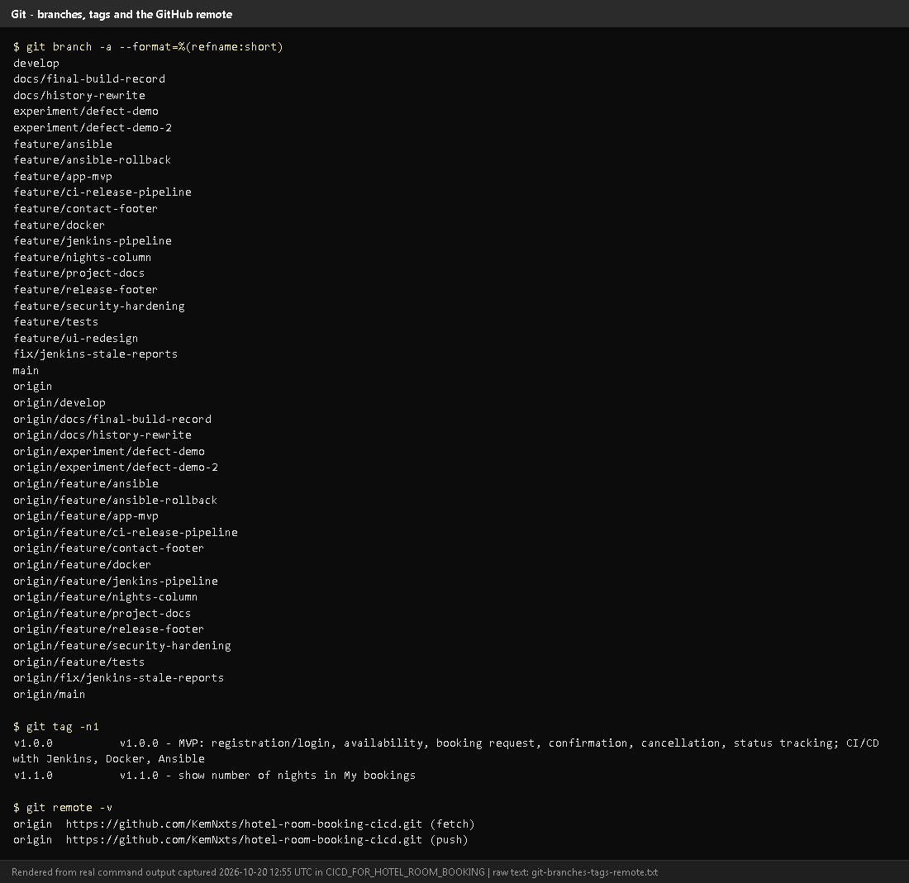
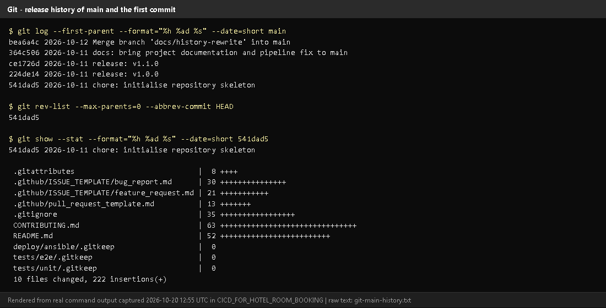
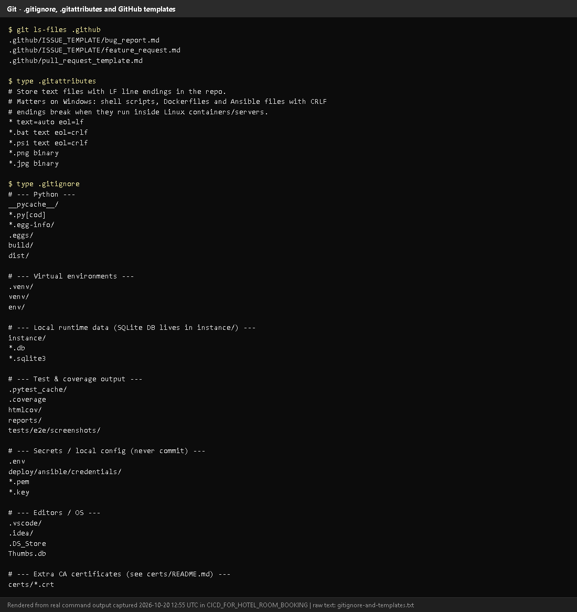
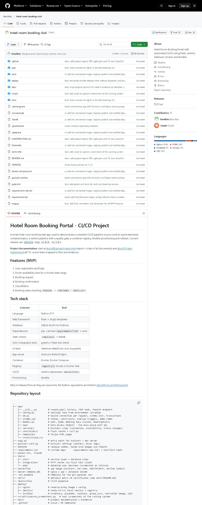
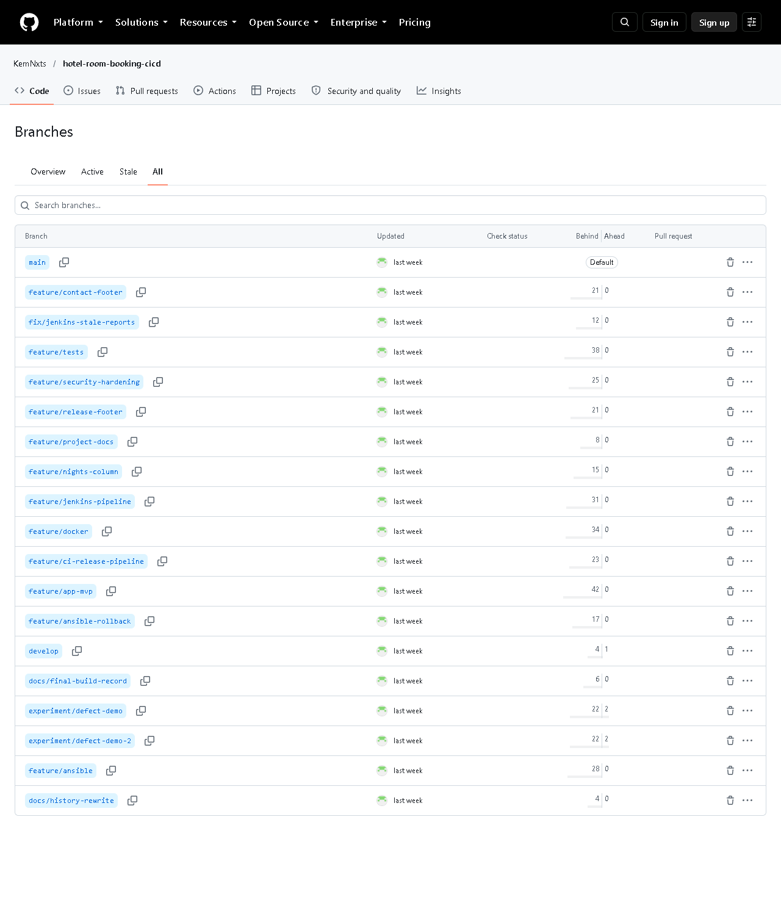
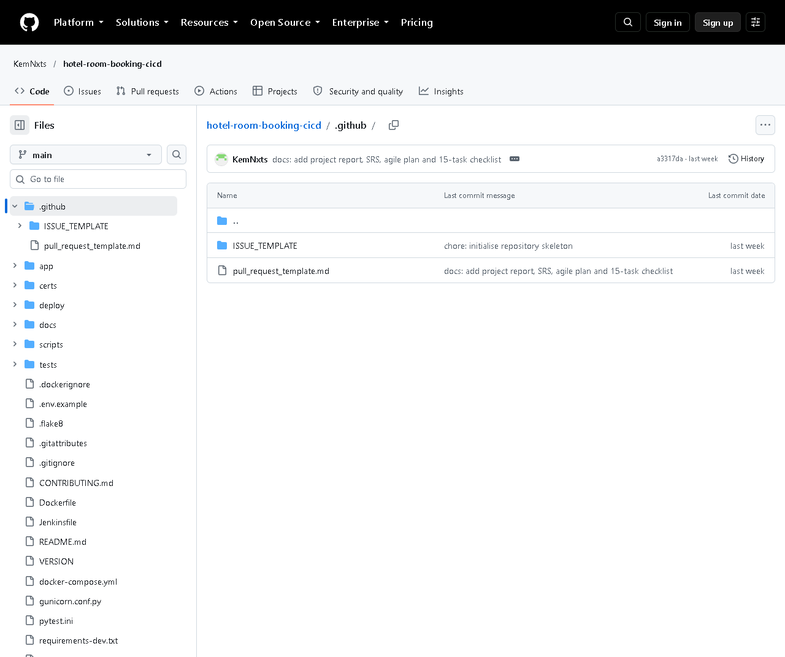

# Task 4 - Git and GitHub Repository Initialization

## A. Task title and objective

**Task 4: Git and GitHub Repository Initialization**

**Objective:** put the project under version control from day one, with a
clean structure, rules for branches and commits, templates for issues and
pull requests, and a remote copy on GitHub.

**Professor's required deliverables**

- README
- `.gitignore` (and `.gitattributes`)
- Folder structure
- Issue and pull-request templates
- Branch naming policy
- Meaningful commit history
- Initial source baseline (skeleton commit)

**Current status: Implemented and verified.** Checked 2026-10-20 with Git
commands (Figures 4.1-4.3) and the public GitHub repository (Figures 4.4-4.6):
19 branches and both release tags are on GitHub.

One note: the branch *policy* is written in `CONTRIBUTING.md`; GitHub
"branch protection rules" (settings that technically block direct pushes)
were **not** configured - that needs the repository owner's login.

## B. Explanation for a complete beginner

**An everyday picture.** Git is like the "version history" of a Google Doc,
but for a whole folder of files, and much more precise: every saved version
has a name, an author, a date and a message saying *why* it changed.

| Term | Plain meaning | In this project |
|---|---|---|
| **Repository (repo)** | the project folder plus its full history | `D:\DevOPS\CICD_FOR_HOTEL_ROOM_BOOKING` |
| **Commit** | one saved snapshot with a message | e.g. `541dad5 chore: initialise repository skeleton` |
| **Branch** | a separate line of work, so experiments don't disturb stable code | `main`, `develop`, `feature/*` |
| **Merge** | joining a branch's work into another branch | features merged into `develop` |
| **Tag** | a permanent name for one commit, e.g. a release | `v1.0.0`, `v1.1.0` |
| **Remote** | a copy of the repo on a server | `origin` = GitHub |
| **Push / pull** | send commits to / fetch commits from the remote | `git push origin develop` |
| **`.gitignore`** | list of files Git must never save | `.env` (secrets), `.venv`, `*.db` |
| **`.gitattributes`** | rules for how files are stored, e.g. line endings | LF line endings in the repo |

**Git vs GitHub.** *Git* is the tool on your computer that records history.
*GitHub* is a website that hosts a copy of a Git repository and adds
collaboration features (issues, pull requests, web view). You can use Git
without GitHub, but not the other way round.

**Why it matters for DevOps:** Jenkins builds whatever is committed, so Git is
the starting point of the whole pipeline - and every deployment can be traced
back to one commit.

## C. What was actually implemented

**Repository files**

| Deliverable | File | Content |
|---|---|---|
| README | `README.md` | features, stack, layout, run/test/Docker/Jenkins/Ansible instructions |
| Ignore rules | `.gitignore` | Python caches, `.venv/`, `instance/`, `*.db`, `reports/`, `.env`, `deploy/ansible/credentials/`, `*.pem`, `*.key`, `certs/*.crt` |
| Line endings | `.gitattributes` | `* text=auto eol=lf` - the same line endings on Windows and Linux (needed for scripts run in Linux containers); `*.bat`/`*.ps1` keep Windows CRLF; `*.png`/`*.jpg` are binary |
| Issue templates | `.github/ISSUE_TEMPLATE/bug_report.md`, `feature_request.md` | forms for bugs and features |
| PR template | `.github/pull_request_template.md` | author + reviewer checklists |
| Branch & commit rules | `CONTRIBUTING.md` | `main` / `develop` / `feature/*` / `fix/*` / `experiment/*`, Conventional Commits (`feat:`, `fix:`, `test:`, `ci:`, `docs:` ...) |

**Folder structure** - `app/` (controllers, services, dao, templates, static),
`tests/` (unit, integration, e2e), `deploy/` (nginx, jenkins, ansible),
`docs/`, `scripts/`, plus `Dockerfile`, `docker-compose.yml`, `Jenkinsfile`.

**Initial baseline.** The first commit `541dad5 chore: initialise repository
skeleton` (2026-10-11) added exactly the skeleton: `.gitattributes`, the two
issue templates, the PR template, `.gitignore`, `CONTRIBUTING.md`, `README.md`
and empty `deploy/ansible`, `tests/e2e`, `tests/unit` folders (Figure 4.2).

**Branches (20 local)** - `main` (releases), `develop` (integration), 13
`feature/*` (including the unpushed `feature/ui-redesign`), `fix/jenkins-stale-reports`,
`experiment/defect-demo` and `-2`, `docs/final-build-record`, `docs/history-rewrite`.

**Tags** - `v1.0.0` -> `224de14`, `v1.1.0` -> `ce1726d` (annotated tags with a message).

**Remote** - `origin` = https://github.com/KemNxts/hotel-room-booking-cicd
(public). Pushed on 2026-10-12. GitHub shows 19 branches and both tags.

**Commit messages follow the convention**, e.g. from `git log`:
`feat: add CSRF protection, ...`, `test: add route-level integration tests ...`,
`ci: add lint, versioned images, ...`, `fix: stop Jenkins publishing stale test reports ...`.

**History rewrite (be ready to explain).** On 2026-10-12, before pushing,
commit messages were edited to remove a co-author line. Contents stayed the
same but all commit IDs changed; old evidence shows the old IDs. Mapping:
[`docs/evidence/git/commit-id-map.md`](../evidence/git/commit-id-map.md).

## D. Screenshots and evidence



*Figure 4.1 - `git branch -a`, `git tag -n1`, `git remote -v` (rendered from real output, 2026-10-20).*
**Notice:** local and `origin/...` branches, the two release tags with messages, and the GitHub remote.
**Proves:** branching model, tags and remote exist.



*Figure 4.2 - Main-branch history and the skeleton commit `541dad5` with its files (rendered from real output).*
**Notice:** `main` contains only the skeleton and the release merges; the
first commit added the README, ignore rules and templates.
**Proves:** an initial source baseline and meaningful history.



*Figure 4.3 - `.github` templates, `.gitattributes` and `.gitignore` (rendered from real output).*
**Notice:** `.env`, credentials, keys and certificates are ignored.
**Proves:** secrets and generated files are kept out of Git.



*Figure 4.4 - The public GitHub repository home page (captured 2026-10-20).*
**Notice:** the folder structure, README rendered below, branch/tag counts.



*Figure 4.5 - All branches on GitHub.* **Notice:** `main`, `develop`, `feature/*`, `fix/*`, `experiment/*`.



*Figure 4.6 - `.github/` on GitHub: `ISSUE_TEMPLATE/` and `pull_request_template.md`.*

## E. How to demonstrate this task to the professor (about 3 minutes)

**Before the demo:** PowerShell in `D:\DevOPS\CICD_FOR_HOTEL_ROOM_BOOKING`; browser tab with https://github.com/KemNxts/hotel-room-booking-cicd.

1. ```powershell
   git status
   ```
   *Say:* "This folder is a Git repository." (Today it shows the branch
   `feature/ui-redesign` and uncommitted UI files - say they are work in progress.)
2. ```powershell
   git branch -a
   git tag -n1
   git remote -v
   ```
   *Say:* "`main` holds releases, `develop` integrates features, each feature
   had its own branch. The tags mark the releases. `origin` is GitHub."
3. ```powershell
   git log --oneline --graph -15 develop
   ```
   *Say:* "Each commit has a type prefix like `feat:` or `fix:` and the merges show each feature branch."
4. ```powershell
   git show --stat 541dad5
   ```
   *Say:* "The very first commit was the skeleton: README, ignore rules and templates."
5. Open `.gitignore` in VS Code - point to `.env`, `credentials/`, `*.key`.
6. **On GitHub:** show the file list, the *branches* page, the *tags* page and `.github/`.

**Recovery:** if `git log` opens a pager that "hangs", press `q`. If GitHub
asks you to sign in, you are viewing the public page - no login is needed to read.

## F. Expected screenshots for the final submission

1. `assets/task-04/git-branches-tags-remote.png` - **exists, 2026-10-20**.
2. `assets/task-04/git-main-history.png` - **exists, 2026-10-20**.
3. `assets/task-04/gitignore-and-templates.png` - **exists, 2026-10-20**.
4. `assets/task-04/github-repository-home.png` - **exists, 2026-10-20**.
5. `assets/task-04/github-branches.png` - **exists, 2026-10-20**.
6. `assets/task-04/github-templates-folder.png` - **exists, 2026-10-20**.
7. `assets/task-04/github-branch-protection.png` - **requires manual capture** only if you configure branch protection (GitHub *Settings -> Branches*, needs your login).

## G. Probable viva questions and answers

1. **Git vs GitHub?** Git records history locally; GitHub hosts a copy online and adds issues, PRs and a web view.
2. **What is a commit?** A saved snapshot of the files with an ID, author, date and message.
3. **Branch vs tag?** A branch moves forward as you commit; a tag is fixed to one commit forever (we use tags for releases).
4. **Why `.gitignore`?** To keep secrets (`.env`), local databases and generated files out of the repository.
5. **What does `.gitattributes` do here?** Forces LF line endings so shell
   scripts and configs work in Linux containers even when edited on Windows.
6. **Explain your branch policy.** `main` = released code, `develop` =
   integration, `feature/<name>` per change, `fix/<name>` for fixes,
   `experiment/<name>` never merged. Features merge into develop with `--no-ff`.
7. **(Project-specific) What is in your first commit?** `541dad5`: README,
   CONTRIBUTING, `.gitignore`, `.gitattributes`, issue and PR templates and empty folders.
8. **(Project-specific) Why do commit IDs in your evidence differ from GitHub?**
   Messages were edited once before publishing; IDs are hashes that include
   the message, so all IDs changed. `docs/evidence/git/commit-id-map.md` maps them.
9. **What is a Conventional Commit?** A message format `type: summary`, e.g.
   `fix: reject check-out before check-in`, making history easy to read.
10. **Is your `main` branch protected?** Only by policy in `CONTRIBUTING.md`;
    GitHub protection rules were not configured (needs the owner's settings).
11. **Why have both `main` and `develop`?** `develop` can be tested on
    staging while `main` only receives releases that passed the pipeline.

## H. Common mistakes and troubleshooting

| Symptom | Cause | Inspect | Fix | Confirm |
|---|---|---|---|---|
| `git log` output does not end | pager waiting | terminal | press `q`, or add `--no-pager` | prompt returns |
| A secret file appears in `git status` | missing ignore rule | `git check-ignore -v <file>` | add a rule to `.gitignore`; never commit it | file no longer listed |
| `git push` rejected | remote has newer commits / no login | `git status`, `git fetch` | `git pull` first; sign in to GitHub | push succeeds |
| Line-ending warnings (CRLF/LF) | Windows editor | `.gitattributes` | harmless; Git normalises to LF | - |
| Old commit ID not found | history rewrite | `docs/evidence/git/commit-id-map.md` | use the current ID | `git show <id>` works |

## I. Quick revision notes

**Five key points**

1. Git = local history; GitHub = hosted copy + collaboration.
2. Skeleton commit `541dad5`: README, ignore rules, templates, CONTRIBUTING.
3. Branches: main / develop / feature / fix / experiment.
4. Tags `v1.0.0` and `v1.1.0` mark releases.
5. `.gitignore` keeps `.env`, credentials and databases out of Git.

**30-60 second explanation**
"The project is a Git repository published on GitHub. The first commit
created the skeleton - README, contributing rules, ignore rules and issue and
pull-request templates. We use `main` for releases, `develop` for
integration and one branch per feature, with conventional commit messages.
Releases are tagged v1.0.0 and v1.1.0. Secrets like `.env` are ignored and
never committed. Everything Jenkins builds starts from a commit here."

**Caveat:** branch protection is a written policy, not a GitHub setting.

**Readiness checklist**
- [ ] I can explain branch vs tag vs commit.
- [ ] I can run `git branch -a`, `git tag -n1`, `git log --graph`.
- [ ] I can open the repo on GitHub and show branches and tags.
- [ ] I can explain why evidence shows different commit IDs.
