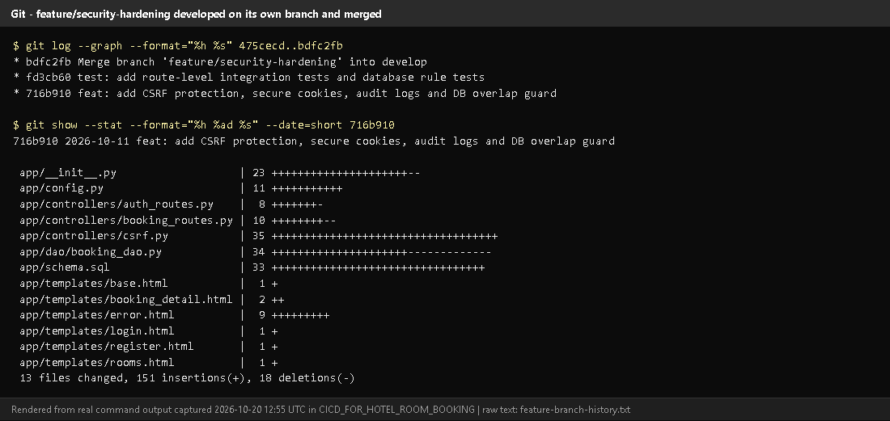
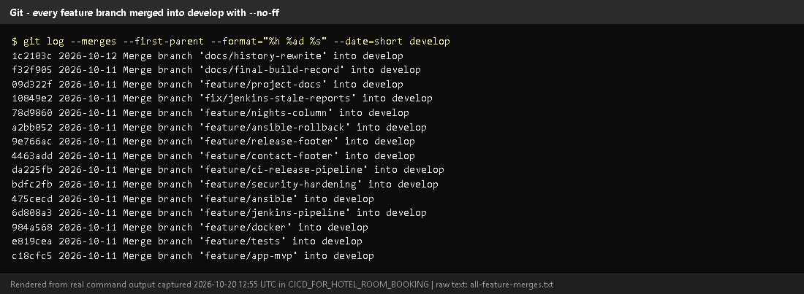
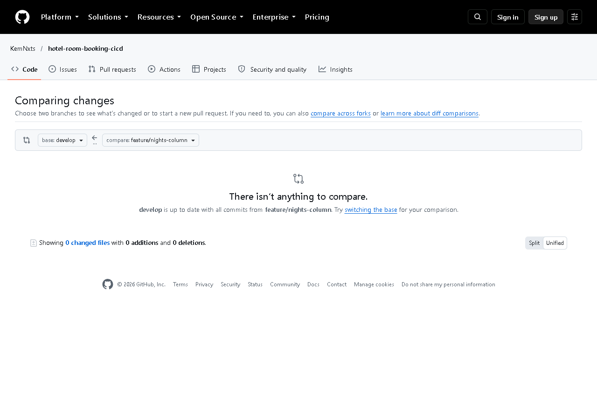
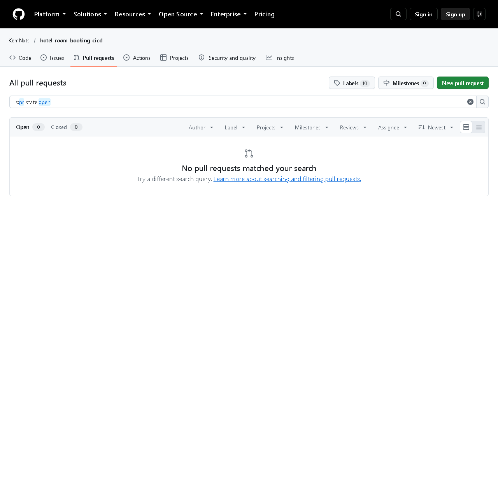
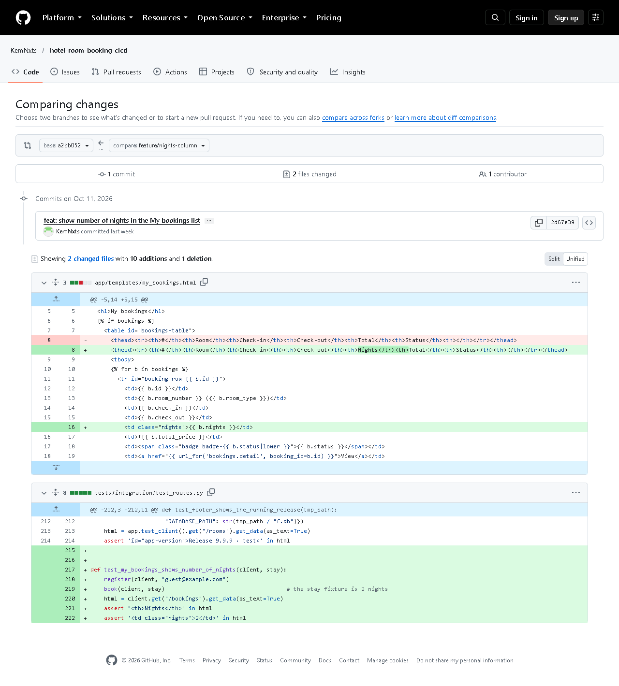

# Task 5 - Feature Development with Branching

## A. Task title and objective

**Task 5: Feature Development with Branching**

**Objective:** develop a core feature on its own branch, with meaningful
commits and tests, have it reviewed through a pull request, and merge it into
`develop`.

**Professor's required deliverables**

- Feature branch
- Changes and tests on that branch
- Meaningful commits (add / commit / push / pull / log)
- Pull request with review comments / review checklist
- Merge into `develop`

**Current status: Partially completed.**

| Part | Status |
|---|---|
| Feature branches, commits with tests, `--no-ff` merges into `develop`, pushed to GitHub | Implemented and verified (Git + GitHub, 2026-10-20) |
| Review checklist | Implemented - `.github/pull_request_template.md`; written review records in `docs/pull-requests/` |
| **Real GitHub pull requests and review comments** | **Pending external action** - GitHub shows **0 pull requests** (Figure 5.4). Merges were done locally and then pushed. |

No PR screenshots or review comments are shown here because none exist.

## B. Explanation for a complete beginner

**An everyday picture.** Several authors write a book. Each writes a new
chapter in a separate copy, so a half-finished chapter never appears in the
printed book. When a chapter is ready, an editor reviews it, and only then is
it added to the master copy.

- **Feature branch** = the separate copy for one feature (`feature/security-hardening`).
- **`develop`** = the master copy where finished features meet.
- **Pull request (PR)** = on GitHub, a request "please review and merge my
  branch", with a discussion page, review comments and a merge button.
- **Code review** = another person reads the changes before they are merged.
- **Merge** = adding the branch's commits into `develop`. With `--no-ff`
  ("no fast-forward") Git always creates a *merge commit*, so the history
  clearly shows "this group of commits was one feature".

**Basic commands**

| Command | Meaning |
|---|---|
| `git checkout -b feature/x develop` | create a new branch from develop and switch to it |
| `git add <files>` | choose which changes go into the next commit |
| `git commit -m "feat: ..."` | save a snapshot with a message |
| `git push -u origin feature/x` | upload the branch to GitHub |
| `git pull` | download and apply new commits from GitHub |
| `git log --oneline --graph` | view history as a graph |
| `git merge --no-ff feature/x` | merge into the current branch with a merge commit |

## C. What was actually implemented

**Worked example: `feature/security-hardening`** - real output of `git log --graph --oneline -4 bdfc2fb` (current commit IDs):

```text
*   bdfc2fb Merge branch 'feature/security-hardening' into develop
|\
| * fd3cb60 test: add route-level integration tests and database rule tests
| * 716b910 feat: add CSRF protection, secure cookies, audit logs and DB overlap guard
|/
*   475cecd Merge branch 'feature/ansible' into develop
```

1. Branch created from `develop`: `git checkout -b feature/security-hardening develop`.
2. Commit 1 `716b910 feat:` - CSRF protection (`app/controllers/csrf.py`),
   secure cookie settings (`app/config.py`), audit logging, `/health` version,
   overlap triggers in `app/schema.sql`.
3. Commit 2 `fd3cb60 test:` - new `tests/integration/test_routes.py` and
   `tests/unit/test_database.py`.
4. Checked locally: `flake8` clean, 87 tests passed at that time.
5. Review record written with the PR template checklist:
   [`docs/pull-requests/feature-security-hardening.md`](../pull-requests/feature-security-hardening.md).
6. Merged: `git checkout develop` then `git merge --no-ff feature/security-hardening` -> `bdfc2fb`.
7. Pushed to GitHub on 2026-10-12 together with all other branches and the tags.

**All feature work used this pattern** - 12 `feature/*`, 1 `fix/*` and 2
`docs/*` branches merged into `develop` with merge commits (Figure 5.2), e.g.
`feature/app-mvp`, `feature/tests`, `feature/docker`, `feature/jenkins-pipeline`,
`feature/ansible`, `feature/ci-release-pipeline`, `feature/nights-column`.

**Review checklist** (`.github/pull_request_template.md`): author checklist
(branch name, commit convention, flake8, tests, Jenkins green, no secrets,
docs) and reviewer checklist (no SQL outside `app/dao/`, server-side
validation, ownership checks, CSRF token on new forms, tests would fail if broken).

**Prepared PR descriptions** (`docs/pull-requests/`): security hardening,
CI release pipeline, release footer (with the merge conflict), release v1.1.0.
These are written review records, **not** GitHub PRs.

**Proof on GitHub that a feature branch was merged:** the compare page
`develop...feature/nights-column` says "develop is up to date with all commits
from feature/nights-column" (Figure 5.3); comparing the branch with its starting
point shows its own commit and diff (Figure 5.5).

## D. Screenshots and evidence



*Figure 5.1 - `git log --graph` of `feature/security-hardening` and `git show --stat 716b910` (rendered from real output, 2026-10-20).*
**Notice:** two commits on the side branch (a `feat:` and a `test:`), then the merge commit into develop; the file list of the feature commit.
**Proves:** a feature branch with code and tests, merged with `--no-ff`.



*Figure 5.2 - `git log --merges --first-parent develop` (rendered from real output).*
**Notice:** every change arrived in `develop` through a `Merge branch 'feature/...'` commit.



*Figure 5.3 - GitHub compare `develop...feature/nights-column` (captured 2026-10-20).*
**Notice:** "develop is up to date with all commits from feature/nights-column".



*Figure 5.4 - The repository's Pull requests page (all states): none.*
**Why included:** honest evidence that real PRs are still pending.



*Figure 5.5 - GitHub compare from the branch's starting point `a2bb052` to `feature/nights-column`.*
**Notice:** 1 commit (`2d67e39 feat: show number of nights...`), 2 files - the
template change and its new test. This is a compare view, not a PR.

## E. How to demonstrate this task to the professor (about 4 minutes)

**Before the demo:** PowerShell in `D:\DevOPS\CICD_FOR_HOTEL_ROOM_BOOKING`; browser on the GitHub repository.

1. ```powershell
   git log --graph --oneline -4 bdfc2fb
   ```
   *Expected:* the graph in section C (the side line `| *` is the feature branch). *Say:* "This feature was built on its
   own branch with a code commit and a test commit, then merged into develop."
2. ```powershell
   git show --stat 716b910
   ```
   *Say:* "Here is what the feature changed."
3. ```powershell
   git log --merges --first-parent --oneline develop
   ```
   *Say:* "Every feature reached develop through a merge commit."
4. Open `docs/pull-requests/feature-security-hardening.md` - *Say:* "I
   reviewed it with our PR checklist; this is the written review record."
5. Open `.github/pull_request_template.md` - the checklist.
6. On GitHub open *Pull requests* - *Say honestly:* "The merges were done
   locally and pushed, so GitHub shows no PRs yet. Here is how a real one is made:"

**Live mini-demo of a real feature-branch PR (optional, needs your GitHub login, ~5 min):**

```powershell
git checkout develop
git pull
git checkout -b feature/demo-readme-note
# edit README.md (add one sentence), save
git add README.md
git commit -m "docs: add a note about the demo"
git push -u origin feature/demo-readme-note
```

Then on GitHub: *Compare & pull request* -> base `develop` -> write a
description using the template -> *Create pull request* -> add a review
comment -> *Merge pull request*. Capture screenshots of the PR page (see section F).

**Recovery:** "Your local changes would be overwritten by checkout" - you
have uncommitted work (today: the UI redesign). Commit it or run `git stash`
first, then `git stash pop` afterwards.

## F. Expected screenshots for the final submission

1. `assets/task-05/feature-branch-history.png` - **exists, 2026-10-20**.
2. `assets/task-05/all-feature-merges.png` - **exists, 2026-10-20**.
3. `assets/task-05/github-compare-merged-into-develop.png` - **exists, 2026-10-20**.
4. `assets/task-05/github-compare-feature-changes.png` - **exists, 2026-10-20**.
5. `assets/task-05/github-pull-requests-empty.png` - **exists, 2026-10-20** (honest current state).
6. `assets/task-05/github-pr-open.png` - a real PR with description and checklist - **requires manual capture** after creating a PR.
7. `assets/task-05/github-pr-review-comment.png` - a review comment - **requires manual capture**.
8. `assets/task-05/github-pr-merged.png` - the merged PR - **requires manual capture**.

## G. Probable viva questions and answers

1. **Why use feature branches?** Unfinished work stays out of `develop`, so
   develop always builds and passes tests; several features can progress in parallel.
2. **What is a pull request?** A GitHub page that asks to merge one branch
   into another, where the change is reviewed and discussed first.
3. **Did you create pull requests?** Not on GitHub - GitHub shows 0 PRs. I
   merged locally with `--no-ff` and pushed; the review records are in
   `docs/pull-requests/`. Creating real PRs is my remaining step.
4. **What does `--no-ff` do?** Always creates a merge commit, so a feature's
   commits stay grouped in the history.
5. **`git pull` vs `git fetch`?** `fetch` downloads new commits; `pull` = fetch + merge into your current branch.
6. **(Project-specific) Show a feature branch and its commits.**
   `feature/security-hardening`: `716b910 feat: add CSRF protection...` and
   `fd3cb60 test: add route-level integration tests...`, merged as `bdfc2fb`.
7. **(Project-specific) What does your review checklist check?** No SQL
   outside DAOs, server-side validation, booking ownership, CSRF token on new
   forms, and that tests would fail if the code were broken.
8. **How did you test the feature before merging?** `flake8` and the full
   pytest suite locally; after merging, Jenkins built `develop`.
9. **What would a reviewer comment look like?** A note on a specific line,
   e.g. "this route changes data - does the form include `csrf_token`?" (an
   example - no real comments exist yet).
10. **What if two features change the same lines?** A merge conflict - see
    Task 6, where exactly that happened and was resolved.

## H. Common mistakes and troubleshooting

| Symptom | Cause | Inspect | Fix | Confirm |
|---|---|---|---|---|
| Commit went to `develop` instead of the feature branch | forgot `checkout -b` | `git branch --show-current` | create the branch from that commit, reset develop only if not pushed | `git log` shows commit on the feature branch |
| `git push` says "no upstream branch" | first push of a new branch | message text | `git push -u origin <branch>` | branch visible on GitHub |
| Checkout refused: local changes would be overwritten | uncommitted work | `git status` | commit or `git stash` | checkout succeeds |
| PR shows unrelated commits | branch started from the wrong base | `git merge-base develop <branch>` | rebase onto develop or recreate the branch | PR shows only the feature commits |

## I. Quick revision notes

**Five key points**

1. One branch per feature, created from `develop`.
2. Separate commits for code (`feat:`) and tests (`test:`).
3. Merged with `--no-ff`, so each feature is a visible unit.
4. Review checklist = `.github/pull_request_template.md`; records in `docs/pull-requests/`.
5. **No real GitHub PRs yet** - say so and show how to make one.

**30-60 second explanation**
"Each feature was developed on its own branch. For example
`feature/security-hardening` has one commit adding CSRF protection and a
second adding tests. I checked it with flake8 and pytest, reviewed it against
our pull-request checklist, and merged it into develop with `--no-ff`, which
keeps a merge commit in the history. All branches are pushed to GitHub, and
GitHub confirms develop contains their commits. Real pull requests on GitHub
haven't been created yet - that's my next step."

**Caveat:** review was a self-review with a checklist; there are no GitHub PRs or reviewer comments.

**Readiness checklist**
- [ ] I can show `git log --graph` for one feature.
- [ ] I can explain PR vs merge.
- [ ] I can explain honestly why GitHub shows 0 PRs.
- [ ] I know the steps to create a real PR.
