# Task 6 - MVP Completion and Git Collaboration

## A. Task title and objective

**Task 6: MVP Completion and Git Collaboration**

**Objective:** finish all six booking workflows securely, and show
collaboration with Git: a second feature branch, a real merge conflict and
its resolution, release tags and a stable source baseline.

**Professor's required deliverables**

- All six workflows: registration/login, availability, booking request, confirmation, cancellation, status tracking
- A second feature branch
- A real merge conflict and its resolution
- A version tag and a release-ready baseline
- Updated backlog
- Security: password hashing, session protection, server-side validation, authorisation

**Current status: Implemented and verified.**

- Six workflows: 5/5 Selenium journeys and 85 unit/integration tests passed on 2026-10-20.
- Merge conflict: happened for real on 2026-10-11 (output saved at the time), the
  resolution commit `9e766ac` is in Git, and on 2026-10-20 the same conflict was
  **reproduced** in a throw-away clone (section E).
- Tags `v1.0.0` and `v1.1.0` exist locally and on GitHub.

Note: the application screenshots below show the **redesigned interface**
that currently runs from the working tree (branch `feature/ui-redesign`, not
yet committed). The six workflows behave the same in the committed v1.1.0.

## B. Explanation for a complete beginner

**An everyday picture.** Two people edit the same sentence of a shared
document while offline. When they sync, the software cannot know which
version to keep, so it shows both and asks a human. That is a **merge
conflict**.

**Why conflicts happen in Git.** Git merges automatically when two branches
change *different* lines. When both change the *same* lines, Git stops,
marks the file with `<<<<<<<`, `=======`, `>>>>>>>` and asks you to decide.
Resolving means editing the file to the correct final content, testing, and
committing the merge.

**Branch vs tag.** A *branch* is a moving pointer that advances with every
new commit (like a bookmark you keep moving). A *tag* is a fixed label on one
commit (like engraving "Release 1.0" on one page). Releases get tags so you can
always return to exactly what was shipped.

**MVP** - the six workflows that make the portal useful. **Stable baseline** -
a tagged commit on `main` that passed the whole pipeline.

**Security terms**: *password hashing* - storing a one-way scrambled form of
the password, never the password itself; *session* - the login cookie;
*authorisation* - checking a user may access *this* booking.

## C. What was actually implemented

**The six workflows**

| # | Workflow | Route | Service function | Verified by |
|---|---|---|---|---|
| 1 | Register / log in | `/register`, `/login` | `AuthService.register`, `login` | journeys 1, 2 |
| 2 | Availability by date | `GET /rooms?check_in=&check_out=` | `BookingService.search_rooms` | journey 3, 5 |
| 3 | Booking request -> PENDING | `POST /bookings` | `request_booking` | journey 3 |
| 4 | Confirmation -> CONFIRMED | `POST /bookings/<id>/confirm` | `confirm_booking` | journey 3 |
| 5 | Cancellation -> CANCELLED | `POST /bookings/<id>/cancel` | `cancel_booking` | journey 4 |
| 6 | Status tracking | `GET /bookings` | `list_bookings` | journey 4 |

**Security in code**

- Passwords: `generate_password_hash` / `check_password_hash` (Werkzeug, scrypt) in `app/services/auth_service.py` (lines 35, 46).
- Session cookie `HttpOnly` + `SameSite=Lax` (`app/config.py`); CSRF token on every form (`app/controllers/csrf.py`).
- Server-side validation of e-mail, name, password length, dates (`auth_service.py`, `booking_service.py` `validate_stay`).
- Authorisation: `get_booking` returns "not found" for another user's booking (integration test `test_other_users_cannot_see_confirm_or_cancel_my_booking`).

**Second feature branch and the real merge conflict**

Two features started from the **same** develop commit (`da225fb`, original `f4d0b26`):

| Branch | Commit (current / original) | Change |
|---|---|---|
| `feature/contact-footer` | `74a153d` / `65ad990` | footer with hotel contact details |
| `feature/release-footer` | `63498a8` / `c24148f` | footer showing the running release |

Both added a footer **in the same place**. `contact-footer` merged first
(`4463add`). Merging `release-footer` then gave (saved 2026-10-11):

```text
CONFLICT (content): Merge conflict in app/static/style.css
CONFLICT (content): Merge conflict in app/templates/base.html
CONFLICT (content): Merge conflict in tests/integration/test_routes.py
Automatic merge failed; fix conflicts and then commit the result.
```

**Resolution** (merge commit `9e766ac`, original `8728b62`): both features
were wanted, so both lines were kept - contact first, release second; one
combined CSS rule; both tests kept. Then flake8 was clean and 89 tests passed,
and the merge was committed with a message describing each decision.

**Release tags and baseline**

| Tag | Commit on `main` | Pipeline evidence |
|---|---|---|
| `v1.0.0` | `224de14` (original `661751d`) | Jenkins #4 (develop) and #5 (main -> prod) green |
| `v1.1.0` | `ce1726d` (original `d07929b`) | Jenkins #6/#7 (develop) and #8 (main -> prod) green |

The production environment still runs `1.1.0-d07929b` - the v1.1.0 release.

**Backlog update** - `docs/02-agile-plan.md` marks HB-06 Done; the merge
conflict is recorded as a sprint-retrospective lesson.

## D. Screenshots and evidence

**The six workflows (redesigned UI, working tree, 2026-10-20)**

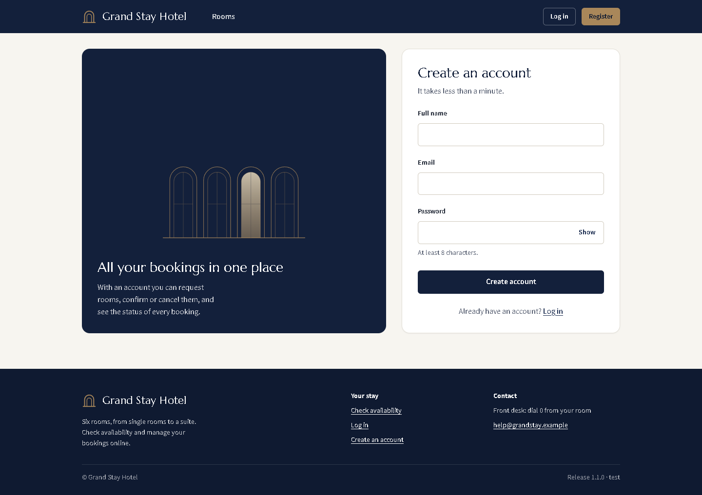

*Figure 6.1 - Workflow 1: registration form with labelled fields and the password rule.*

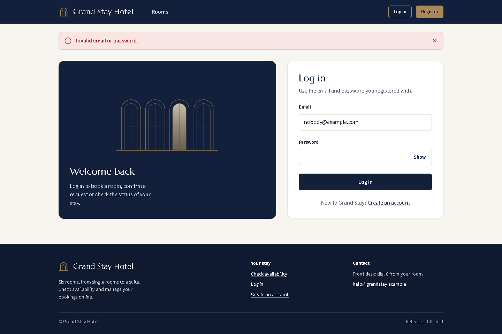

*Figure 6.2 - Workflow 1: login with wrong credentials shows a neutral error (does not reveal which part was wrong).*

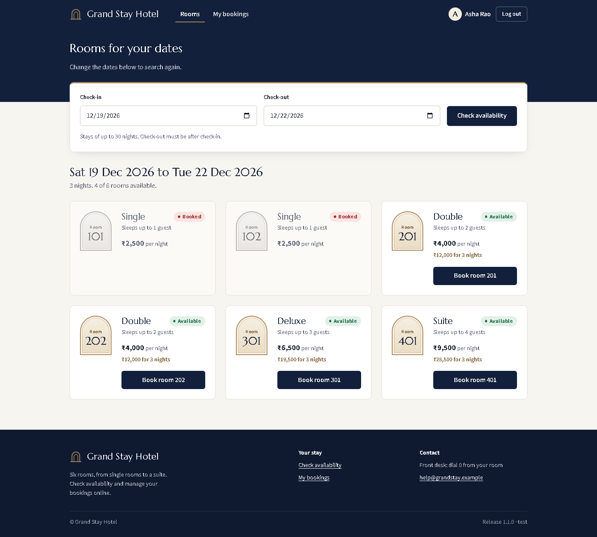

*Figure 6.3 - Workflow 2: availability for the chosen dates - booked rooms marked "Booked", free rooms with the total for the stay.*

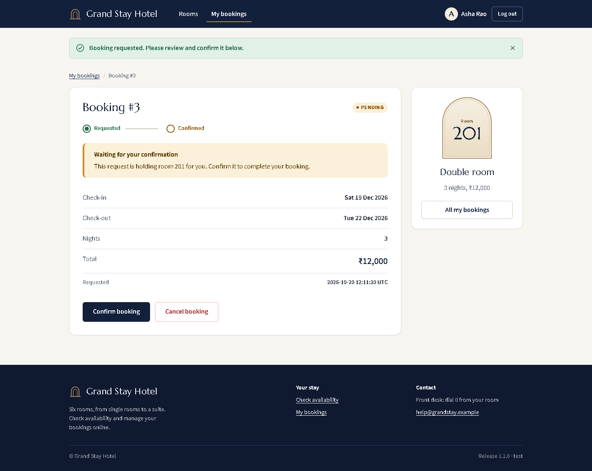

*Figure 6.4 - Workflow 3: the new booking is PENDING.*

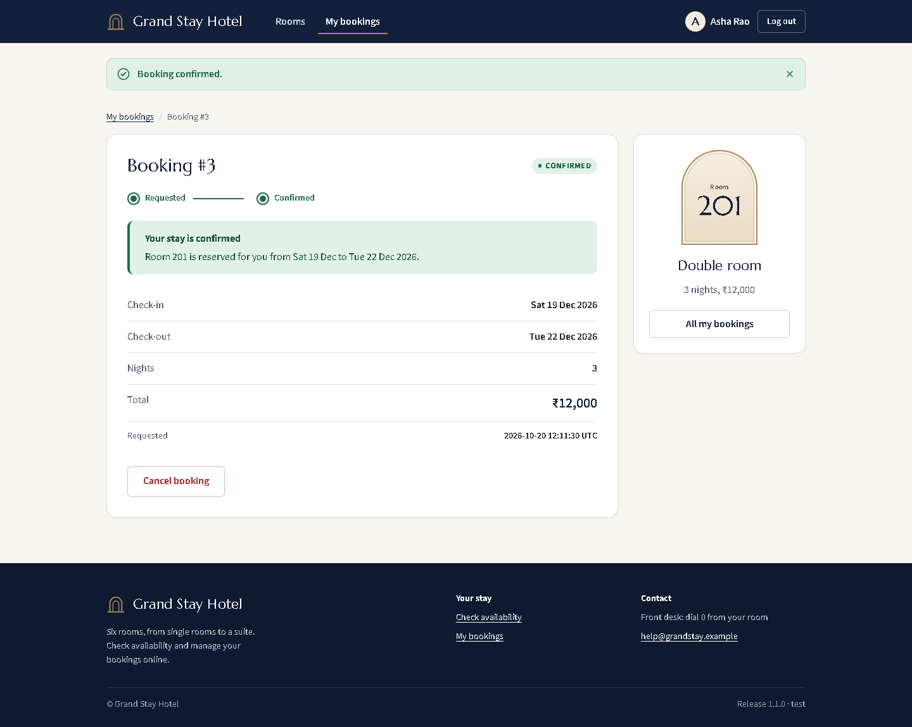

*Figure 6.5 - Workflow 4: CONFIRMED, progress shows both steps done.*

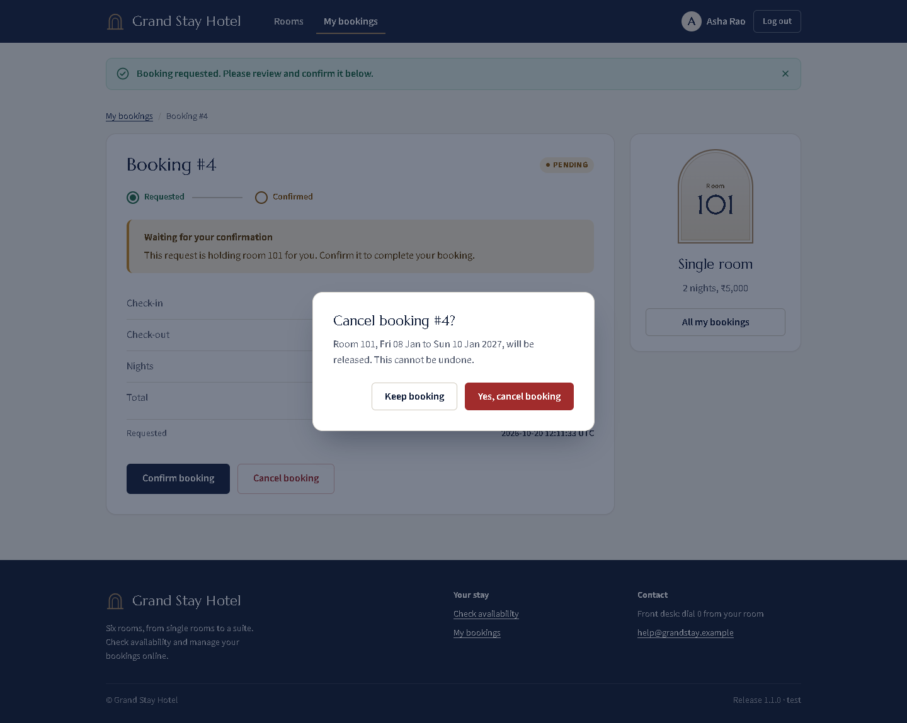

*Figure 6.6 - Workflow 5: cancelling opens a confirmation dialog first.*

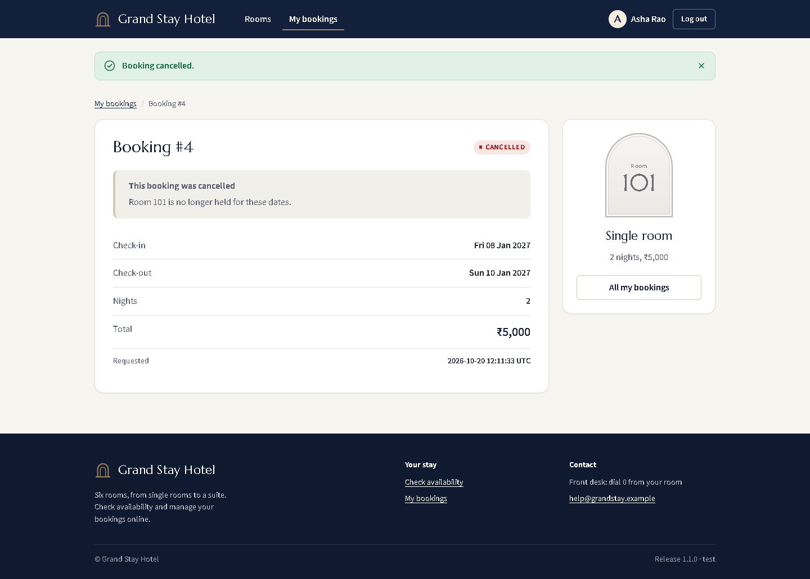

*Figure 6.7 - Workflow 5: status CANCELLED, room released.*

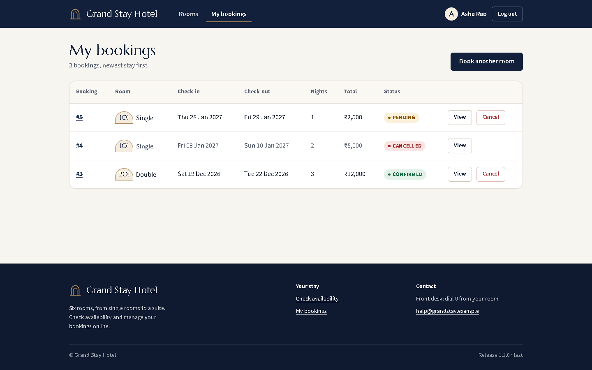

*Figure 6.8 - Workflow 6: status tracking for all of the guest's bookings (PENDING, CANCELLED, CONFIRMED).*

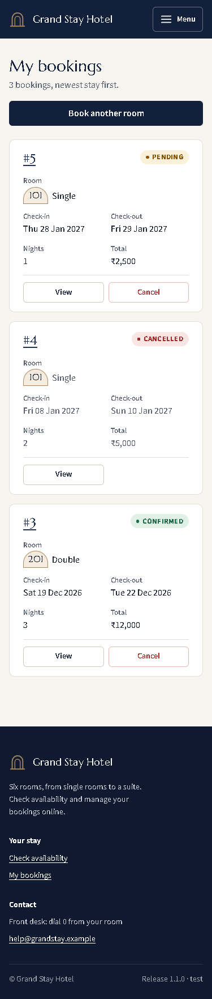

*Figure 6.9 - The same page at phone width (375 px).*

**Collaboration**

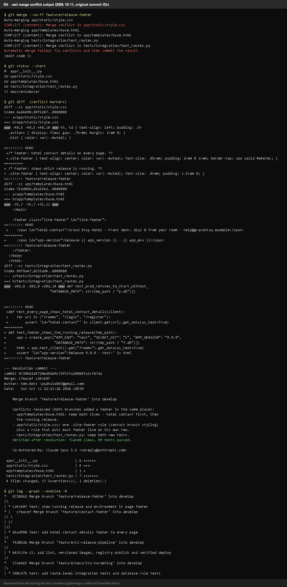

*Figure 6.10 - The conflict as recorded on 2026-10-11 (rendered from `docs/evidence/git/merge-conflict.txt`; original commit IDs).*
**Notice:** three `CONFLICT (content)` lines and the conflict markers from both branches.
**Proves:** the conflict was real Git output, not described afterwards.

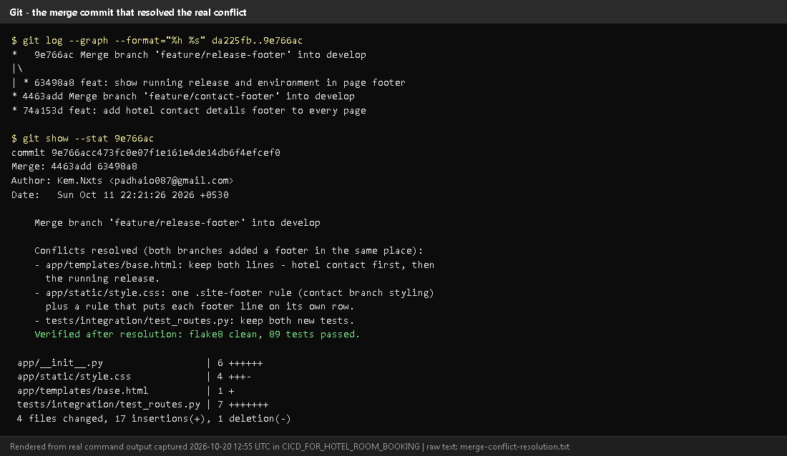

*Figure 6.11 - `git log --graph` and `git show --stat 9e766ac` today (rendered from real output).*
**Notice:** the two footer branches in the graph and the merge message describing each resolution decision.

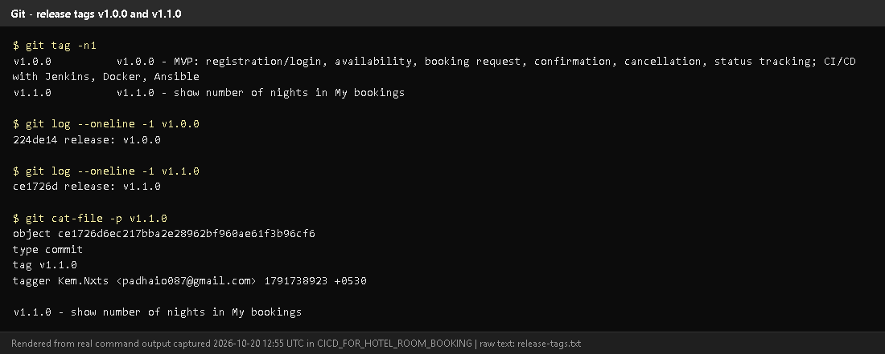

*Figure 6.12 - `git tag -n1` and the annotated tag object of `v1.1.0` (rendered from real output).*

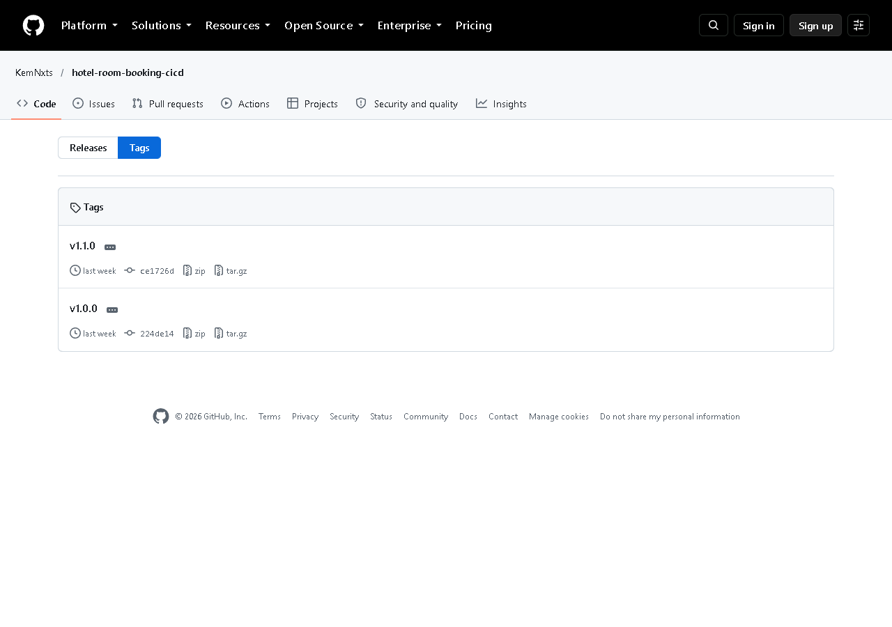

*Figure 6.13 - `v1.0.0` and `v1.1.0` on GitHub.*

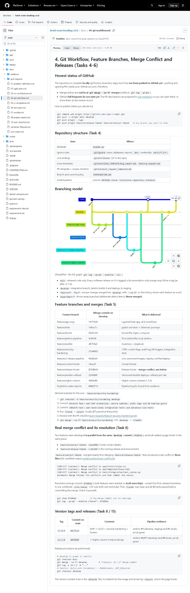

*Figure 6.14 - `docs/04-git-workflow.md` on GitHub: branching model, merges, the conflict story and the release procedure.*

## E. How to demonstrate this task to the professor (about 5 minutes)

**Before the demo:** PowerShell in `D:\DevOPS\CICD_FOR_HOTEL_ROOM_BOOKING`.

**Part 1 - the six workflows (browser).**

```powershell
.venv\Scripts\python -m flask --app wsgi run --port 5001
```

Open http://127.0.0.1:5001: register -> search dates -> *Book room* ->
*Confirm booking* -> book another -> *Cancel booking* -> *Yes, cancel booking*
-> *My bookings*. *Say:* "These are the six MVP workflows; they are also
checked automatically by five Selenium journeys."

**Part 2 - the real merge conflict, replayed safely in a throw-away copy**
(new PowerShell window; nothing in the real repository changes):

```powershell
cd $env:TEMP
git clone D:\DevOPS\CICD_FOR_HOTEL_ROOM_BOOKING conflict-demo
cd conflict-demo
git checkout -b replay da225fb
git merge --no-ff --no-edit origin/feature/contact-footer
git merge --no-ff --no-edit origin/feature/release-footer
```

*Expected:* the first merge succeeds; the second prints three
`CONFLICT (content)` lines and "Automatic merge failed" (verified 2026-10-20).

```powershell
git status
git diff
```

*Point to:* `UU` files and the `<<<<<<< HEAD` / `=======` / `>>>>>>>` blocks.
*Say:* "Both branches added a footer in the same place, so Git asks a human.
I kept both lines." Then show the real resolution and clean up:

```powershell
git merge --abort
git show --stat 9e766ac
cd ..
Remove-Item -Recurse -Force conflict-demo
```

**Part 3 - tags.** In the project folder:

```powershell
git tag -n1
git show v1.0.0 --stat --oneline
```

*Say:* "Tags are fixed labels for the released commits; branches keep moving."

**Recovery:** if `git clone` says the folder exists, run
`Remove-Item -Recurse -Force $env:TEMP\conflict-demo` first.

## F. Expected screenshots for the final submission

1. `assets/task-06/app-desktop-03-register.png` - **exists, 2026-10-20** (copied from `docs/ui-evidence/after/`).
2. `assets/task-06/app-desktop-05-login-error.png` - **exists, 2026-10-20**.
3. `assets/task-06/app-desktop-06-availability-logged-in.png` - **exists, 2026-10-20**.
4. `assets/task-06/app-desktop-08-booking-requested.png` - **exists, 2026-10-20**.
5. `assets/task-06/app-desktop-09-booking-confirmed.png` - **exists, 2026-10-20**.
6. `assets/task-06/app-desktop-10-cancel-dialog.png` - **exists, 2026-10-20**.
7. `assets/task-06/app-desktop-11-booking-cancelled.png` - **exists, 2026-10-20**.
8. `assets/task-06/app-desktop-12-my-bookings.png` - **exists, 2026-10-20**.
9. `assets/task-06/app-mobile-12-my-bookings.png` - **exists, 2026-10-20**.
10. `assets/task-06/merge-conflict-output.png` - **exists** (rendered from the 2026-10-11 log).
11. `assets/task-06/merge-conflict-resolution.png` - **exists, 2026-10-20**.
12. `assets/task-06/release-tags.png` - **exists, 2026-10-20**.
13. `assets/task-06/github-release-tags.png` - **exists, 2026-10-20**.
14. `assets/task-06/github-doc-04-git-workflow.png` - **exists, 2026-10-20**.

## G. Probable viva questions and answers

1. **What is a merge conflict?** Two branches changed the same lines; Git cannot choose, so a human edits the result.
2. **How did your conflict happen?** Two features branched from the same
   commit and both added a footer in `base.html` (plus CSS and a test). The second merge conflicted in all three files.
3. **How did you resolve it?** Kept both features (contact line, then release
   line), merged the CSS into one rule, kept both tests, ran flake8 and all
   tests (89 passed), then committed the merge `9e766ac`.
4. **How do you know you didn't break anything?** Tests after resolution, and
   Jenkins build #4 of develop was green before the v1.0.0 release.
5. **Branch vs tag?** A branch moves with new commits; a tag stays on one commit.
6. **Why tag releases?** To redeploy or roll back exactly what was released
   (`v1.0.0` was used for the Ansible rollback demo).
7. **(Project-specific) How are passwords stored?** Werkzeug scrypt hashes
   (`generate_password_hash`), never plain text - a unit test checks this.
8. **(Project-specific) What stops one guest cancelling another's booking?**
   The service checks the owner; another user gets 404 and the status stays unchanged (integration test).
9. **What is a stable baseline?** A tagged commit on `main` that passed the
   full pipeline - `v1.1.0` (`ce1726d`), running in prod.
10. **Why are there two IDs for the same commit in your documents?** The
    messages were edited once before publishing (removing a co-author line);
    the map is in `docs/evidence/git/commit-id-map.md`.
11. **Is the conflict screenshot genuine?** Yes - Git's own output was saved
    to a file at the time, and the conflict can be reproduced live from the
    pushed branches, as in the demo.

## H. Common mistakes and troubleshooting

| Symptom | Cause | Inspect | Fix | Confirm |
|---|---|---|---|---|
| Replay merge does not conflict | wrong start commit | `git log --oneline -1` | start from `da225fb` | three CONFLICT lines |
| Conflict markers left in a file | resolution incomplete | `git grep -n "<<<<<<<"` | edit file, remove markers | grep finds nothing; tests pass |
| `git merge --abort` fails | merge already committed | `git status` | in the throw-away clone just delete it | folder removed |
| Booking button missing | logged out, or room booked | page shows "Log in to book"/"Booked" | log in / choose other dates | Book button appears |
| HTTP 400 on a form | stale CSRF token | page open across restart | reload the page | form submits |

## I. Quick revision notes

**Five key points**

1. Six workflows, each with a route, a service function and a Selenium journey.
2. Security: hashed passwords, CSRF tokens, secure cookies, owner checks.
3. Real conflict between `feature/contact-footer` and `feature/release-footer`, 3 files.
4. Resolved by keeping both; merge commit `9e766ac`; 89 tests passed afterwards.
5. Releases tagged `v1.0.0`, `v1.1.0`; prod runs v1.1.0.

**30-60 second explanation**
"All six booking workflows are complete and tested by Selenium. For
collaboration, two features were developed in parallel from the same commit -
a contact footer and a release footer. Both changed the same lines, so the
second merge produced a real conflict in three files. I kept both features,
ran all tests, and committed the merge. After the pipeline passed, I merged
develop into main and tagged the releases v1.0.0 and v1.1.0. I can replay the
conflict live in a throw-away copy of the repository."

**Caveat:** the screenshots show the new UI, which is not yet committed or deployed.

**Readiness checklist**
- [ ] I can click through all six workflows.
- [ ] I can replay the conflict in a temp clone and explain the markers.
- [ ] I can explain branch vs tag.
- [ ] I can explain the two commit IDs.
