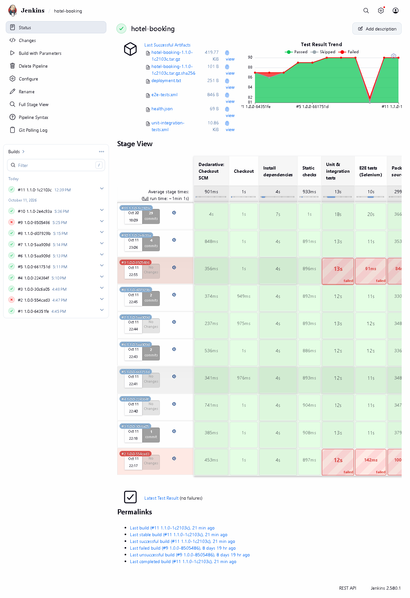
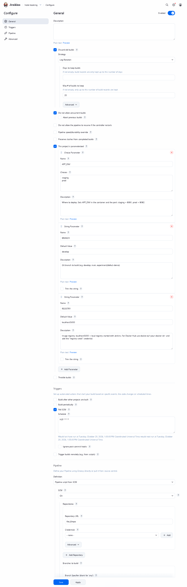
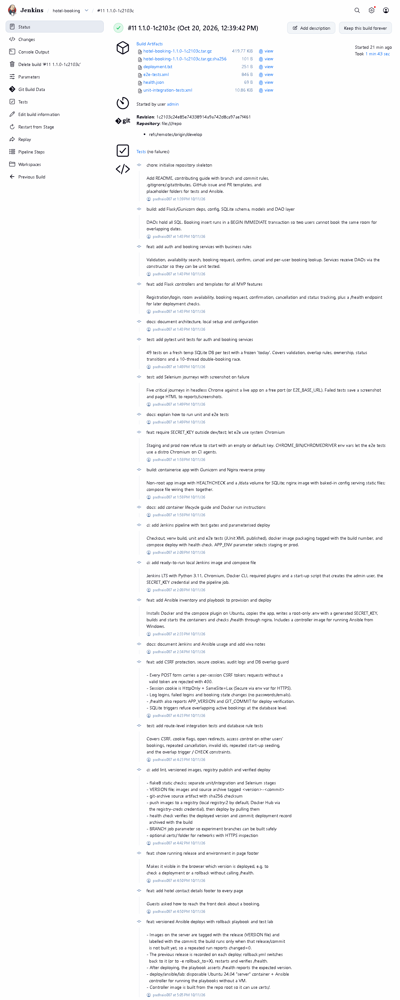
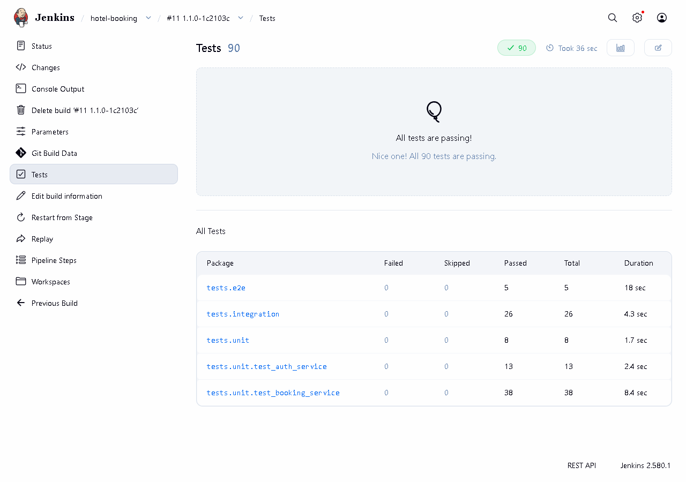
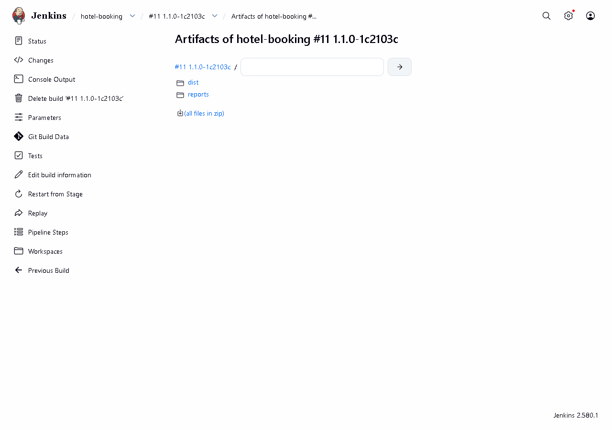
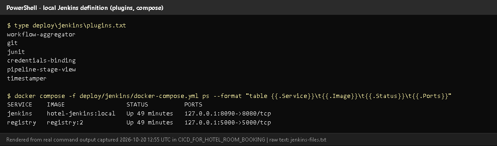

# Task 7 - Jenkins Installation and Continuous Integration

## A. Task title and objective

**Task 7: Jenkins Installation and Continuous Integration (CI) Job**

**Objective:** install Jenkins and configure a job that, for every change,
checks out the repository, prepares Python, installs dependencies, runs
static checks and tests, publishes test reports and archives artifacts.

**Professor's required deliverables**

- Jenkins installed and a job configured for the repository
- Checkout; Python environment; reproducible dependency installation
- Linting / syntax checks
- pytest execution and test reports
- Archived artifacts (source package + reports)
- Build trigger: GitHub webhook if possible, otherwise polling or manual trigger (documented)

**Current status: Implemented and verified.** A real run on 2026-10-20 -
Jenkins build **#11** - passed every stage with 90 tests and archived its
artifacts (Figures 7.3-7.5). All 11 builds are visible in Jenkins (Figure 7.1).

Two honest points:

- **Trigger:** Jenkins **polls** Git every ~5 minutes (`pollSCM`) and builds
  are started with *Build with Parameters*. A GitHub **webhook** was not set
  up because this Jenkins runs on `localhost`, which GitHub cannot reach.
- **Build tool:** the job uses Python tools (pip, compileall, flake8, pytest),
  **not a Maven job**. Professor's approval of this equivalent is needed.

## B. Explanation for a complete beginner

**An everyday picture.** Imagine a quality inspector at a factory who, every
time a new batch of parts arrives, takes them, assembles a sample, runs all
the standard checks and writes a report - every time, the same way, without
being asked. **Jenkins** is that inspector for code.

**Continuous Integration (CI)** - every change is automatically built and
tested soon after it is committed, so problems are found within minutes, not
weeks later.

| Term | Meaning | In this project |
|---|---|---|
| **Jenkins** | an automation server that runs jobs | Jenkins LTS 2.580.1 in a Docker container, http://localhost:8090 |
| **Job** | a configured task Jenkins can run | `hotel-booking` |
| **Pipeline** | a job made of ordered **stages** | defined in the `Jenkinsfile` (Task 8) |
| **Build** | one run of the job, numbered | #1 ... #11 |
| **Agent** | the machine where steps run | here the Jenkins container itself (built-in node) |
| **Trigger** | what starts a build | polling every 5 min, or a person clicking *Build* |
| **Polling** | Jenkins asks Git "anything new?" on a schedule | `pollSCM('H/5 * * * *')` |
| **Webhook** | GitHub tells Jenkins immediately when something is pushed | not possible: Jenkins not reachable from the internet |
| **Linting** | automatic style/error checking without running the code | `flake8` |
| **Artifact** | a file produced by a build and kept with it | source tarball + checksum, test XML, deployment record |
| **Plugin** | add-on for Jenkins | Pipeline, Git, JUnit, Credentials Binding, Stage View, Timestamper |

**Three different things - don't mix them up**

1. *An installed Jenkins* - the server is running (http://localhost:8090 answers).
2. *A saved pipeline definition* - the `Jenkinsfile` in Git.
3. *An executed job* - a numbered build with results, e.g. build #11 SUCCESS.

Only (3) proves the CI works; this report shows all three.

## C. What was actually implemented

**Installation as code** - `deploy/jenkins/`:

| File | Purpose |
|---|---|
| `Dockerfile` | Jenkins LTS (JDK 21) + Python 3.11 + Chromium & chromedriver (for Selenium) + Docker CLI with the compose plugin; trusts extra CA certificates from `certs/` |
| `plugins.txt` | `workflow-aggregator`, `git`, `junit`, `credentials-binding`, `pipeline-stage-view`, `timestamper` |
| `init.groovy.d/01-setup.groovy` | on first start: creates user `admin` (password from `.env`), the secret-text credential `hotel-secret-key`, and the job `hotel-booking` ("Pipeline script from SCM", repository `file:///repo`, branch `*/${BRANCH}`, parameters APP_ENV/BRANCH/REGISTRY) |
| `docker-compose.yml` | runs Jenkins on `127.0.0.1:8090` and a local image registry on `127.0.0.1:5000`; mounts the repository read-only at `/repo` and the host's Docker socket |
| `.env.example` | template for the git-ignored `.env` (`JENKINS_ADMIN_PASSWORD`, `HOTEL_SECRET_KEY`) |

Start command (from `deploy\jenkins`): `docker compose up -d --build`.

**What the CI part of the job does** (stages from the `Jenkinsfile`):

| Stage | Command | Fails when |
|---|---|---|
| Checkout | `checkout scm`, `rm -rf reports dist`, read `VERSION` + commit | branch missing |
| Install dependencies | `python3.11 -m venv .venv` then `pip install -r requirements-dev.txt` (pinned versions) | a package cannot be installed |
| Static checks | `python -m compileall -q app wsgi.py` + `flake8 app tests scripts wsgi.py gunicorn.conf.py` | syntax or lint error |
| Unit & integration tests | `pytest tests/unit tests/integration --junitxml=reports/unit-integration-tests.xml` | any test fails |
| E2E tests (Selenium) | `pytest -m e2e --junitxml=reports/e2e-tests.xml` | any journey fails |
| Package source | `git archive ... -o dist/hotel-booking-<tag>.tar.gz` + `sha256sum` | - |

**Reports and artifacts** (`post { always { ... } }`, Jenkinsfile lines 211-212):

```groovy
junit allowEmptyResults: true, testResults: 'reports/*.xml'        // test trend + Tests page
archiveArtifacts artifacts: 'reports/**, dist/**', allowEmptyArchive: true   // kept with the build
```

Build #11 archived: `hotel-booking-1.1.0-1c2103c.tar.gz` (+ `.sha256`),
`unit-integration-tests.xml`, `e2e-tests.xml`, `health.json`, `deployment.txt`.

**Build history (from the Jenkins API, 2026-10-20)**

| Build | Branch | Result |
|---|---|---|
| #1 | feature/ci-release-pipeline | SUCCESS |
| #2 | experiment/defect-demo | FAILURE (deliberate defect, Task 10) |
| #3-#8 | experiment fix, develop, main | SUCCESS |
| #9 | experiment/defect-demo-2 | FAILURE (deliberate, Task 10) |
| #10 | develop | SUCCESS |
| **#11** | develop (`1c2103c`) | **SUCCESS, 90 tests, 103 s - run during this audit** |

**Python instead of Maven.** A Maven job would run `mvn test` on a Java
project. This project is Python, so the equivalent steps are pip (dependencies),
compileall + flake8 (compile/lint) and pytest (tests, writing the same JUnit
XML format that Maven's Surefire plugin writes). They are not Maven.

## D. Screenshots and evidence



*Figure 7.1 - Job `hotel-booking`: build history #1-#11, test-result trend, last artifacts and the stage view (captured 2026-10-20).*
**Notice:** builds #2 and #9 red, all others green; each stage's duration per build.
**Proves:** Jenkins is installed, the job exists and has really executed builds.



*Figure 7.2 - Job configuration: the three parameters, "Do not allow concurrent builds", Poll SCM `H/5 * * * *`, and "Pipeline script from SCM" with repository `file:///repo`.*
**Proves:** the trigger and SCM settings described above. No secret values appear on this page.



*Figure 7.3 - Build #11 (`1.1.0-1c2103c`), started 2026-10-20: result SUCCESS.*



*Figure 7.4 - Test report of build #11: 90 tests, 0 failures, grouped by package (unit, integration, e2e).*
**Proves:** pytest ran inside Jenkins and its JUnit reports were published.



*Figure 7.5 - Archived artifacts of build #11: source tarball + `.sha256`, test XML, `health.json`, `deployment.txt`.*



*Figure 7.6 - `deploy/jenkins/plugins.txt` and the running Jenkins + registry containers (rendered from real output, 2026-10-20).*

## E. How to demonstrate this task to the professor (about 4 minutes)

**Before the demo:** Docker Desktop running ("Engine running" in its window).
Know the admin password: it is the `JENKINS_ADMIN_PASSWORD=` line in
`deploy\jenkins\.env` (do not show this file on screen).

1. **Make sure Jenkins runs** (PowerShell):
   ```powershell
   cd D:\DevOPS\CICD_FOR_HOTEL_ROOM_BOOKING\deploy\jenkins
   docker compose ps
   ```
   *Expected:* `jenkins` and `registry` "Up". If not: `docker compose up -d`, wait ~1 minute.
2. Open **http://localhost:8090**, log in as `admin`.
3. Open job **hotel-booking**. *Say:* "This is the CI job. The stage view shows
   every build; red ones were deliberate experiments."
4. Click **Configure** (read only - don't save). Show *This project is
   parameterized*, *Poll SCM* `H/5 * * * *`, *Pipeline script from SCM*.
   *Say:* "Jenkins checks the repository every five minutes. A webhook needs
   Jenkins to be reachable from GitHub, which a laptop is not."
5. Click **Build with Parameters** -> `BRANCH=develop`, `APP_ENV=staging` -> **Build**.
   Watch the stage view (about 2 minutes). *Say* each stage name as it turns green.
6. Open the new build -> **Tests** (90 passed) -> **Build Artifacts** (tarball, checksum, reports).
7. Open **Console Output** and scroll to `flake8` and `90 passed` lines.

**Recovery:** login page not loading - wait: Jenkins needs ~60 s after a start.
"permission denied ... docker.sock" (Linux host only) - set `DOCKER_GID` in
`deploy/jenkins/.env`. Build cannot see your latest change - Jenkins builds
**committed** code only; commit first.

## F. Expected screenshots for the final submission

1. `assets/task-07/jenkins-job-stage-view.png` - **exists, 2026-10-20**.
2. `assets/task-07/jenkins-job-configuration.png` - **exists, 2026-10-20**.
3. `assets/task-07/jenkins-build-11-summary.png` - **exists, 2026-10-20**.
4. `assets/task-07/jenkins-build-11-tests.png` - **exists, 2026-10-20**.
5. `assets/task-07/jenkins-build-11-artifacts.png` - **exists, 2026-10-20**.
6. `assets/task-07/jenkins-files.png` - **exists, 2026-10-20**.
7. `assets/task-07/github-webhook.png` - **only if** a webhook is configured on a public Jenkins (manual; currently not applicable).

## G. Probable viva questions and answers

1. **What is Jenkins?** An automation server that runs build/test/deploy jobs automatically.
2. **What is Continuous Integration?** Automatically building and testing every change soon after it is committed, so errors are found quickly.
3. **Installed Jenkins vs Jenkinsfile vs executed build?** The server, the
   pipeline definition stored in Git, and an actual numbered run with results.
   Only a build (e.g. #11) proves it works.
4. **How is your build triggered?** Poll SCM every ~5 minutes, plus manual
   *Build with Parameters*. A webhook isn't possible because GitHub cannot reach localhost.
5. **How do you install dependencies reproducibly?** A fresh venv each build
   and `pip install -r requirements-dev.txt` with pinned versions (`Flask==3.1.3`, `pytest==9.1.1`...).
6. **What does flake8 check?** Syntax errors, undefined names, unused imports and style (config in `.flake8`, line length 110).
7. **Where do the test reports come from?** pytest writes JUnit XML
   (`--junitxml`), and the JUnit plugin shows them on the Tests page.
8. **(Project-specific) What artifacts does a build keep?** The source
   archive `hotel-booking-<version>-<commit>.tar.gz` with its sha256, test XML,
   `health.json` and `deployment.txt`.
9. **(Project-specific) Why run Jenkins in Docker?** The whole server
   (plugins, Python, Chromium, Docker CLI, the job) is defined in files in
   `deploy/jenkins/` and starts with one command; nothing is clicked by hand.
10. **Is this a Maven job?** No. The project is Python; pip, flake8 and
    pytest do the jobs Maven would do for Java. I'll confirm with the professor that this is acceptable.
11. **What is an agent?** The machine that executes the steps; here the
    built-in node (the Jenkins container), which uses the host's Docker through the mounted socket.

## H. Common mistakes and troubleshooting

| Symptom | Cause | Inspect | Fix | Confirm |
|---|---|---|---|---|
| http://localhost:8090 not reachable | Docker Desktop or the container stopped | `docker compose ps` in `deploy\jenkins` | start Docker Desktop; `docker compose up -d` | login page loads |
| Build doesn't include my change | change not committed | `git status` | commit (and choose that branch in `BRANCH`) | console "Building commit <id>" |
| Stage "Install dependencies" fails with SSL errors | antivirus HTTPS scanning | console output | put the root CA in `certs/` and rebuild Jenkins (`docker compose up -d --build`) | stage green |
| Login fails | wrong password | `deploy\jenkins\.env` (privately) | use that value; it is set on first start only | dashboard opens |
| Tests page shows old results | stale report files (fixed) | Checkout stage runs `rm -rf reports dist` | already fixed in `fix/jenkins-stale-reports` | build #9 lists only tests that ran |

## I. Quick revision notes

**Five key points**

1. Jenkins runs in Docker, defined in `deploy/jenkins/`, at http://localhost:8090.
2. Job `hotel-booking` = pipeline from SCM (`Jenkinsfile`), parameters APP_ENV / BRANCH / REGISTRY.
3. CI stages: checkout, venv + pinned pip install, compileall + flake8, pytest (85 + 5).
4. JUnit reports and artifacts (tarball + sha256) are kept with each build.
5. Trigger = polling (no public URL for a webhook); Python tools, not Maven.

**30-60 second explanation**
"Jenkins runs in a Docker container that is completely defined in the
repository - plugins, Python, Chromium for Selenium and the job itself. The
job `hotel-booking` reads the Jenkinsfile from Git. For each build it checks
out the code, creates a fresh virtual environment, installs pinned
dependencies, runs flake8 and all 90 tests, publishes the JUnit reports and
archives a source package with a checksum. Build #11, run today, passed all
stages. It polls Git every five minutes because a webhook needs a public Jenkins."

**Caveat:** no webhook; Python tooling instead of a Maven job (needs approval).

**Readiness checklist**
- [ ] Docker Desktop running; `docker compose ps` shows Jenkins up.
- [ ] I can log in and start *Build with Parameters*.
- [ ] I can open Tests and Artifacts of a build.
- [ ] I can explain polling vs webhook and Python vs Maven.
