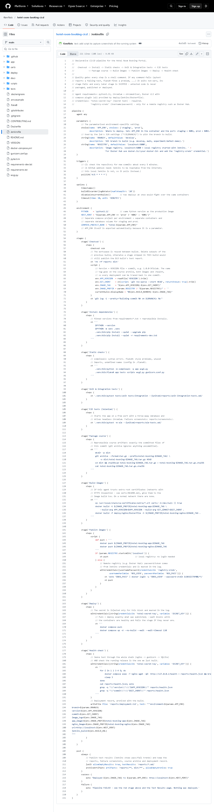
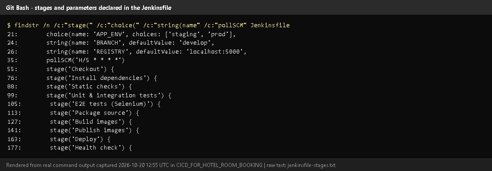
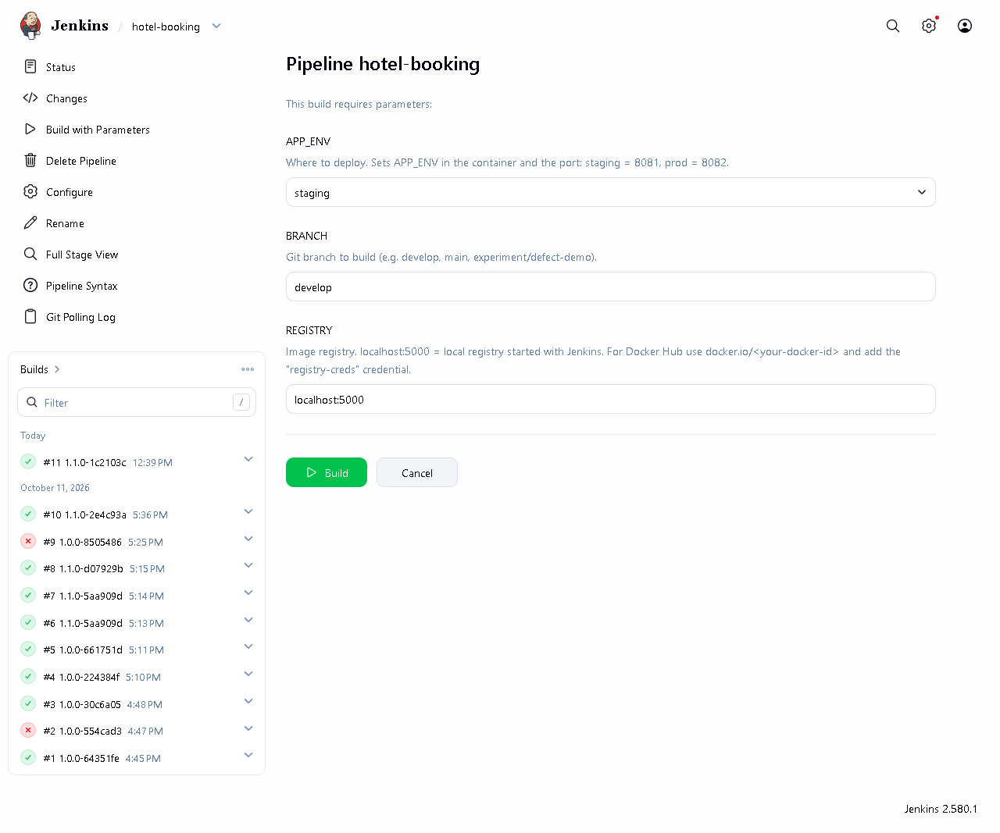
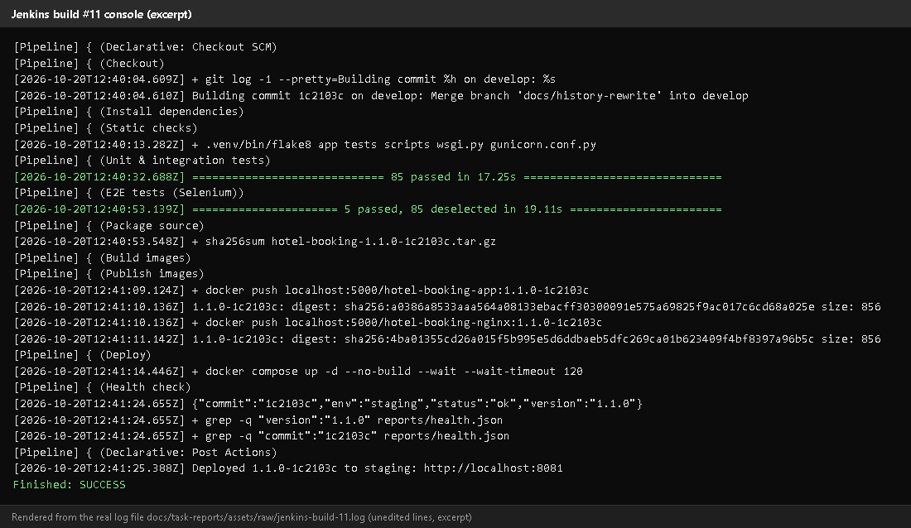
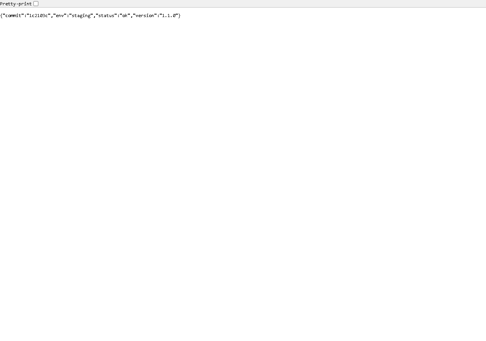
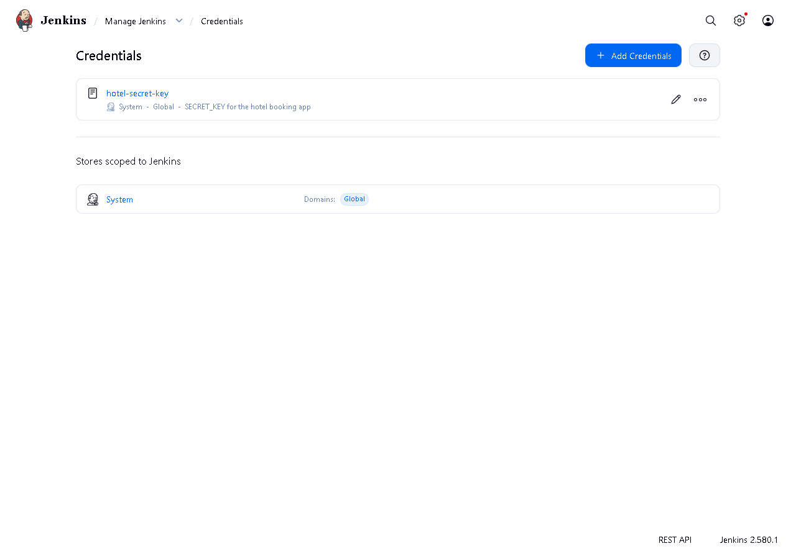

# Task 8 - Pipeline as Code and Server Deployment

## A. Task title and objective

**Task 8: Pipeline as Code and Server Deployment**

**Objective:** describe the whole build-test-package-deploy process in a
`Jenkinsfile` stored in Git, parameterise at least one environment-specific
setting, keep secrets out of the repository, and deploy automatically after
all quality gates pass, followed by a health check.

**Professor's required deliverables**

- A `Jenkinsfile` with stages for checkout, dependencies, static checks, tests, packaging, Docker build, deployment and health check
- At least one parameterised environment-specific setting
- Configuration through environment variables / files; passwords, keys and registry credentials outside source control
- Deployment to an available target (local deployment acceptable if no server exists - documented)

**Current status: Implemented and verified.** Jenkins build **#11** on
2026-10-20 ran all 10 stages, deployed release `1.1.0-1c2103c` to the
**staging** environment and the health check confirmed the version and
commit (Figures 8.3-8.5).

Deployment target: a Docker Compose stack on the same machine as Jenkins
(local "staging" on port 8081 and "prod" on port 8082). No separate remote
server is used by Jenkins; remote-server deployment is done by Ansible (Task 13).

## B. Explanation for a complete beginner

**An everyday picture.** A recipe card that lists every step in order
("preheat, mix, bake 20 minutes, test with a toothpick") lets anyone bake the
same cake. A **Jenkinsfile** is the recipe card for releasing software: it
lists every step, and because it lives in Git, changes to the recipe are
reviewed and versioned like code.

| Term | Meaning |
|---|---|
| **Pipeline as code** | the pipeline is a text file in the repository, not settings clicked in a web UI |
| **Stage** | one named step group (e.g. "Unit & integration tests"); stages run in order |
| **Declarative pipeline** | Jenkins' structured syntax: `pipeline { parameters {...} stages {...} post {...} }` |
| **Parameter** | a value chosen when starting a build (e.g. staging or prod) |
| **Environment variable** | a named value the commands can read (e.g. `HOST_PORT`) |
| **Credential** | a secret stored encrypted in Jenkins and injected only when needed |
| **Deployment** | starting the new version where users can reach it |
| **Health check** | asking the running app "are you OK, and which version are you?" (`GET /health`) |
| **Quality gate** | a check that must pass before the next step is allowed; here every test stage comes before Deploy |

**Why it helps:** the same steps run every time, nothing is forgotten,
history shows who changed the process, and a broken step stops the release.

## C. What was actually implemented

File: [`Jenkinsfile`](../../Jenkinsfile) (declarative pipeline).

**Parameters** (lines 19-29)

| Parameter | Values | Effect |
|---|---|---|
| `APP_ENV` | `staging` / `prod` | sets `APP_ENV` in the container, the port (staging **8081**, prod **8082**) and the compose project name `hotel-staging` / `hotel-prod` (separate containers and separate database volume) |
| `BRANCH` | e.g. `develop`, `main` | which Git branch is built |
| `REGISTRY` | `localhost:5000` (default) or `docker.io/<user>` | where images are pushed and pulled |

Derived variables (lines 45-51): `HOST_PORT`, `COMPOSE_PROJECT_NAME`. In the
Checkout stage: `APP_VERSION` (from the `VERSION` file), `GIT_SHORT`,
`IMAGE_TAG = <version>-<commit>`, `IMAGE_PREFIX`.

**Stages and what build #11 did**

| # | Stage (line) | What it does | Build #11 result |
|---|---|---|---|
| 1 | Checkout (55) | `checkout scm`, delete old `reports/` + `dist/`, compute tag | commit `1c2103c`, tag `1.1.0-1c2103c` |
| 2 | Install dependencies (76) | fresh venv, pinned `pip install` | ok |
| 3 | Static checks (88) | `compileall`, `flake8` | no findings |
| 4 | Unit & integration tests (99) | pytest, JUnit XML | 85 passed |
| 5 | E2E tests (Selenium) (105) | headless Chromium | 5 passed |
| 6 | Package source (113) | `git archive` + `sha256sum` | `hotel-booking-1.1.0-1c2103c.tar.gz` |
| 7 | Build images (127) | `docker build` app + nginx, with `APP_VERSION`/`GIT_COMMIT` | 2 images |
| 8 | Publish images (141) | `docker push` to the registry | pushed (digests in console) |
| 9 | Deploy (163) | `withCredentials(hotel-secret-key)`; `docker compose pull`; `docker compose up -d --no-build --wait` | containers healthy |
| 10 | Health check (177) | `wget /health` through Nginx; `grep` the expected version **and** commit; write `reports/deployment.txt` | `{"commit":"1c2103c","env":"staging","status":"ok","version":"1.1.0"}` |

**Secrets stay outside Git**

```groovy
withCredentials([string(credentialsId: 'hotel-secret-key', variable: 'SECRET_KEY')]) {
    sh '''
        docker compose pull
        docker compose up -d --no-build --wait --wait-timeout 120
    '''
}
```

- `hotel-secret-key` is a Jenkins *secret text* credential (created from the git-ignored `deploy/jenkins/.env`); Jenkins masks it in logs. The build #11 log was searched for the key: **not present**.
- A remote registry password would be the credential `registry-creds`, used with `docker login --password-stdin`.
- `docker-compose.yml` refuses to start without `SECRET_KEY` (`${SECRET_KEY:?...}`), and the app refuses to start in staging/prod with a missing or default key.

**Health check stage (simplified excerpt of lines 177-200 - the real file
retries `wget` up to 5 times and escapes the quotes for Groovy as `\\"`; the
`#` comments are added here)**

```sh
docker compose exec -T nginx wget -qO- http://127.0.0.1/health > reports/health.json
grep -q "\"version\":\"$APP_VERSION\"" reports/health.json   # right release?
grep -q "\"commit\":\"$GIT_SHORT\"" reports/health.json      # right commit?
```

If the running app reports a different version or commit, `grep` fails and
the build fails.

**Deployment record** (artifact `reports/deployment.txt` of build #11):

```text
environment=staging
branch=develop
version=1.1.0
commit=1c2103c
image_tag=1.1.0-1c2103c
app_image=localhost:5000/hotel-booking-app:1.1.0-1c2103c
nginx_image=localhost:5000/hotel-booking-nginx:1.1.0-1c2103c
url=http://localhost:8081
jenkins_build=null
```

`jenkins_build=null` is a small known issue: Jenkins' own "Jenkins URL"
setting was never filled in, so `BUILD_URL` is empty. Fix: *Manage Jenkins ->
System -> Jenkins Location -> Jenkins URL* = `http://localhost:8090/`.

## D. Screenshots and evidence



*Figure 8.1 - `Jenkinsfile` on GitHub (captured 2026-10-20).* **Notice:** `parameters`, `triggers { pollSCM }`, `options`, `environment`, the ten stages and `post`.



*Figure 8.2 - Line numbers of every stage and parameter (`findstr` on the Jenkinsfile, rendered from real output).*



*Figure 8.3 - The *Build with Parameters* form: APP_ENV, BRANCH, REGISTRY.*
**Proves:** the environment-specific setting is a real parameter.



*Figure 8.4 - Build #11 console excerpt (rendered from the saved console log): each stage starting, 85 + 5 tests passed, the archive checksum, image pushes with digests, `/health` and "Deployed 1.1.0-1c2103c to staging".*



*Figure 8.5 - http://localhost:8081/health in a browser after build #11: commit `1c2103c`, env `staging`, version `1.1.0`.*
**Proves:** the deployed app is the exact commit that was built and tested.



*Figure 8.6 - *Manage Jenkins -> Credentials*: `hotel-secret-key` exists; its value is never displayed.*

## E. How to demonstrate this task to the professor (about 5 minutes)

**Before the demo:** Docker Desktop running; Jenkins up (`docker compose ps` in `deploy\jenkins`); VS Code open on the project.

1. **Open `Jenkinsfile` in VS Code.** Walk through: `parameters` (APP_ENV),
   `environment` (HOST_PORT), then each `stage(...)`. *Say:* "The whole
   pipeline is code in Git, so it is versioned and reviewed like the app."
2. **Start a deploy:** Jenkins -> *hotel-booking* -> *Build with Parameters* ->
   `APP_ENV = staging`, `BRANCH = develop` -> *Build*.
3. **Narrate the stage view** as stages turn green (about 2 minutes). Point
   out that *Deploy* is after both test stages - "that is the quality gate".
4. **Open the build's Console Output**, search (Ctrl+F) for `Deployed` and
   `"status":"ok"`.
5. **Prove it in a browser:** http://localhost:8081/health - the `commit`
   equals the commit shown in the console line "Building commit ...".
6. **Show the parameter effect:** run again with `APP_ENV = prod` and `BRANCH = main`;
   then http://localhost:8082/health shows `"env":"prod"`. *Say:* "Same pipeline,
   different environment, chosen by one parameter."
7. **Show secrets handling:** *Manage Jenkins -> Credentials* (value hidden);
   in VS Code show `withCredentials` in the Deploy stage.

**Recovery:** Deploy stage "port is already allocated" - another program uses
8081/8082; stop it or `docker compose -p hotel-staging down` and rebuild.
Health check fails because of an old container - run the build again; it
pulls and recreates the containers.

## F. Expected screenshots for the final submission

1. `assets/task-08/github-file-Jenkinsfile.png` - **exists, 2026-10-20**.
2. `assets/task-08/jenkinsfile-stages.png` - **exists, 2026-10-20**.
3. `assets/task-08/jenkins-build-with-parameters.png` - **exists, 2026-10-20**.
4. `assets/task-08/jenkins-build-11-console.png` - **exists, 2026-10-20** (rendered from the real console log).
5. `assets/task-08/staging-health-after-build-11.png` - **exists, 2026-10-20**.
6. `assets/task-08/jenkins-credentials-masked.png` - **exists, 2026-10-20**.

## G. Probable viva questions and answers

1. **What is "pipeline as code"?** The pipeline is a file (`Jenkinsfile`) in
   the repository, so it is versioned, reviewed and identical on every run.
2. **Name your stages in order.** Checkout, Install dependencies, Static
   checks, Unit & integration tests, E2E tests, Package source, Build images,
   Publish images, Deploy, Health check.
3. **Which setting is parameterised?** `APP_ENV`: staging or prod - it changes
   the app environment, the port (8081/8082) and the compose project (separate data).
4. **How are secrets handled?** `SECRET_KEY` is a Jenkins credential injected
   with `withCredentials` only in Deploy/Health check and masked in logs; nothing secret is in Git.
5. **What happens if a test fails?** That stage fails and every later stage,
   including Deploy, is skipped (build #2 shows this).
6. **(Project-specific) How do you know the deployed version is the tested one?**
   Images are tagged `<version>-<commit>`; the health-check stage compares the
   version and commit returned by `/health` with the ones built.
7. **(Project-specific) Where does it deploy?** To a Docker Compose stack on
   the Jenkins host: staging :8081, prod :8082. Real servers are handled by Ansible.
8. **Why `--wait` on `docker compose up`?** It waits until containers are
   healthy (Docker HEALTHCHECK) and fails the stage if they never are.
9. **What is `post { always }` for?** It publishes test reports and archives
   artifacts even when the build fails, so failures can be analysed.
10. **Why `disableConcurrentBuilds`?** Two deployments at the same time would fight over the same containers.
11. **What is `deployment.txt`?** A record archived with each build: environment, branch, version, commit, image names, URL.

## H. Common mistakes and troubleshooting

| Symptom | Cause | Inspect | Fix | Confirm |
|---|---|---|---|---|
| Health check stage fails on `grep` | old container still running another version | console: `cat reports/health.json` | rerun; check no other stack uses the port | `/health` shows the new commit |
| Deploy: `SECRET_KEY is not set` | credential missing | *Manage Jenkins -> Credentials* | recreate `hotel-secret-key` (secret text) | Deploy green |
| `jenkins_build=null` in deployment record | Jenkins URL not configured | *Manage Jenkins -> System* | set Jenkins URL `http://localhost:8090/` | next record shows the build URL |
| Publish images: connection refused | registry container stopped | `docker compose ps` in `deploy\jenkins` | `docker compose up -d registry` | push succeeds |
| Changes in the Jenkinsfile ignored | not committed / wrong branch | console "Building commit" | commit and build that branch | stage list updated |

## I. Quick revision notes

**Five key points**

1. `Jenkinsfile` = the pipeline as code, 10 stages, versioned in Git.
2. Parameter `APP_ENV` chooses staging (:8081) or prod (:8082).
3. Secrets come from Jenkins credentials (`withCredentials`), never from Git.
4. Deploy runs only after lint + 90 tests; then `/health` must match version **and** commit.
5. Build #11 (2026-10-20) deployed `1.1.0-1c2103c` to staging and passed.

**30-60 second explanation**
"Our pipeline is a Jenkinsfile in the repository. It checks out a branch,
installs pinned dependencies, runs flake8 and all tests, packages the source,
builds Docker images tagged with version and commit, pushes them to a
registry, deploys them with Docker Compose and finally checks that `/health`
reports exactly that version and commit. The APP_ENV parameter chooses
staging or prod. The secret key is a Jenkins credential, never in Git. Build
#11 today deployed commit 1c2103c to staging successfully."

**Caveat:** Jenkins deploys to Docker on its own host, not a remote server; `jenkins_build` in the record is empty until the Jenkins URL is set.

**Readiness checklist**
- [ ] I can name the 10 stages in order.
- [ ] I can run a staging and a prod build and show both `/health` pages.
- [ ] I can point to `withCredentials` and explain masking.
- [ ] I can explain why the health check compares the commit.
