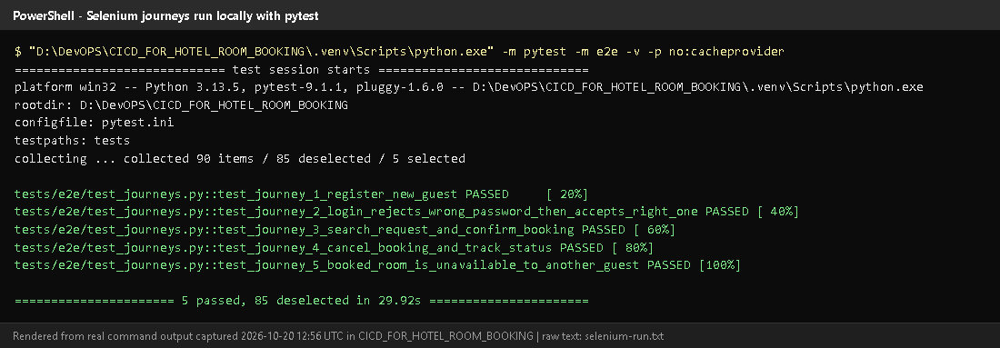
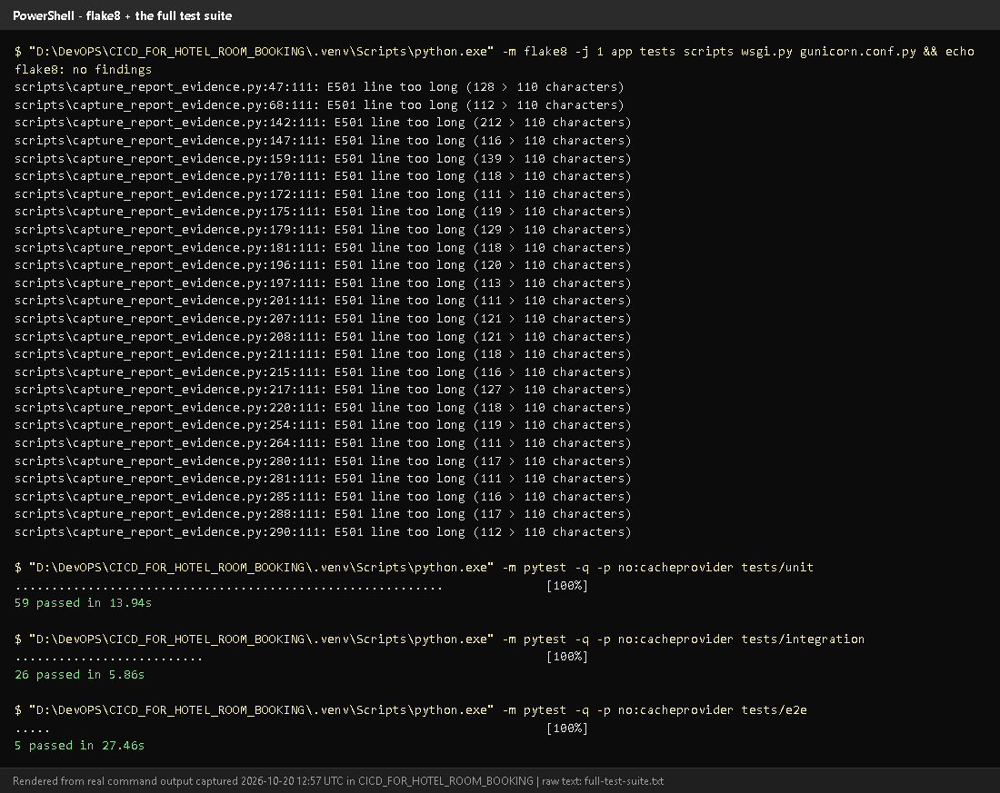
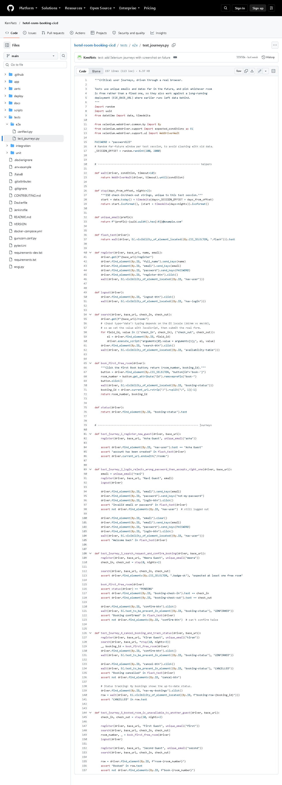
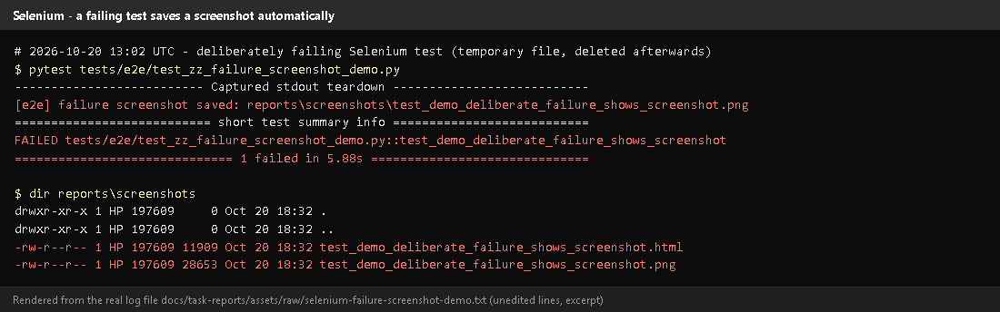
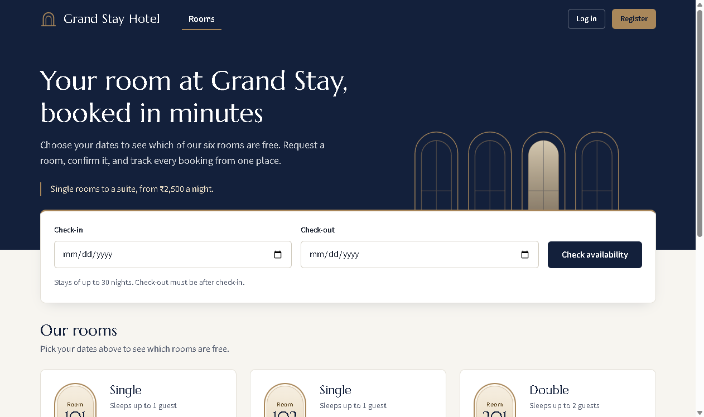
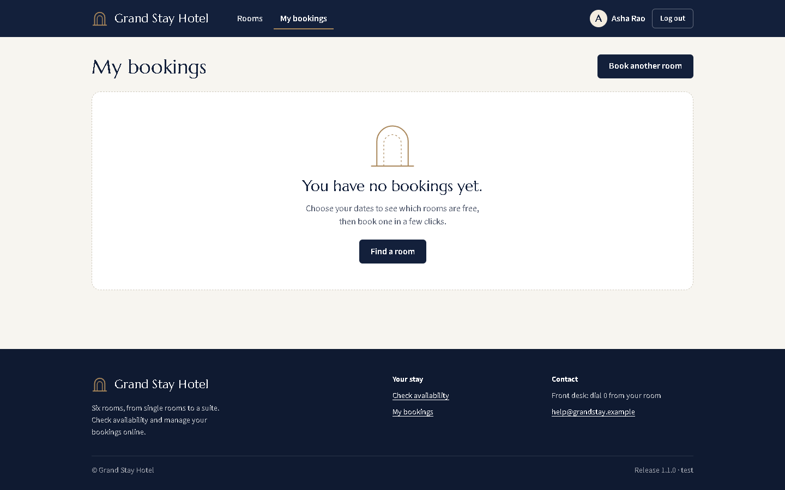

# Task 9 - Selenium Test Design and Local Execution

## A. Task title and objective

**Task 9: Selenium Test Design and Local Execution**

**Objective:** automate the most important user journeys in a real web
browser, with stable locators, explicit waits, clear assertions and isolated
test data; run them locally; produce reports and screenshots on failure.

**Professor's required deliverables**

- 3-5 meaningful Selenium journeys (register/login, availability, booking, confirmation/status, cancellation)
- Stable element selectors, explicit waits, assertions, deterministic test data
- Local execution (the brief mentions Maven - see the note below)
- Test reports and screenshots on failure
- Clean-up / isolated test database so repeated runs stay reliable

**Current status: Implemented and verified.** On 2026-10-20: **5 of 5**
journeys passed locally (Figure 9.1), the full suite of 90 tests passed
(Figure 9.2), and the screenshot-on-failure feature was demonstrated with a
temporary, deliberately failing test (Figures 9.4-9.5) that was deleted afterwards.

**Maven note:** the tests are Python and run with **pytest**, not Maven.
pytest writes the same JUnit-XML report format that Maven would, which
Jenkins displays. If running through Maven is compulsory, this must be
discussed with the professor.

## B. Explanation for a complete beginner

**An everyday picture.** A robot sits at the computer, opens Chrome, types
into the forms and clicks the buttons exactly like a guest - then checks
that the right message appears. If something is wrong it takes a photo of
the screen. That robot is **Selenium**.

| Term | Meaning | In this project |
|---|---|---|
| **Browser automation** | a program controls a real browser | headless Chrome (no window) |
| **WebDriver** | the standard interface that lets code control a browser | `selenium.webdriver.Chrome` |
| **Locator / selector** | how the test finds an element on the page | `By.ID, "booking-status"` |
| **Stable locator** | one that does not change when the design changes | element ids like `book-201`, `confirm-btn` |
| **Explicit wait** | "wait until X is visible (max 10 s)", then continue at once | `WebDriverWait(...).until(...)` |
| **Assertion** | the check that decides pass/fail | `assert status(driver) == "PENDING"` |
| **Test data** | the users, dates and bookings a test creates | unique e-mails, random far-future dates |
| **Fixture** | pytest setup code a test can request | `driver` (a browser), `base_url` (a running app) |
| **Headless** | the browser runs without a visible window | default; `HEADLESS=0` shows it |

**Why not `time.sleep(3)`?** Sleeping either wastes time (page was ready
earlier) or fails (page was slower). Explicit waits are faster and more reliable.

**Unit vs integration vs Selenium tests** (all three exist here)

| Type | What it tests | Speed | Count |
|---|---|---|---|
| Unit | one service/database rule, no web server | ms | 59 |
| Integration | real routes through Flask's test client (HTTP status, redirects, CSRF) | fast | 26 |
| Selenium (end-to-end) | a full journey in a real browser | seconds each | 5 |

## C. What was actually implemented

**Files:** `tests/e2e/test_journeys.py` (journeys and helpers) and
`tests/e2e/conftest.py` (fixtures and the failure hook).

**The five journeys** (`tests/e2e/test_journeys.py`)

| # | Test (line) | What the robot does | Key assertions |
|---|---|---|---|
| 1 | `test_journey_1_register_new_guest` (81) | registers a new guest | name in the navbar, "account has been created", now on /rooms |
| 2 | `test_journey_2_login_rejects_wrong_password_then_accepts_right_one` (89) | registers, logs out, wrong password, right password | "Invalid email or password", still logged out; then "Welcome back" |
| 3 | `test_journey_3_search_request_and_confirm_booking` (108) | searches dates, books the first free room, confirms | status PENDING with the right dates; then CONFIRMED; no second Confirm button |
| 4 | `test_journey_4_cancel_booking_and_track_status` (128) | books, confirms, cancels via the dialog, opens My bookings | dialog appears and status is still CONFIRMED until confirmed; then CANCELLED in detail and in My bookings |
| 5 | `test_journey_5_booked_room_is_unavailable_to_another_guest` (150) | guest A books a room; guest B searches the same dates | the room shows "Booked" for B and has no Book button |

**Helpers** (lines 22-75): `wait()` (explicit wait), `stay()` (dates),
`unique_email()`, `register()`, `logout()`, `search()`, `book_first_free_room()`, `status()`.

**Stable locators** - ids added to the templates for testing: `register-btn`,
`login-btn`, `nav-user`, `search-btn`, `availability-table`, `room-<number>`,
`book-<number>`, `booking-status`, `confirm-btn`, `cancel-btn`,
`cancel-confirm-btn`, `booking-row-<id>`.

**Explicit wait example** (lines 22-23):

```python
def wait(driver, condition, timeout=10):
    return WebDriverWait(driver, timeout).until(condition)   # continue as soon as true, fail after 10 s
```

**Dates are set with JavaScript** (line 60) because typing into
`<input type="date">` depends on the computer's date format (dd/mm vs mm/dd).

**Deterministic, isolated test data**

- `base_url` fixture (`conftest.py` line 26): starts the real app on a free port
  (`make_server(..., 0, ...)`, line 36) with a **throw-away SQLite database**
  in a temporary folder, deleted after the run - repeated runs never interfere.
- To test a running deployment instead, set `E2E_BASE_URL`; then the tests
  use unique e-mails (`uuid`) and random dates 200-2000 days ahead
  (`_SESSION_OFFSET`, line 17) and book whichever room is free.

**Screenshots on failure** (`conftest.py`)

1. The hook `pytest_runtest_makereport` (line 80) stores each test's result on the test item.
2. After the test, the `driver` fixture checks `rep_call.failed` (line 65).
3. If failed, `_save_failure_artifacts` (line 71) saves `reports/screenshots/<test>.png` **and** the page HTML.
4. Jenkins archives `reports/**` with the build.

**Reports:** `pytest --junitxml=reports/e2e-tests.xml` (as in the Jenkinsfile) -
JUnit XML that Jenkins shows on the *Tests* page.

## D. Screenshots and evidence



*Figure 9.1 - `pytest -m e2e -v` on 2026-10-20 (rendered from real output): 5 journeys PASSED.*
**Proves:** the journeys run locally through pytest.



*Figure 9.2 - flake8 (no findings), then unit 59, integration 26 and e2e 5 passed (rendered from real output, 2026-10-20).*



*Figure 9.3 - `tests/e2e/test_journeys.py` on GitHub (the pushed version; the local
working copy adds the confirmation-dialog step in journey 4 and the readable-date
check in journey 3, both for the uncommitted UI redesign).*
**Notice:** `By.ID` locators, the `wait()` helper, assertions.



*Figure 9.4 - A temporary, deliberately failing test run on 2026-10-20 (rendered from real output): "failure screenshot saved: reports\screenshots\...png", then `1 failed`; the folder contains a `.png` and an `.html`.*



*Figure 9.5 - The actual image saved by the hook: what the browser showed at the moment of failure.*
**Proves:** failures leave visual evidence automatically.



*Figure 9.6 - The empty "My bookings" state (redesigned UI) - one of the pages the journeys navigate.*

## E. How to demonstrate this task to the professor (about 4 minutes)

**Before the demo:** Google Chrome installed; PowerShell in `D:\DevOPS\CICD_FOR_HOTEL_ROOM_BOOKING`.

1. Open `tests/e2e/test_journeys.py` in VS Code; show journey 3 and the `wait()` helper.
   *Say:* "Locators use ids; waits are explicit; each journey ends with assertions."
2. **Run the journeys and let the professor watch the browser:**
   ```powershell
   $env:HEADLESS="0"
   .venv\Scripts\python -m pytest -m e2e -v
   Remove-Item Env:HEADLESS
   ```
   *Expected:* Chrome windows open and click through the pages; finally `5 passed, 85 deselected` (about 30 s).
3. **Produce a JUnit report:**
   ```powershell
   .venv\Scripts\python -m pytest -m e2e --junitxml=reports/e2e-tests.xml -q
   ```
   Open `reports\e2e-tests.xml` - one `<testcase>` per journey.
4. **Explain isolation:** "Each run starts the app with a brand-new temporary
   database, so runs never depend on each other."
5. **Screenshots on failure:** show Figure 9.5, or point to `conftest.py`
   lines 65-76 and *say:* "When a journey fails, a screenshot and the HTML are saved and archived by Jenkins."
6. **Against a running deployment** (optional, staging must be up):
   ```powershell
   $env:E2E_BASE_URL="http://localhost:8081"
   .venv\Scripts\python -m pytest -m e2e -q
   Remove-Item Env:E2E_BASE_URL
   ```
   Note: staging currently runs the committed v1.1.0 interface, while the
   local tests expect the redesigned one (dialog, readable dates), so
   journeys 3 and 4 fail there (checked 2026-10-20: 3 passed, 2 failed) until
   the redesign is deployed. Test the
   deployment with the tests of the same version.

**Recovery:** `SessionNotCreatedException` - update Chrome (Selenium
downloads the matching driver automatically). Tests hang on first run -
Selenium Manager is downloading chromedriver; wait once.

## F. Expected screenshots for the final submission

1. `assets/task-09/selenium-run.png` - **exists, 2026-10-20**.
2. `assets/task-09/full-test-suite.png` - **exists, 2026-10-20**.
3. `assets/task-09/github-file-tests_e2e_test_journeys.py.png` - **exists, 2026-10-20**.
4. `assets/task-09/selenium-failure-demo-output.png` - **exists, 2026-10-20**.
5. `assets/task-09/selenium-failure-screenshot-saved-by-hook.png` - **exists, 2026-10-20**.
6. `assets/task-09/app-desktop-07-my-bookings-empty.png` - **exists, 2026-10-20**.
7. (optional) a photo/screen recording of the visible browser run with `HEADLESS=0` - **requires manual capture** (it is a live demo).

## G. Probable viva questions and answers

1. **What is Selenium WebDriver?** A library and protocol that lets code control a real browser - open pages, type, click, read text.
2. **Which journeys did you automate and why?** Register; wrong-then-right
   login; search-book-confirm; cancel and track status; a booked room is
   unavailable to another guest - the six MVP workflows end to end.
3. **What is an explicit wait?** Waiting for a condition (e.g. element
   visible) up to a timeout, continuing as soon as it is true. Better than `sleep`.
4. **Why ids as locators?** They are unique and do not change when layout or
   styling changes; the UI redesign kept them, so the tests still passed.
5. **How do you keep test data from interfering?** Each local run uses a new
   temporary database; against deployments, unique e-mails and random future dates.
6. **How do screenshots on failure work?** A pytest hook records the result;
   the browser fixture saves a PNG and the HTML if the test failed.
7. **(Project-specific) Why are dates set with JavaScript?** Typing into a
   date input depends on the OS date format; setting `value` is identical everywhere.
8. **(Project-specific) What changed in the tests for the UI redesign?**
   Journey 4 now confirms the cancel dialog; journey 3 reads the ISO date from
   the `datetime` attribute and checks the readable text. Both still assert the same behaviour.
9. **Unit vs integration vs Selenium?** Unit: one rule, no server. Integration:
   real HTTP routes in-process. Selenium: the full journey in a browser.
10. **Do you run Selenium through Maven?** No - through pytest. It produces JUnit
    XML like Maven's Surefire would. Confirm with the professor if Maven is mandatory.
11. **How does Jenkins run a browser without a screen?** Headless Chromium inside the Jenkins container (`CHROME_BIN`, `CHROMEDRIVER` set in its Dockerfile).

## H. Common mistakes and troubleshooting

| Symptom | Cause | Inspect | Fix | Confirm |
|---|---|---|---|---|
| `SessionNotCreatedException` | Chrome/driver mismatch or no Chrome | Chrome version | update Chrome | journeys start |
| `TimeoutException` waiting for `nav-user` | page layout changed or app error | `reports/screenshots/*.png` | look at the screenshot; fix the page or locator | test passes |
| Journeys 3/4 fail against staging | staging runs an older UI than the local tests expect | `/health` version | run the matching version's tests, or deploy the new UI | 5 passed |
| Tests pass alone but fail together | shared data | `base_url` fixture | keep the throw-away DB; use unique data | repeated runs pass |
| Date typed wrongly | locale-dependent typing | `search()` helper | use the JavaScript value setter | correct dates shown |

## I. Quick revision notes

**Five key points**

1. 5 journeys covering all 6 MVP workflows, in `tests/e2e/test_journeys.py`.
2. Stable `By.ID` locators + explicit `WebDriverWait` waits + clear assertions.
3. Isolated data: a temporary database per run; unique e-mails and dates.
4. Failure -> PNG + HTML in `reports/screenshots/` (demonstrated 2026-10-20).
5. Runs through pytest (JUnit XML), locally and in Jenkins; not Maven.

**30-60 second explanation**
"Selenium drives a real Chrome browser through five journeys: registering,
logging in with a wrong and then right password, searching and booking a room
and confirming it, cancelling it and checking My bookings, and making sure a
booked room is not offered to another guest. The tests find elements by id,
wait explicitly, and assert the visible result. Each run starts the app with
a fresh temporary database, so results are repeatable. If a journey fails, a
screenshot and the page HTML are saved, and Jenkins keeps them. Today all
five passed."

**Caveat:** pytest, not Maven, runs the tests.

**Readiness checklist**
- [ ] I can run the journeys with `HEADLESS=0` so the browser is visible.
- [ ] I can explain explicit waits and stable locators with code on screen.
- [ ] I can show a failure screenshot (Figure 9.5).
- [ ] I can explain the three test levels.
