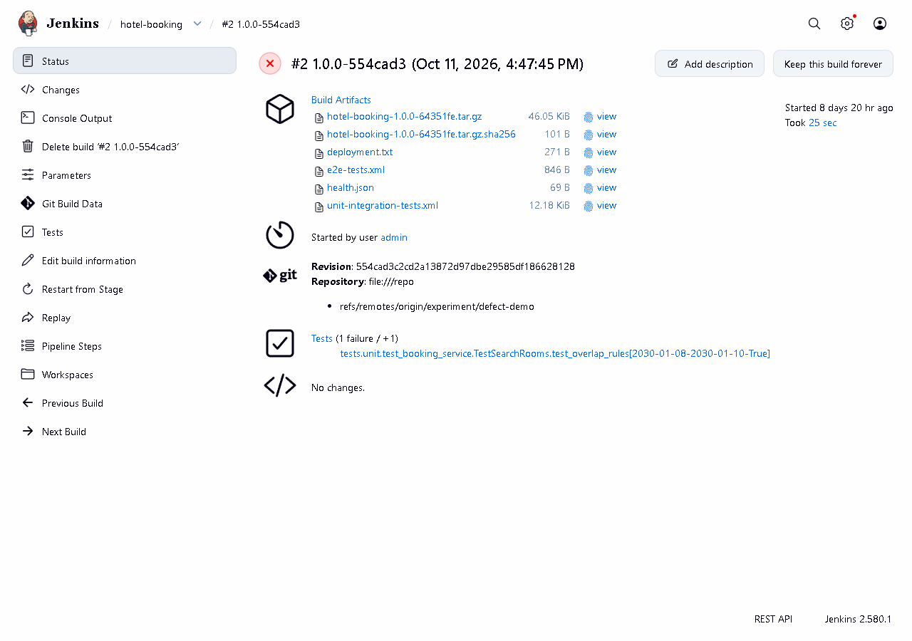
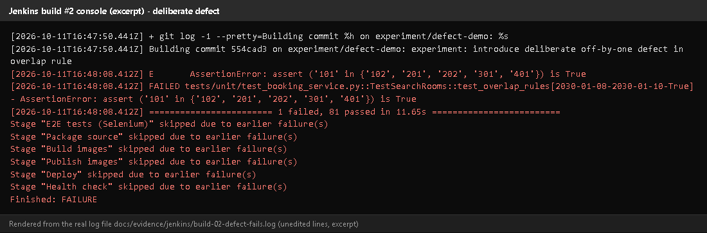
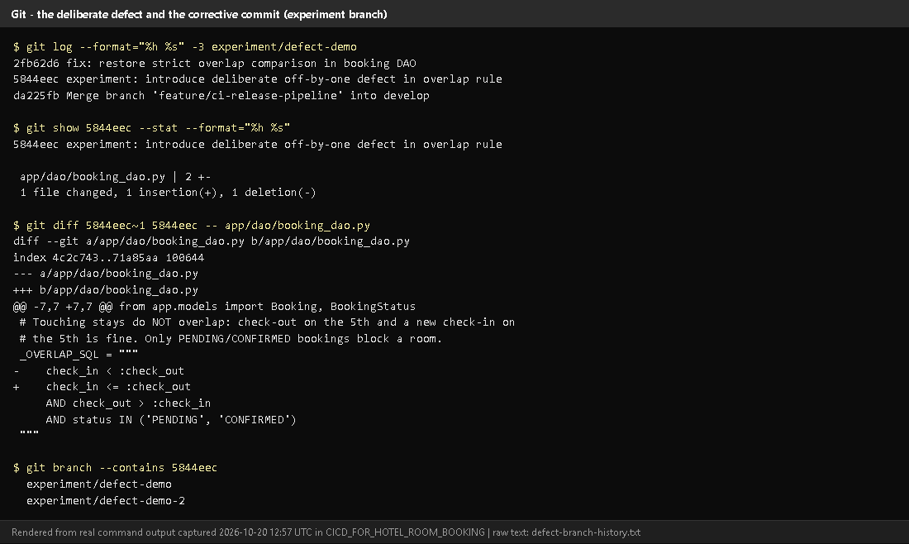
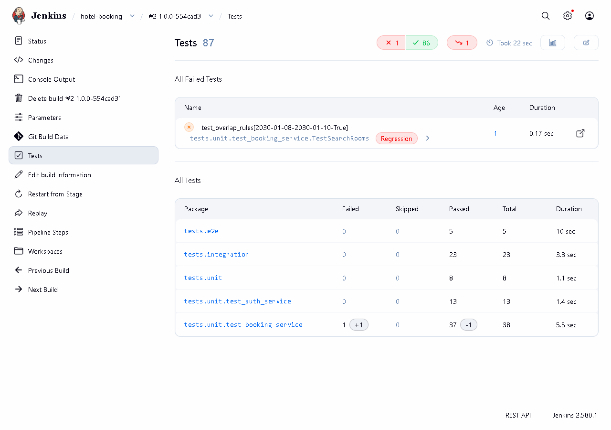
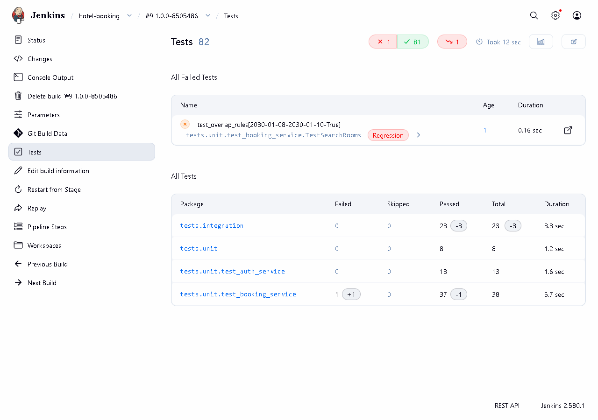
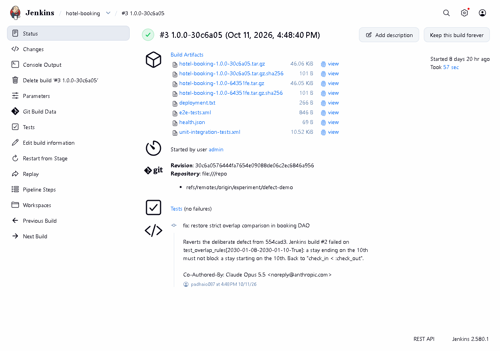
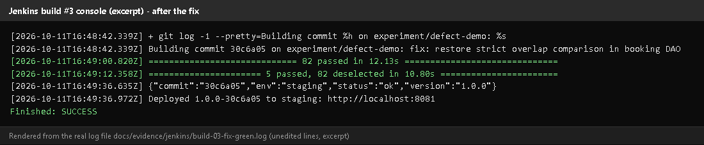
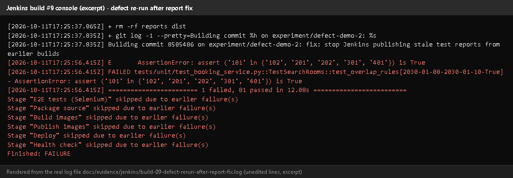

# Task 10 - Continuous Testing in Jenkins

## A. Task title and objective

**Task 10: Continuous Testing in Jenkins**

**Objective:** run all automated tests (backend and Selenium) inside the
pipeline, publish their reports, and make test failures **stop the
deployment** - then prove it with a deliberately introduced defect, a
corrective commit and a successful re-run.

**Professor's required deliverables**

- Backend and Selenium tests integrated into the pipeline
- Test report publication
- Failure propagation and a quality gate that blocks deployment
- A documented, deliberately introduced defect (on a disposable branch)
- Evidence the defect causes a test failure
- A corrective commit and a successful re-run

**Current status: Implemented and verified.** The experiment was run on
2026-10-11 (builds #2, #3, #9). On 2026-10-20 the build records were checked
again directly in Jenkins (Figures 10.1-10.5), and today's build #11 again
ran all 90 tests before deploying.

## B. Explanation for a complete beginner

**An everyday picture.** At an airport, a plane cannot take off until the
safety checklist is complete. If one check fails, the plane stays at the gate
- nobody "takes off anyway". A **quality gate** is that rule for software:
if any test fails, the new version is not deployed.

| Term | Meaning | In this project |
|---|---|---|
| **Continuous testing** | every build automatically runs the tests | every Jenkins build runs flake8 + 90 tests |
| **Quality gate** | a condition that must pass before the next step | test stages come before Deploy |
| **Failure propagation** | a failure travels up and marks the whole build failed | pytest exit code != 0 -> stage fails -> build FAILURE |
| **Skipped stage** | Jenkins does not run later stages after a failure | "Stage 'Deploy' skipped due to earlier failure(s)" |
| **Regression** | a test that passed before now fails | Jenkins labels it *Regression* |
| **Defect experiment** | breaking the code on purpose to prove the tests notice | an off-by-one bug in the overlap rule |
| **Disposable branch** | a branch for an experiment that is never merged | `experiment/defect-demo` |

**Build failure vs deployment failure.** A *build failure* means the pipeline
stopped before deploying (e.g. a test failed) - users are not affected. A
*deployment failure* means the new version was started but is unhealthy -
that is what the health check and rollback are for.

## C. What was actually implemented

**How tests stop the pipeline** - each test stage is a shell command; pytest
exits with a non-zero code when any test fails, so Jenkins marks the stage
failed and skips every later stage:

```groovy
stage('Unit & integration tests') {
    steps { sh '.venv/bin/pytest tests/unit tests/integration --junitxml=reports/unit-integration-tests.xml' }
}
stage('E2E tests (Selenium)') {
    steps { sh '.venv/bin/pytest -m e2e --junitxml=reports/e2e-tests.xml' }
}
// ... Package, Build images, Publish, Deploy, Health check come only after these
post { always { junit allowEmptyResults: true, testResults: 'reports/*.xml' } }
```

**The deliberate-defect experiment** (branch `experiment/defect-demo`, never
merged into `develop` or `main` - `git branch --contains 5844eec` lists only the two experiment branches)

| Step | Commit (current / original ID in logs) | What happened |
|---|---|---|
| Baseline | - | staging ran `1.0.0-64351fe` (build #1) |
| 1. Defect | `5844eec` / `554cad3` | in `app/dao/booking_dao.py` the rule `check_in < :check_out` became `check_in <= :check_out` - an off-by-one that wrongly blocks a guest from arriving on the day the previous guest leaves |
| 2. Build #2 | FAILURE | `FAILED ...TestSearchRooms::test_overlap_rules[2030-01-08-2030-01-10-True]`, `1 failed, 81 passed`; E2E, Package, Build images, Publish, Deploy, Health check **skipped**; staging still answered `"commit":"64351fe"` |
| 3. Fix | `2fb62d6` / `30c6a05` | `fix: restore strict overlap comparison in booking DAO` |
| 4. Build #3 | SUCCESS | 87/87 tests; staging moved to `1.0.0-30c6a05` |

The diff of the defect (Figure 10.3):

```diff
 _OVERLAP_SQL = """
-    check_in < :check_out
+    check_in <= :check_out
     AND check_out > :check_in
```

**The stale-report bug (found from the evidence, fixed, re-verified)**

- Build #2's Tests page lists **`tests.e2e`: 5 passed** although its E2E stage
  was skipped (Figure 10.4). Cause: Jenkins reuses its workspace, and
  `reports/e2e-tests.xml` from build #1 was still there, so `junit 'reports/*.xml'` published it again.
- Fix on branch `fix/jenkins-stale-reports`: the Checkout stage now runs
  `rm -rf reports dist` before anything else.
- Proof: build #9 (`experiment/defect-demo-2` = the same defect + the fix,
  current commit `a3d8626`, shown in Jenkins as `8505486`) failed on the same
  test and its report lists **82 tests and no e2e package** - only the tests that actually ran (Figure 10.5).
- Every later build (including #11 today) starts with `+ rm -rf reports dist`,
  so a report can never come from an older build.

## D. Screenshots and evidence



*Figure 10.1 - Build #2 `1.0.0-554cad3` in Jenkins (checked 2026-10-20): result FAILURE.*



*Figure 10.2 - Console excerpt of build #2 (rendered from the saved log `docs/evidence/jenkins/build-02-defect-fails.log`).*
**Notice:** the failing assertion, `1 failed, 81 passed`, and six "skipped due to earlier failure(s)" lines including Deploy.
**Proves:** the quality gate stopped the deployment.



*Figure 10.3 - The experiment branch history, the one-character diff, and the branches that contain the defect (rendered from real output, 2026-10-20).*



*Figure 10.4 - Build #2's Tests page: 1 failed (`test_overlap_rules[...-True]`, marked Regression). Also notice `tests.e2e 5` - the stale report described above.*



*Figure 10.5 - Build #9 after the report fix: 82 tests, 1 failed, and no `tests.e2e` entry.*
**Proves:** the current build's report cannot reuse an older build's results.



*Figure 10.6 - Build #3 `1.0.0-30c6a05`: SUCCESS after the corrective commit.*



*Figure 10.7 - Build #3 console excerpt (rendered from the saved log): tests passed, deployed, health check OK.*



*Figure 10.8 - Build #9 console excerpt: `+ rm -rf reports dist`, the same failing test, later stages skipped.*

## E. How to demonstrate this task to the professor (about 5 minutes)

**Option A - show the recorded experiment (safe, 2 minutes).**

1. Jenkins -> *hotel-booking*: point at red builds #2 and #9 in the stage view.
2. Open **#2 -> Console Output**, Ctrl+F `skipped due` - *Say:* "The test failed,
   so Jenkins skipped packaging and deployment."
3. Open **#2 -> Tests** - the failed overlap test.
4. Open **#3** - green after the fix.
5. In PowerShell (project folder):
   ```powershell
   git log --oneline -3 experiment/defect-demo
   git diff 5844eec~1 5844eec -- app/dao/booking_dao.py
   ```
   *Say:* "One character, `<` to `<=`, and the tests caught it."

**Option B - repeat the experiment live (about 6 minutes, disposable branch).**
Warning: do this only on an `experiment/*` branch; never merge it.

```powershell
git stash -u                      # only if you have uncommitted work (today: the UI redesign)
git checkout -b experiment/live-defect develop
```

Edit `app/dao/booking_dao.py` line 10: change `check_in < :check_out` to
`check_in <= :check_out`, save.

```powershell
git commit -am "experiment: deliberate off-by-one defect (live demo)"
```

Jenkins -> *Build with Parameters* -> `BRANCH = experiment/live-defect`,
`APP_ENV = staging` -> Build. *Expected:* red at "Unit & integration tests",
later stages "skipped". Check http://localhost:8081/health - the commit is
unchanged (not deployed). Then fix and re-run:

```powershell
git revert --no-edit HEAD
```

Build the same branch again - *Expected:* all green, staging shows the new
commit. Clean up:

```powershell
git checkout feature/ui-redesign  # or the branch you were on
git stash pop                     # only if you stashed
git branch -D experiment/live-defect
```

## F. Expected screenshots for the final submission

1. `assets/task-10/jenkins-build-02-failed.png` - **exists, 2026-10-20**.
2. `assets/task-10/build-02-defect-console.png` - **exists** (rendered from the 2026-10-11 log).
3. `assets/task-10/defect-branch-history.png` - **exists, 2026-10-20**.
4. `assets/task-10/jenkins-build-02-failed-test.png` - **exists, 2026-10-20**.
5. `assets/task-10/jenkins-build-09-tests-no-stale-report.png` - **exists, 2026-10-20**.
6. `assets/task-10/jenkins-build-03-fixed.png` - **exists, 2026-10-20**.
7. `assets/task-10/build-03-fix-console.png` - **exists** (rendered from the 2026-10-11 log).
8. `assets/task-10/build-09-rerun-console.png` - **exists** (rendered from the 2026-10-11 log).

## G. Probable viva questions and answers

1. **What is a quality gate?** A check that must pass before the pipeline continues - here all lint and tests before Deploy.
2. **How does a failed test stop deployment?** pytest exits non-zero, the
   `sh` step fails, the stage fails and Jenkins skips all later stages.
3. **What defect did you introduce?** `<` became `<=` in the overlap SQL,
   blocking back-to-back stays (check-out day = next check-in day).
4. **Which test caught it?** `TestSearchRooms::test_overlap_rules[2030-01-08-2030-01-10-True]` - a stay ending on the 10th must not block one starting on the 10th.
5. **How do you know it wasn't deployed?** The log shows Deploy skipped, and
   staging's `/health` still reported the previous commit `64351fe`.
6. **Why on an experiment branch?** So the defect never reaches `develop` or
   `main`; `git branch --contains 5844eec` lists only experiment branches.
7. **(Project-specific) What was the stale-report problem?** Build #2's
   report showed 5 E2E tests passing although that stage never ran - an old
   XML file in the reused workspace. Fixed by deleting `reports/` and `dist/` at checkout; build #9 proves it.
8. **(Project-specific) Why do the IDs in Jenkins (`554cad3`) differ from Git (`5844eec`)?**
   Commit messages were edited once before publishing, which changed all IDs;
   see `docs/evidence/git/commit-id-map.md`.
9. **Build failure vs deployment failure?** Build failure: stopped before
   deploying (users unaffected). Deployment failure: the new version started
   but is unhealthy - caught by `--wait` and the health check, fixed by rollback.
10. **Do Selenium tests also gate the deploy?** Yes - the E2E stage comes before Package/Deploy.
11. **Why publish reports even when the build fails?** `post { always }` runs
    on failure too, so you can see *which* test failed.

## H. Common mistakes and troubleshooting

| Symptom | Cause | Inspect | Fix | Confirm |
|---|---|---|---|---|
| Report shows tests from an earlier build | stale XML in workspace | Checkout stage in the console | ensure `rm -rf reports dist` is present (it is since the fix) | report count = tests actually run |
| Defect build is green | defect not committed, or wrong branch built | console "Building commit ..." | commit and set `BRANCH` correctly | red stage |
| Experiment merged by accident | merged into develop | `git branch --contains <defect id>` | `git revert` the merge on develop | tests pass |
| `git checkout` refuses | uncommitted work | `git status` | `git stash -u` / `git stash pop` | branch switched |

## I. Quick revision notes

**Five key points**

1. Every build runs flake8 + 85 unit/integration + 5 Selenium tests before deploying.
2. A failing test -> stage fails -> later stages (incl. Deploy) skipped.
3. Defect `<` -> `<=` (commit `5844eec`) failed build #2; fix `2fb62d6` made build #3 green.
4. Staging kept the old version during the failed build.
5. Stale-report bug found, fixed (`rm -rf reports dist`), proven by build #9.

**30-60 second explanation**
"Tests are the quality gate of our pipeline: Jenkins runs lint, unit,
integration and Selenium tests, and only if all pass does it package and
deploy. To prove it I introduced a one-character bug on an experiment branch,
changing `<` to `<=` in the overlap rule. Build #2 failed on the overlap
test, every later stage was skipped, and staging kept the previous version.
A corrective commit made build #3 green. I also found that build #2's report
reused an old Selenium result; I fixed that, and build #9 proves reports now
only contain tests that really ran."

**Caveat:** the experiment ran on 2026-10-11; on 2026-10-20 its records were re-checked, not re-run (Option B shows how to re-run it).

**Readiness checklist**
- [ ] I can open builds #2, #3, #9 and explain each.
- [ ] I can show the one-line diff.
- [ ] I can explain the stale-report fix.
- [ ] I know how to repeat the experiment safely on an experiment branch.
