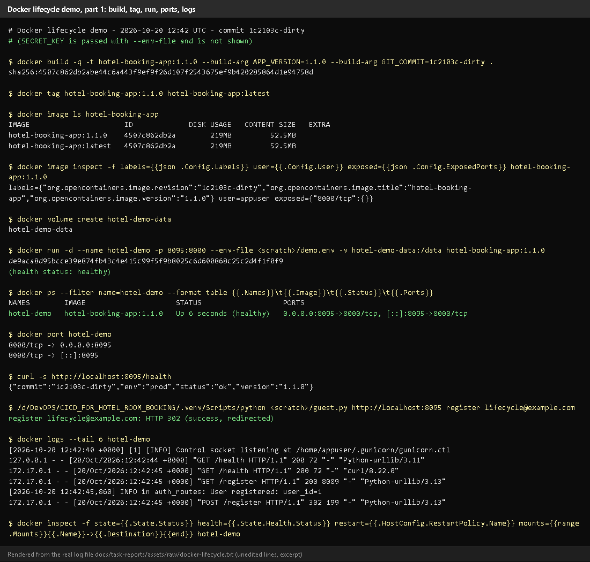
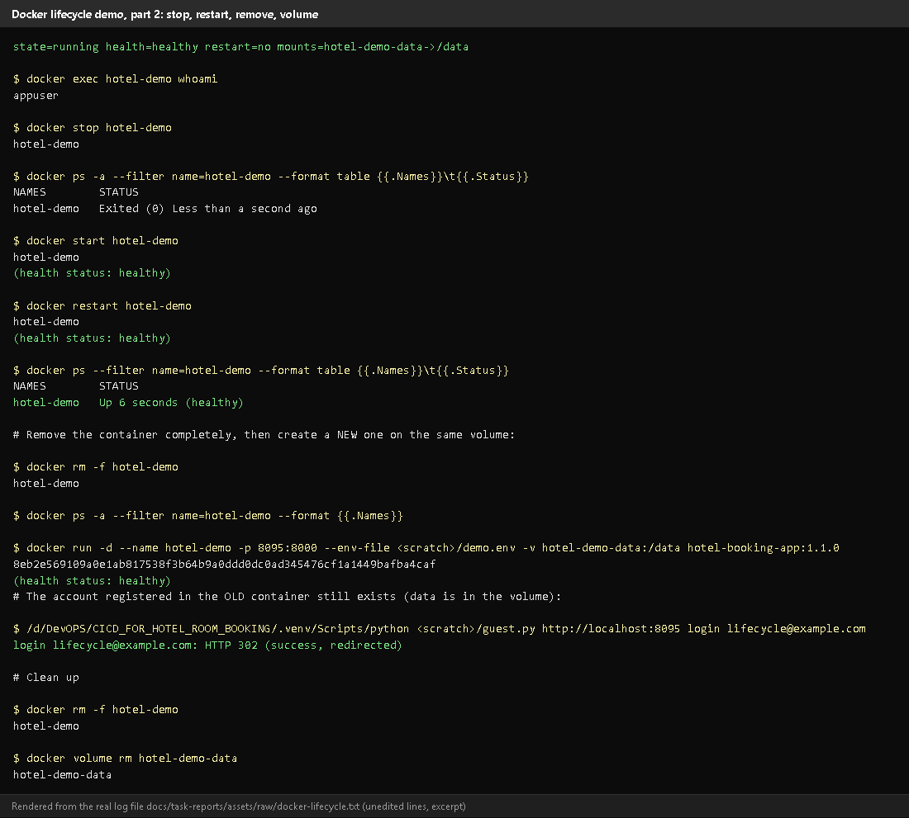
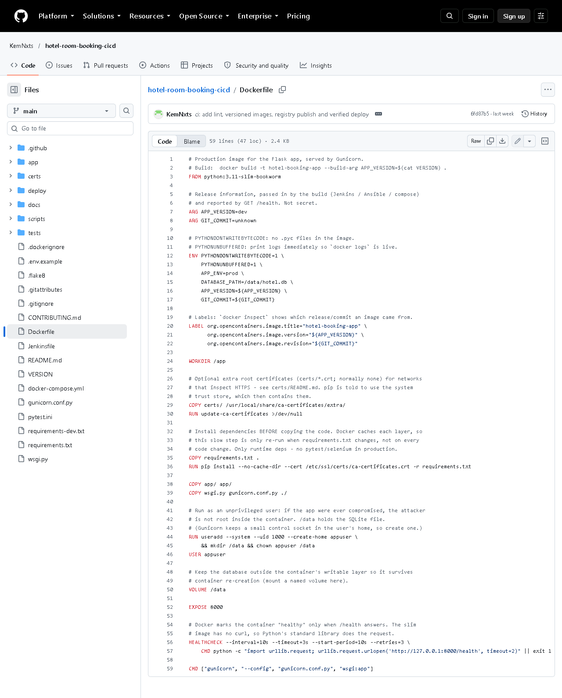
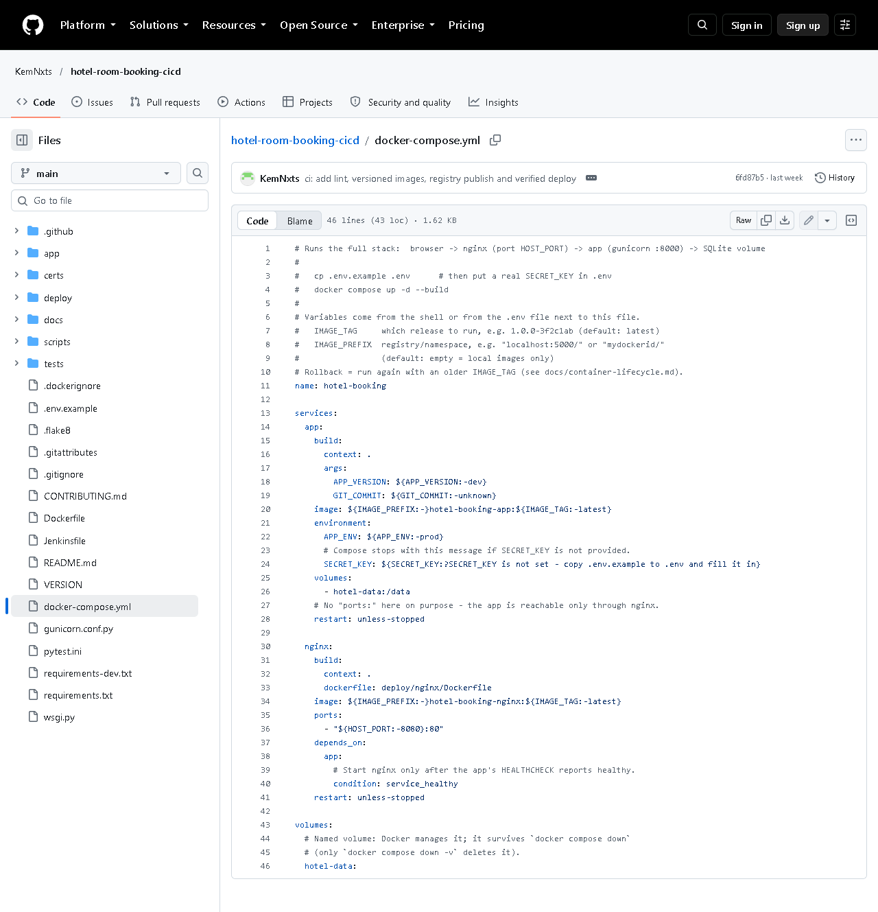
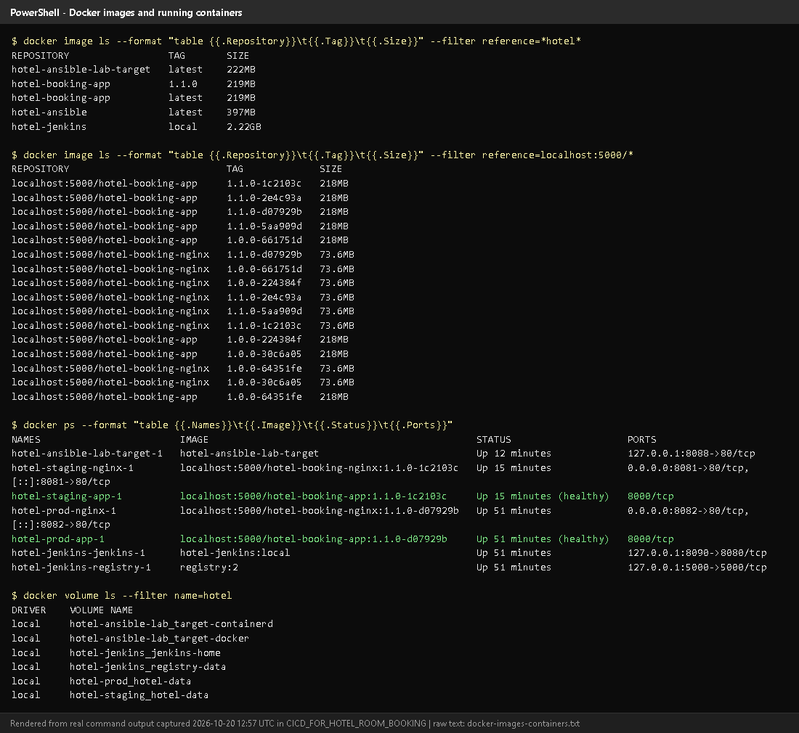

# Task 11 - Docker Image and Container Lifecycle

## A. Task title and objective

**Task 11: Docker Image and Container Lifecycle**

**Objective:** package the Flask application into a Docker image that runs
with a production server, as a non-root user, configured by environment
variables and without secrets inside; then demonstrate the full life of a
container: build, tag, run, port mapping, logs, inspection, stop, restart,
removal and persistent data.

**Professor's required deliverables**

- Dockerfile with a suitable Python base image, reproducible dependency install, production WSGI server, exposed and mapped port, non-root user, environment-variable configuration, no baked-in secrets, `.dockerignore`, a health check
- Demonstration of build and tag, create and run, port mapping, logs and inspection, stop / restart / remove, persistent database storage
- Proof that the container actually starts and serves requests

**Current status: Implemented and verified.** The complete lifecycle was
run again on 2026-10-20 (Figures 11.1-11.2): the container became healthy,
answered on the mapped port, ran as `appuser`, and an account created in one
container still worked in a **new** container using the same volume.

## B. Explanation for a complete beginner

**An everyday picture.** A shipping container holds goods in a standard box
that fits every ship, train and truck. A **Docker container** holds an
application plus everything it needs (Python, libraries, settings) in a
standard box that runs the same on any machine with Docker - "it works on my
machine" stops being a problem.

| Term | Plain meaning | In this project |
|---|---|---|
| **Dockerfile** | the recipe for building an image | `Dockerfile` (app), `deploy/nginx/Dockerfile` |
| **Image** | a read-only package built from the recipe (like a class / a template) | `hotel-booking-app:1.1.0` |
| **Container** | a running instance of an image (like an object) | `hotel-demo`, `hotel-prod-app-1` |
| **Tag** | the name:version label of an image | `1.1.0`, `latest`, `1.1.0-1c2103c` |
| **Port mapping** | connect a port on your computer to a port inside the container | `-p 8095:8000` |
| **Volume** | storage managed by Docker that lives outside containers | `hotel-demo-data` / `hotel-data` mounted at `/data` |
| **Logs** | what the app prints, collected by Docker | `docker logs` |
| **Inspect** | detailed JSON description of a container/image | `docker inspect` |
| **Health check** | a command Docker runs regularly to ask "are you OK?" | `GET /health` every 10 s |
| **Docker Compose** | starts several containers together from one file | `docker-compose.yml`: nginx + app + volume |

**Why can data survive deleting a container?** A container's own file
system disappears with it. Our SQLite file lives at `/data/hotel.db`, and
`/data` is a **volume**, which Docker keeps until you delete the volume itself.
A new container that mounts the same volume sees the same data.

**Lifecycle states:** created -> running -> (stopped = exited) -> running
again -> removed. Health status: starting -> healthy (or unhealthy).

## C. What was actually implemented

**`Dockerfile` (application image)** - key lines:

| Line | Instruction | Why |
|---|---|---|
| 3 | `FROM python:3.11-slim-bookworm` | small official Python image, same Python as the pipeline |
| 7-8 | `ARG APP_VERSION`, `ARG GIT_COMMIT` | release info, shown by `/health` and as image labels |
| 12-17 | `ENV APP_ENV=prod`, `DATABASE_PATH=/data/hotel.db` ... | configuration by environment variables |
| 20-22 | `LABEL org.opencontainers.image.version / revision` | `docker inspect` shows which release and commit an image came from |
| 29 | `COPY certs/ ...` + `update-ca-certificates` | optional extra root CAs (antivirus HTTPS scanning); folder normally empty |
| 35-36 | `COPY requirements.txt` then `RUN pip install --no-cache-dir ...` | pinned dependencies; copied **before** the code so this slow layer is cached |
| 38-39 | `COPY app/ ...`, `COPY wsgi.py gunicorn.conf.py` | the application |
| 44-46 | `useradd ... appuser`, `USER appuser` | not root inside the container |
| 50 | `VOLUME /data` | the database lives on a volume |
| 52 | `EXPOSE 8000` | Gunicorn's port |
| 56-57 | `HEALTHCHECK ... urllib.request.urlopen('http://127.0.0.1:8000/health')` | Docker knows when the app is really ready |
| 59 | `CMD ["gunicorn", "--config", "gunicorn.conf.py", "wsgi:app"]` | production WSGI server (2 workers) |

**No secrets in the image:** `SECRET_KEY` is given at run time (`-e` or
`--env-file`); the app refuses to start in prod without it.
**`.dockerignore`** excludes `.git`, `.venv`, `tests`, `docs`, `deploy/ansible`,
`deploy/jenkins`, `*.md`, `.env` and `*.db`.

**`docker-compose.yml`** - two services: `app` (image
`${IMAGE_PREFIX}hotel-booking-app:${IMAGE_TAG}`, volume `hotel-data:/data`,
no published port) and `nginx` (reverse proxy, published on
`${HOST_PORT:-8080}:80`, starts only when the app is `service_healthy`); both
`restart: unless-stopped`. The Nginx image (`deploy/nginx/Dockerfile`) bakes
in `hotel.conf` and serves `/static/` directly.

**Lifecycle demo run on 2026-10-20** (raw output: `assets/raw/docker-lifecycle.txt`):

| Step | Command (shortened) | Observed |
|---|---|---|
| build | `docker build -t hotel-booking-app:1.1.0 --build-arg APP_VERSION=1.1.0 --build-arg GIT_COMMIT=1c2103c-dirty .` | image built |
| tag | `docker tag hotel-booking-app:1.1.0 hotel-booking-app:latest` | two tags, same image ID |
| inspect image | `docker image inspect -f '...'` | labels version/revision, `user=appuser`, `exposed 8000/tcp` |
| volume | `docker volume create hotel-demo-data` | created |
| run | `docker run -d --name hotel-demo -p 8095:8000 --env-file ... -v hotel-demo-data:/data hotel-booking-app:1.1.0` | `Up (healthy)`, `0.0.0.0:8095->8000/tcp` |
| request | `curl -s http://localhost:8095/health` | `{"commit":"1c2103c-dirty","env":"prod","status":"ok","version":"1.1.0"}` |
| use | register a guest over HTTP | `HTTP 302` (success) |
| logs | `docker logs --tail 6 hotel-demo` | Gunicorn start, health checks, `POST /register 302` |
| inspect | `docker inspect -f 'state=... health=... mounts=...'` | `running`, `healthy`, `hotel-demo-data->/data` |
| user | `docker exec hotel-demo whoami` | `appuser` |
| stop | `docker stop hotel-demo` | `Exited (0)` |
| start / restart | `docker start`, `docker restart` | healthy again |
| remove | `docker rm -f hotel-demo` | gone |
| new container | same `docker run` on the same volume | healthy |
| data survived | log in with the account from the first container | `HTTP 302` (success) |
| clean up | `docker rm -f`, `docker volume rm` | removed |

(`-dirty` in the commit label means the image was built from a working tree
with uncommitted changes - the UI redesign - and is honest about it.)

## D. Screenshots and evidence



*Figure 11.1 - Lifecycle demo, part 1: build, tag, image labels/user/port, volume, run, `docker ps` with port mapping, `/health`, registration, logs (rendered from the real run on 2026-10-20).*



*Figure 11.2 - Part 2: inspect, `whoami` = appuser, stop -> Exited, start, restart, remove, a new container on the same volume, the old account still logs in, clean-up.*
**Proves:** every lifecycle operation, and persistence through a volume.



*Figure 11.3 - `Dockerfile` on GitHub.* **Notice:** slim base, dependencies before code, `USER appuser`, `VOLUME`, `EXPOSE`, `HEALTHCHECK`, Gunicorn `CMD`.



*Figure 11.4 - `docker-compose.yml`: app + nginx, named volume, `service_healthy` dependency, `SECRET_KEY` required.*



*Figure 11.5 - `docker image ls`, `docker ps` and `docker volume ls` on 2026-10-20 (rendered from real output): versioned images, the running staging/prod/Jenkins/lab containers and the data volumes.*

## E. How to demonstrate this task to the professor (about 5 minutes)

**Before the demo:** Docker Desktop running. PowerShell in
`D:\DevOPS\CICD_FOR_HOTEL_ROOM_BOOKING`. These exact commands were run on 2026-10-20.

```powershell
# 1. build and tag the image
docker build -t hotel-booking-app:demo --build-arg APP_VERSION=1.1.0 .
docker image ls hotel-booking-app

# 2. create a volume and run a container with a port mapping
docker volume create hotel-demo-data
docker run -d --name hotel-demo -p 8095:8000 -e SECRET_KEY=demo-only-secret-123 -v hotel-demo-data:/data hotel-booking-app:demo
docker ps --filter name=hotel-demo
```

*Expected:* status `Up ... (healthy)` after ~10 s and `0.0.0.0:8095->8000/tcp`.
*Say:* "Port 8095 on my laptop is mapped to port 8000 inside the container."

```powershell
# 3. it serves requests
curl.exe -s http://localhost:8095/health
```

Open http://localhost:8095/register in the browser and create an account.

```powershell
# 4. logs and inspection
docker logs --tail 5 hotel-demo
docker inspect -f "{{.State.Health.Status}}" hotel-demo
docker exec hotel-demo whoami

# 5. stop, start, restart
docker stop hotel-demo
docker ps -a --filter name=hotel-demo
docker start hotel-demo
docker restart hotel-demo

# 6. remove the container, start a NEW one on the same volume
docker rm -f hotel-demo
docker run -d --name hotel-demo -p 8095:8000 -e SECRET_KEY=demo-only-secret-123 -v hotel-demo-data:/data hotel-booking-app:demo
```

Log in at http://localhost:8095/login with the account from step 3.
*Say:* "The container was deleted, but the database is on a volume, so the
account still exists." (Use the same `SECRET_KEY` - a different one only logs existing sessions out; the account stays.)

```powershell
# 7. clean up
docker rm -f hotel-demo
docker volume rm hotel-demo-data
docker image rm hotel-booking-app:demo
```

**Notes:** in PowerShell use `curl.exe` (plain `curl` is a different
PowerShell command). `-e SECRET_KEY=...` here is a throw-away demo value; real
deployments take it from `.env` or Jenkins credentials.

**Recovery:** "port is already allocated" - choose another port, e.g.
`-p 8096:8000`. "Conflict. The container name is already in use" -
`docker rm -f hotel-demo`. Build fails with `CERTIFICATE_VERIFY_FAILED` -
antivirus HTTPS scanning; see `certs/README.md`.

## F. Expected screenshots for the final submission

1. `assets/task-11/lifecycle-part1-build-run.png` - **exists, 2026-10-20** (rendered from the real run).
2. `assets/task-11/lifecycle-part2-stop-restart-volume.png` - **exists, 2026-10-20**.
3. `assets/task-11/github-file-Dockerfile.png` - **exists, 2026-10-20**.
4. `assets/task-11/github-file-docker-compose.yml.png` - **exists, 2026-10-20**.
5. `assets/task-11/docker-images-containers.png` - **exists, 2026-10-20**.
6. Earlier lifecycle evidence (2026-10-11): `docs/evidence/docker/lifecycle.txt` - **exists**.

## G. Probable viva questions and answers

1. **Image vs container?** An image is the read-only package; a container is a running instance of it. Many containers can run from one image.
2. **Why copy `requirements.txt` before the code?** Docker caches each layer;
   dependencies are reinstalled only when `requirements.txt` changes, not on every code change.
3. **Why a non-root user?** If the app were compromised, the attacker would not be root inside the container (`whoami` shows `appuser`).
4. **How is the app configured?** Environment variables (`APP_ENV`,
   `SECRET_KEY`, `DATABASE_PATH`...); no secrets are in the image.
5. **What does the HEALTHCHECK do?** Every 10 s it requests `/health`; Docker
   marks the container healthy/unhealthy, and compose starts Nginx only when the app is healthy.
6. **What is port mapping?** `-p 8095:8000` connects port 8095 on the host to 8000 in the container.
7. **(Project-specific) How did you prove data persistence?** I created an
   account, deleted the container, started a new one on the same volume and
   logged in with that account - HTTP 302 success (2026-10-20).
8. **(Project-specific) Why Gunicorn and Nginx?** Gunicorn runs the Python app
   with several workers; Nginx is the only public entry point and serves CSS
   directly. The app port isn't even published in compose.
9. **What does `.dockerignore` do?** Keeps files like `.git`, `.venv`, tests,
   docs and `.env` out of the build context - smaller images, no secrets.
10. **`docker stop` vs `docker rm`?** Stop ends the process (container still
    exists, can start again); rm deletes the container (volume kept).
11. **What happens to data with `docker compose down -v`?** `-v` also deletes the volume - the database is lost. Plain `down` keeps it.

## H. Common mistakes and troubleshooting

| Symptom | Cause | Inspect | Fix | Confirm |
|---|---|---|---|---|
| `failed to connect to the docker API` | Docker Desktop not running | Docker Desktop window | start it, wait for "Engine running" | `docker ps` works |
| Container exits immediately | missing `SECRET_KEY` in prod | `docker logs hotel-demo` | pass `-e SECRET_KEY=...` | `Up (healthy)` |
| `port is already allocated` | port used | `docker ps` | other host port | container starts |
| Status stays `starting`/`unhealthy` | app error | `docker logs`, `docker inspect` | fix config; rebuild | `healthy` |
| Data gone after restart | no volume, or `down -v` | `docker inspect -f "{{.Mounts}}"` | always mount `-v name:/data` | data present |
| `curl` in PowerShell prints a table | PowerShell alias | - | use `curl.exe` | JSON shown |

## I. Quick revision notes

**Five key points**

1. Image = package, container = running instance, tag = name:version.
2. Dockerfile: slim Python, cached dependencies, non-root, `VOLUME /data`, `HEALTHCHECK`, Gunicorn.
3. Configuration by environment variables; `SECRET_KEY` only at run time.
4. Full lifecycle demonstrated on 2026-10-20, including persistence via a volume.
5. Compose runs Nginx (public) + app (private) + named volume.

**30-60 second explanation**
"The Dockerfile builds a small Python image: dependencies first for caching,
then the code, a non-root user, a volume for the SQLite database, a health
check, and Gunicorn as the production server. Configuration comes from
environment variables, so the image contains no secrets. I demonstrated the
lifecycle: build and tag, run with a port mapping, check `/health`, read the
logs, inspect, stop, start, restart and remove. Because the database is on a
volume, an account created in one container still worked in a brand-new one."

**Caveat:** the demo image was built from a working tree with uncommitted UI changes, so its commit label ends in `-dirty`.

**Readiness checklist**
- [ ] Docker Desktop is running before the viva.
- [ ] I can run the 7-step demo without notes.
- [ ] I can explain image vs container and why the volume keeps data.
- [ ] I remember `curl.exe` in PowerShell.
