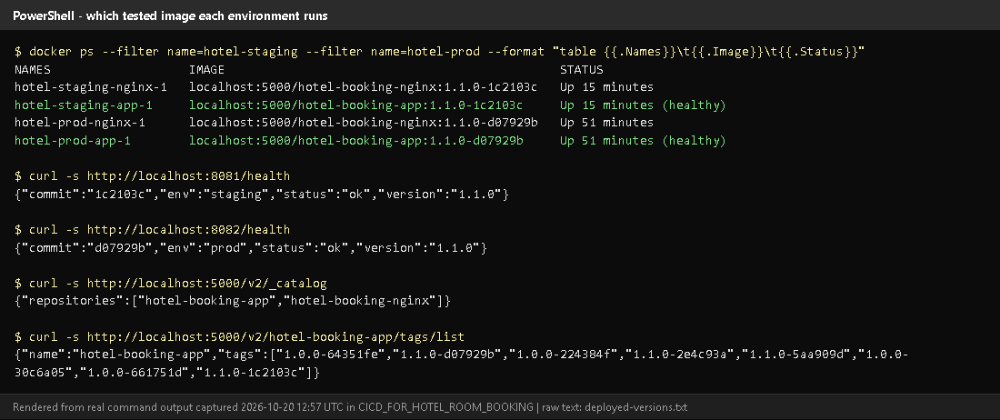
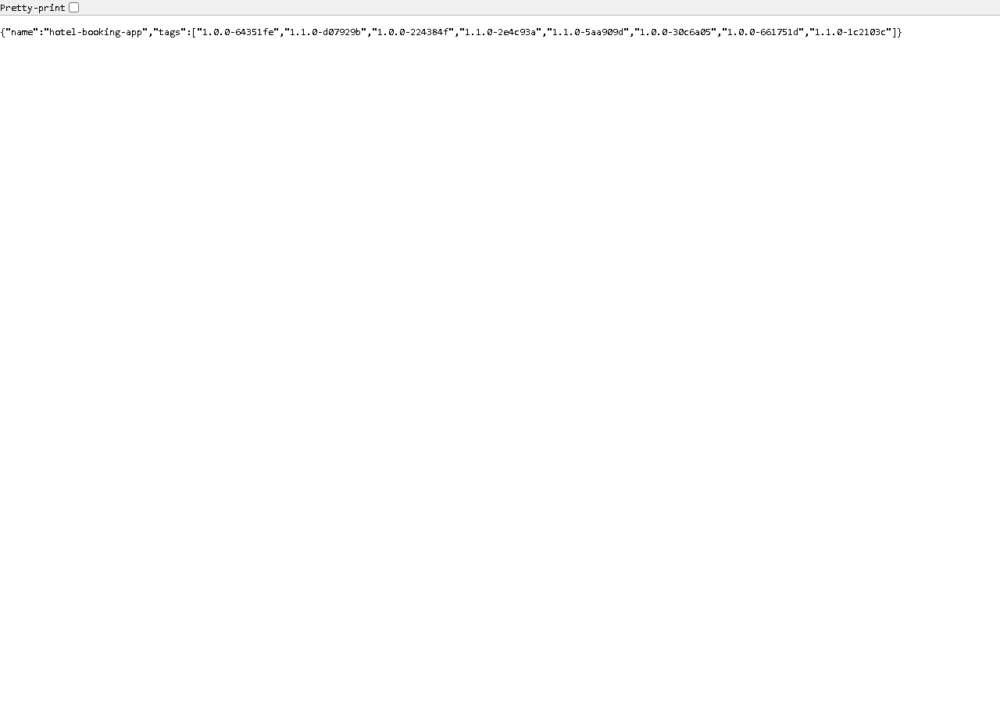
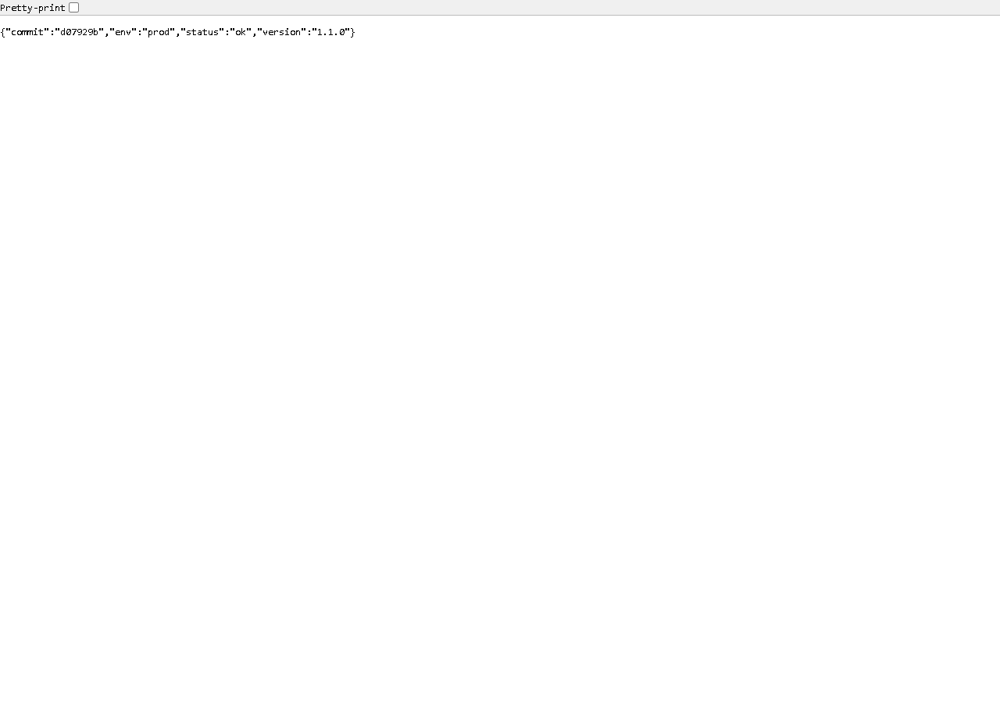
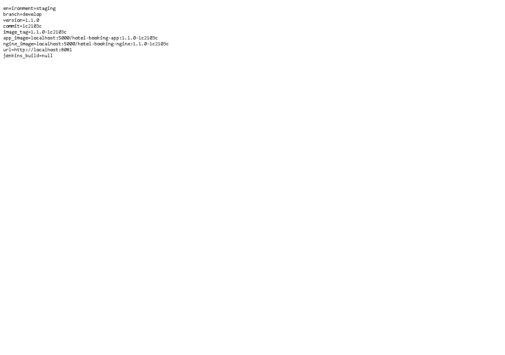
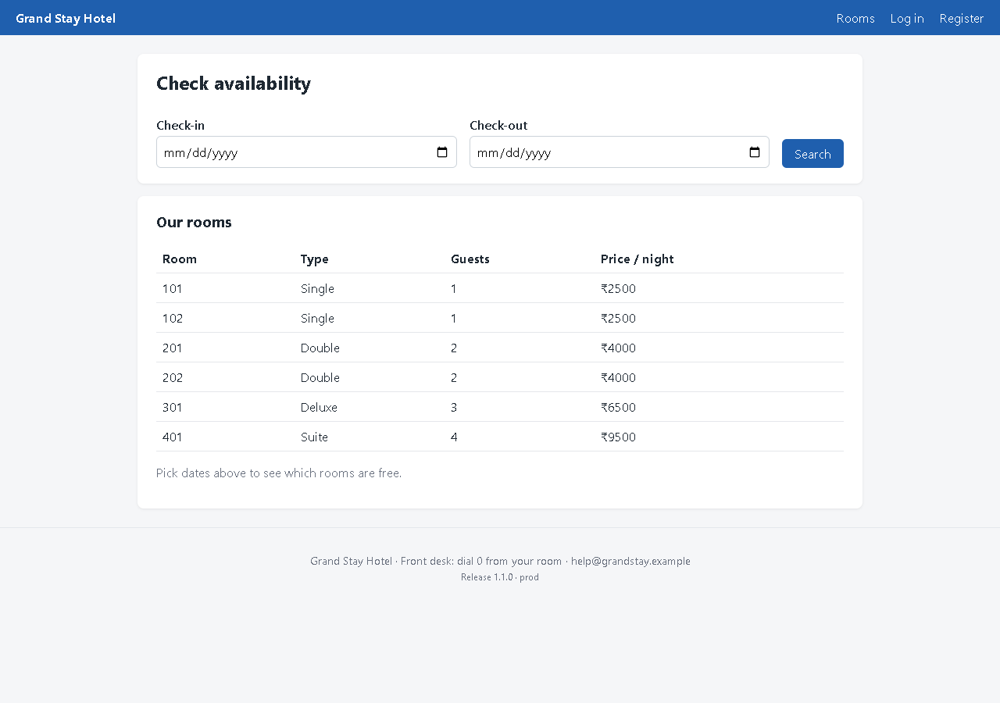

# Task 12 - Jenkins-Docker Continuous Deployment

## A. Task title and objective

**Task 12: Jenkins-Docker Continuous Deployment**

**Objective:** after all tests pass, have Jenkins build a Docker image,
tag it with a version and the commit SHA, publish it to a registry, deploy
exactly that tested image, check its health and record what was deployed.

**Professor's required deliverables**

1. Build the image after the mandatory tests pass
2. Tag it with a version and an identifiable commit SHA
3. Publish it to Docker Hub or an available registry
4. Deploy the tested version
5. Perform a health check
6. Record the deployed version and pipeline result
- Use Jenkins credentials securely; never deploy untested or uncommitted code

**Current status: Implemented and verified (local registry).**
Build #11 on 2026-10-20 built, tagged `1.1.0-1c2103c`, pushed to the local
registry, deployed to staging, health-checked and archived the deployment record.

**Docker Hub publishing: pending external action.** The pipeline supports it
(`REGISTRY=docker.io/<user>` + credential `registry-creds`), but it was
**never run** - there is no Docker Hub account/token. All publishing so far
went to the **local registry** at `localhost:5000`.

## B. Explanation for a complete beginner

**An everyday picture.** A bakery tests each batch, then puts the approved
loaves into labelled boxes ("Batch 1.1.0, baked from recipe card #1c2103c")
in a store-room. Shops collect boxes from the store-room by label. If a batch
turns out bad, a shop simply takes an older box. The store-room is the
**registry**, the label is the **image tag**.

| Term | Meaning | In this project |
|---|---|---|
| **Continuous Deployment (CD)** | every change that passes all tests is deployed automatically | Jenkins deploys after the test stages |
| **CI vs CD** | CI = build + test every change; CD = also release/deploy it automatically | stages 1-6 are CI, 7-10 are CD |
| **Registry** | a server that stores and serves Docker images | `registry:2` container at `localhost:5000` |
| **Docker Hub** | Docker's public hosted registry on the internet | supported, not used (no account) |
| **Local vs hosted registry** | local runs on your machine (free, private, only you can reach it); hosted is on the internet (others/servers can pull) | local |
| **Push / pull** | upload an image to / download from a registry | `docker push`, `docker compose pull` |
| **Commit SHA** | the unique ID of a Git commit (short form 7 characters) | `1c2103c` |
| **Version tag** | human release number from the `VERSION` file | `1.1.0` |

**Why both version and SHA?** `1.1.0` tells people *which release*;
`1c2103c` tells you *exactly which code*. Together (`1.1.0-1c2103c`) every
running container can be traced to one commit and one Jenkins build.

## C. What was actually implemented

**Tag calculation** (Jenkinsfile, Checkout stage):

```groovy
env.APP_VERSION  = readFile('VERSION').trim()                                    // 1.1.0
env.GIT_SHORT    = sh(script: 'git rev-parse --short HEAD', returnStdout: true).trim()  // 1c2103c
env.IMAGE_TAG    = "${env.APP_VERSION}-${env.GIT_SHORT}"                          // 1.1.0-1c2103c
env.IMAGE_PREFIX = params.REGISTRY ? "${params.REGISTRY}/" : ''                   // localhost:5000/
```

**Stage by stage (build #11)**

| Stage | What happened |
|---|---|
| Build images | `docker build -t localhost:5000/hotel-booking-app:1.1.0-1c2103c --build-arg APP_VERSION=1.1.0 --build-arg GIT_COMMIT=1c2103c .` and the same for `hotel-booking-nginx` - **only after** both test stages passed |
| Publish images | `docker push` both; console shows `1.1.0-1c2103c: digest: sha256:a0386a85...` and `sha256:4ba01355...` |
| Deploy | with `SECRET_KEY` from the Jenkins credential: `docker compose pull` (fetch exactly the pushed images) then `docker compose up -d --no-build --wait` (no rebuild on deploy) |
| Health check | `/health` must contain `"version":"1.1.0"` **and** `"commit":"1c2103c"` |
| Record | `reports/deployment.txt` archived (Figure 12.4) |

**Registry login logic** (Jenkinsfile lines 148-155): if `REGISTRY` starts
with `localhost` no login is needed; otherwise
`withCredentials([usernamePassword(credentialsId: 'registry-creds', ...)])`
and `echo "$REG_PASS" | docker login -u "$REG_USER" --password-stdin ...` -
the password never appears in the Jenkinsfile or the log.

**Never untested or uncommitted code**

- Images are built only after lint and all 90 tests pass (stage order).
- Jenkins checks out **commits** (`checkout scm`); uncommitted files on a
  laptop can never reach Jenkins.
- Deploy uses `--no-build`: it runs the image that was pushed, not a fresh build.
- The health check fails the build if the running commit differs.

**What is deployed right now** (checked 2026-10-20, Figure 12.1):

| Environment | Image | `/health` |
|---|---|---|
| staging :8081 | `localhost:5000/hotel-booking-app:1.1.0-1c2103c` (build #11) | `{"commit":"1c2103c","env":"staging",...,"version":"1.1.0"}` |
| prod :8082 | `localhost:5000/hotel-booking-app:1.1.0-d07929b` (build #8, release v1.1.0) | `{"commit":"d07929b","env":"prod",...,"version":"1.1.0"}` |

`d07929b` is the original ID of the v1.1.0 release commit (current ID
`ce1726d`; commit messages were edited once before publishing - see
`docs/evidence/git/commit-id-map.md`).

**Registry contents** - 8 tags of `hotel-booking-app`, one per successful
build: `1.0.0-64351fe`, `1.0.0-30c6a05`, `1.0.0-224384f`, `1.0.0-661751d`,
`1.1.0-5aa909d`, `1.1.0-d07929b`, `1.1.0-2e4c93a`, `1.1.0-1c2103c`. Old tags
are kept, which is what makes rollback possible (Task 14).

**How to switch to Docker Hub (not done):** create an access token on Docker
Hub; in Jenkins *Manage Jenkins -> Credentials -> Add* "Username with
password", ID `registry-creds`; build with `REGISTRY=docker.io/<your-docker-id>`.

## D. Screenshots and evidence



*Figure 12.1 - Which image each environment runs, both `/health` answers, and the registry catalogue and tags (rendered from real output, 2026-10-20).*
**Proves:** images are tagged version-commit, stored in the registry and the deployed containers run them.



*Figure 12.2 - http://localhost:5000/v2/hotel-booking-app/tags/list in the browser.*



*Figure 12.3 - http://localhost:8082/health: prod runs release 1.1.0 (`d07929b`).*



*Figure 12.4 - `reports/deployment.txt` archived by build #11: environment, branch, version, commit, image names, URL.* (`jenkins_build=null`: the Jenkins URL setting is not configured - see Task 8.)



*Figure 12.5 - The prod portal at http://localhost:8082 - the deployed v1.1.0 interface (the newer UI redesign is not deployed yet).*

## E. How to demonstrate this task to the professor (about 5 minutes)

**Before the demo:** Docker Desktop, Jenkins and the registry running
(`docker compose ps` in `deploy\jenkins`).

1. Jenkins -> *hotel-booking* -> *Build with Parameters* -> `BRANCH = develop`,
   `APP_ENV = staging`, `REGISTRY = localhost:5000` -> *Build*.
2. While it runs, open the `Jenkinsfile` at the Checkout stage and explain
   `IMAGE_TAG = <VERSION>-<commit>`.
3. After it finishes: **Console Output**, Ctrl+F `digest:` - *Say:* "Both images were pushed to the registry."
4. Browser: http://localhost:5000/v2/hotel-booking-app/tags/list - the new tag is in the list.
5. PowerShell:
   ```powershell
   docker ps --format "table {{.Names}}\t{{.Image}}\t{{.Status}}"
   curl.exe -s http://localhost:8081/health
   ```
   *Say:* "The staging container runs the image from the registry with this
   exact tag, and `/health` reports the same commit."
6. Open the build's **Build Artifacts -> reports/deployment.txt**.
7. *Say about Docker Hub:* "For Docker Hub I would add a `registry-creds`
   credential and set REGISTRY to my Docker ID; that path is implemented but not tested because I have no Docker Hub account."

**Recovery:** Publish stage "connection refused" - the registry container is
stopped: `docker compose up -d registry` in `deploy\jenkins`. Deploy uses an
old container - another stack on the same port; `docker compose -p hotel-staging down`, then build again.

## F. Expected screenshots for the final submission

1. `assets/task-12/deployed-versions.png` - **exists, 2026-10-20**.
2. `assets/task-12/registry-tags.png` - **exists, 2026-10-20**.
3. `assets/task-12/prod-health.png` - **exists, 2026-10-20**.
4. `assets/task-12/jenkins-build-11-deployment-record.png` - **exists, 2026-10-20**.
5. `assets/task-12/prod-portal-v1.1.0.png` - **exists, 2026-10-20**.
6. `assets/task-12/dockerhub-repository.png` - the image on Docker Hub - **requires manual capture after publishing to Docker Hub** (pending external action).

## G. Probable viva questions and answers

1. **CI vs CD?** CI builds and tests every change; CD goes further and
   automatically releases/deploys every change that passed.
2. **Why tag with version and SHA?** The version names the release; the SHA
   identifies the exact code. `1.1.0-1c2103c` links a container to one commit and one build.
3. **Registry vs Docker Hub?** A registry is any server that stores images;
   Docker Hub is one hosted public registry. We use our own local registry.
4. **Did you publish to Docker Hub?** No - it is implemented (`registry-creds`
   + REGISTRY parameter) but not tested; the local registry was demonstrated.
5. **How do you ensure only tested code is deployed?** Images are built after
   all tests pass, from a committed checkout; deploy uses `--no-build` with the pushed image; the health check compares the commit.
6. **(Project-specific) What runs in prod now and how do you know?**
   `1.1.0-d07929b` - `docker ps` shows the image and `/health` returns `"commit":"d07929b"`.
7. **(Project-specific) Why `docker compose pull` before `up`?** To deploy
   exactly what is in the registry - the same thing any other server would get.
8. **Where are registry credentials kept?** In Jenkins credentials
   (`registry-creds`), passed with `--password-stdin`; not needed for the local registry.
9. **Why keep old images?** For rollback: deploying an older tag needs no rebuild (shown in Task 14).
10. **Local registry limitation?** Only this machine can pull from it; a
    separate server would need a hosted registry (Docker Hub) or network access to it.

## H. Common mistakes and troubleshooting

| Symptom | Cause | Inspect | Fix | Confirm |
|---|---|---|---|---|
| `push` fails "connection refused" | registry stopped | `docker compose ps` (deploy\jenkins) | `docker compose up -d registry` | push ok |
| Docker Hub push "unauthorized" | missing/wrong `registry-creds` | Jenkins credentials | add a Docker Hub access token as `registry-creds` | push ok |
| Health check: wrong commit | stale container | `docker ps` image tag | rebuild; ensure no other stack on the port | commit matches |
| Tag shows `unknown` | `GIT_COMMIT` not passed | Build images stage | keep `--build-arg GIT_COMMIT=$GIT_SHORT` | `/health` shows SHA |
| Registry fills the disk | every build adds a tag | `docker system df` | delete old tags you no longer need for rollback | space recovered |

## I. Quick revision notes

**Five key points**

1. After tests: build -> tag `<version>-<sha>` -> push -> pull -> deploy -> health -> record.
2. Local registry `localhost:5000` holds 8 tags; old tags enable rollback.
3. Deploy uses `--no-build`: the tested, pushed image is what runs.
4. Credentials via Jenkins (`hotel-secret-key`, `registry-creds`), never in Git.
5. Docker Hub: implemented, **not tested** (pending account).

**30-60 second explanation**
"When all tests pass, Jenkins builds the app and Nginx images and tags them
with the release version and commit, for example 1.1.0-1c2103c. It pushes
them to our local Docker registry, then deploys by pulling exactly those
images and starting them with Docker Compose. The health check confirms the
running app reports the same version and commit, and a deployment record is
archived with the build. Staging and prod run images from the registry. Docker
Hub is supported by a parameter and a credential but hasn't been tested."

**Caveat:** only a local registry was used; Docker Hub publishing is pending.

**Readiness checklist**
- [ ] I can show the registry tag list in the browser.
- [ ] I can explain version + SHA tags.
- [ ] I can match `docker ps` image tags with `/health`.
- [ ] I can explain honestly why Docker Hub wasn't used.
