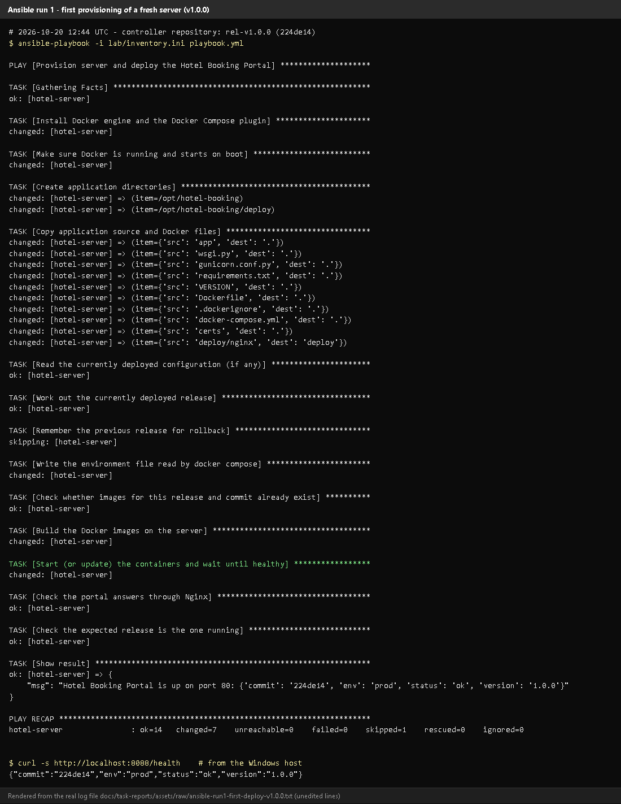
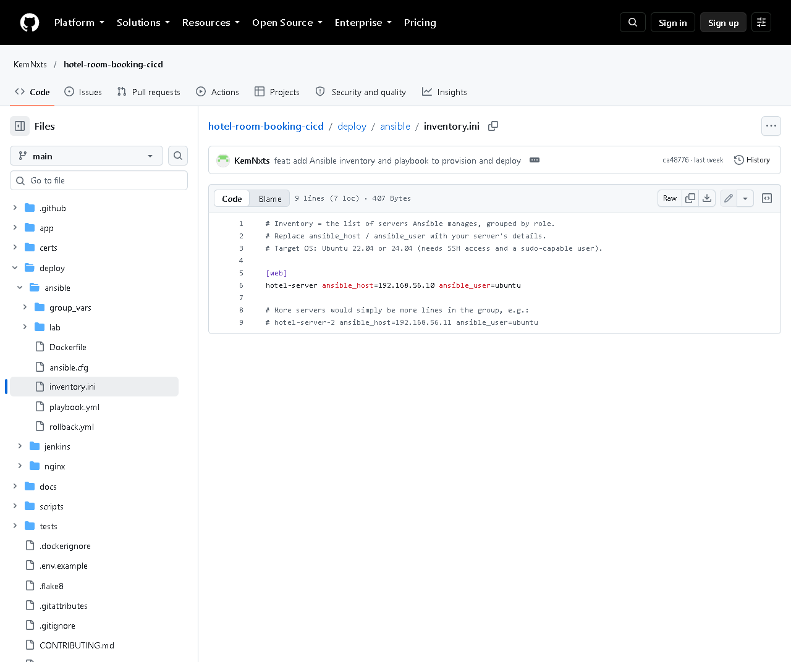
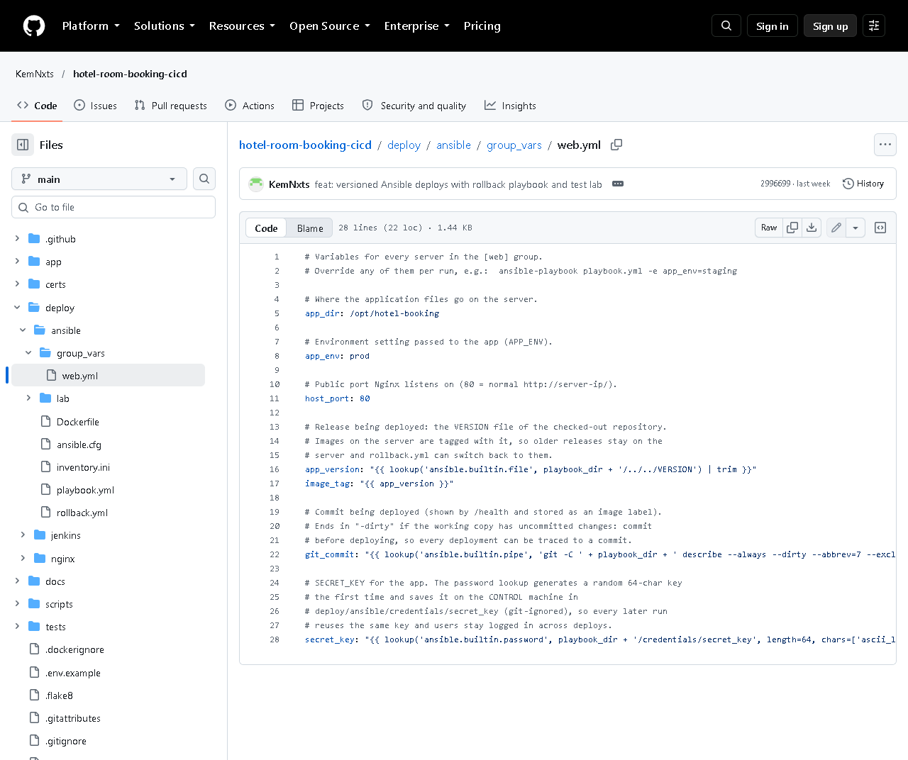
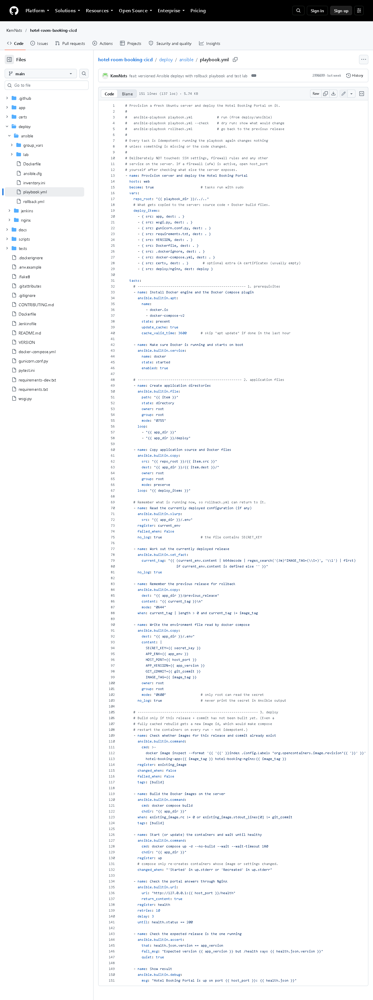
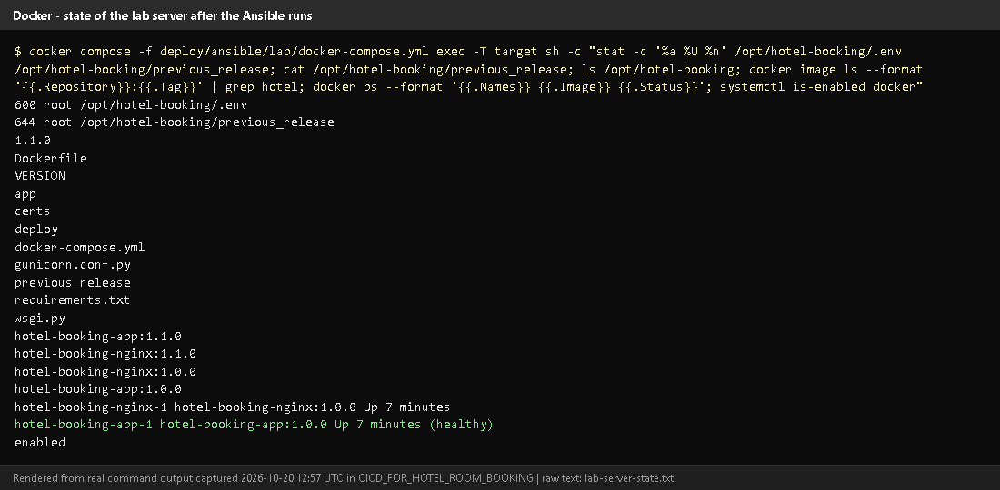

# Task 13 - Configuration Management with Ansible

## A. Task title and objective

**Task 13: Configuration Management with Ansible**

**Objective:** describe in code how a server must be set up - packages,
directories, configuration, permissions, services, ports, Nginx and health
verification - and let Ansible bring a server to that state automatically,
using variables for environment-specific values.

**Professor's required deliverables**

- Ansible inventory and playbook for the selected target
- Automated prerequisites: packages, deployment directories, application configuration, service/container setup, file permissions, network ports, Nginx configuration, application health verification
- Variables for environment-specific configuration
- No destructive changes; SSH/firewall settings not changed without checking
- If no separate target exists: the safest local/virtualised setup, documented

**Current status: Implemented and verified (container-based lab).**
On 2026-10-20 the playbook provisioned a **fresh** lab server from scratch
(Docker not installed beforehand): `ok=14 changed=7 failed=0`, and `/health`
answered with release 1.0.0 (Figure 13.1).

**Target honesty:** the "server" is a disposable **Ubuntu 24.04 Docker
container with systemd and SSH** (`deploy/ansible/lab/`), not a separate
virtual machine or cloud server. The real-server inventory
(`deploy/ansible/inventory.ini`, `192.168.56.10`) has **not** been used.

## B. Explanation for a complete beginner

**An everyday picture.** Instead of telling a new employee "install this,
then create that folder, then copy these files...", you give them a written
checklist that describes the *finished* state of the office. Anyone following
it gets the same result - and if something is already done, they skip it.
**Ansible** follows such a checklist on servers, over SSH.

| Term | Meaning | In this project |
|---|---|---|
| **Configuration management** | describing a machine's desired state in files and applying it automatically | `deploy/ansible/` |
| **Control node** | the machine that runs Ansible | the `hotel-ansible` container (Ansible doesn't run natively on Windows) |
| **Managed node / target** | the server being configured | `hotel-server` (the lab container) |
| **Inventory** | the list of servers, in groups | `inventory.ini` (real) / `lab/inventory.ini` (lab) - group `[web]` |
| **Playbook** | a YAML file listing tasks for a group of hosts | `playbook.yml`, `rollback.yml` |
| **Task** | one desired state, using a **module** | "Install Docker engine..." using `apt` |
| **Module** | a built-in action (apt, copy, file, service, uri...) | 10 built-in modules, no extra collections |
| **Variables** | values that differ per environment | `group_vars/web.yml` |
| **become** | run tasks with administrator rights (sudo) | `become: true` |
| **Handler** | a task that runs only when notified by a change | **not used** in this project (compose restarts containers itself when their image or settings change) |
| **Idempotent** | running it again changes nothing if the state is already right | see Task 14 (`changed=0`) |
| **Agentless** | nothing needs installing on the server except SSH and Python | true for Ansible |

**Playbook vs inventory:** the inventory says *where* (which servers); the playbook says *what* (which state).

## C. What was actually implemented

**Files** (`deploy/ansible/`)

| File | Content |
|---|---|
| `inventory.ini` | `[web]` group: `hotel-server ansible_host=192.168.56.10 ansible_user=ubuntu` (edit for a real server) |
| `lab/inventory.ini` | the same group pointing at the lab container `target` (lab-only password, not reachable from outside Docker) |
| `group_vars/web.yml` | `app_dir: /opt/hotel-booking`, `app_env: prod`, `host_port: 80`, `app_version` (read from the `VERSION` file), `image_tag`, `git_commit` (from Git, `-dirty` if uncommitted changes), `secret_key` (generated once by the password lookup into the git-ignored `credentials/secret_key`) |
| `ansible.cfg` | inventory path, `interpreter_python = auto_silent`, `host_key_checking = False` (lab setting, commented) |
| `playbook.yml` | provision + deploy (14 tasks, below; the run output also shows Ansible's automatic "Gathering Facts") |
| `rollback.yml` | return to the previous release (Task 14) |
| `Dockerfile` | the control-node image (`python:3.12-slim` + `ansible-core 2.21.5` + ssh + git) |
| `lab/docker-compose.yml`, `lab/Dockerfile.target` | the disposable Ubuntu 24.04 target (systemd, sshd, privileged, port 8088 -> 80) and the controller |

**Tasks in `playbook.yml` and the deliverable each covers**

| Line | Task | Module | Deliverable |
|---|---|---|---|
| 33 | Install Docker engine and the Docker Compose plugin | `apt` | packages |
| 42 | Make sure Docker is running and starts on boot | `service` | service setup |
| 49 | Create application directories (`/opt/hotel-booking`, `.../deploy`, root 0755) | `file` | directories, permissions |
| 60 | Copy application source and Docker files | `copy` | application files |
| 70-83 | Read current `.env`, work out the running release, remember it in `previous_release` | `slurp`, `set_fact`, `copy` | release tracking (for rollback) |
| 90 | Write the environment file (`SECRET_KEY`, `APP_ENV`, `HOST_PORT`, version, `IMAGE_TAG`) **mode 0600, `no_log: true`** | `copy` | application configuration, permissions, secret protection |
| 109 | Check whether images for this release and commit already exist | `command` (`docker image inspect`) | idempotency |
| 119 | Build the Docker images on the server (only if needed) | `command` | container setup |
| 126 | Start (or update) the containers and wait until healthy | `command` (`docker compose up -d --no-build --wait`) | container/service setup |
| 134 | Check the portal answers through Nginx | `uri` with retries | health verification |
| 143 | Check the expected release is the one running | `assert` | health verification |
| 149 | Show result | `debug` | - |

**Nginx and ports:** Nginx runs as a container whose configuration is baked
into the `hotel-booking-nginx` image (`deploy/nginx/hotel.conf`); it publishes
`host_port` (80) on the server. **Not touched on purpose:** SSH settings and
firewall rules (the playbook says so in its header). If `ufw` is active, open
`host_port` yourself after checking what else is exposed.

**What the first run on the fresh lab server changed** (2026-10-20, `changed=7`):
Install Docker; start/enable Docker; create directories; copy files; write
`.env`; build images; start containers. Then `/health` =
`{"commit":"224de14","env":"prod","status":"ok","version":"1.0.0"}`.

**State of the server afterwards** (Figure 13.5): `.env` is `600 root`,
`previous_release` exists, images for 1.0.0 and 1.1.0 are present, the
containers are healthy and Docker is enabled at boot.

## D. Screenshots and evidence



*Figure 13.1 - Run 1 on a fresh lab server, from a clean clone of tag v1.0.0 (rendered from the real run on 2026-10-20).*
**Notice:** each task's `changed`/`ok`, the censored `.env` task (`no_log`), the final
message with `/health`, and `PLAY RECAP ... ok=14 changed=7 failed=0`.
**Proves:** Ansible installed prerequisites and deployed the application automatically.



*Figure 13.2 - `deploy/ansible/inventory.ini` on GitHub - group `[web]`.*



*Figure 13.3 - `group_vars/web.yml`: environment-specific values, the version taken from `VERSION`, and the generated secret key.*



*Figure 13.4 - `playbook.yml` on GitHub: the tasks listed above.*



*Figure 13.5 - Inside the lab server (rendered from real output, 2026-10-20): file permissions (`600 root .env`), the files in `/opt/hotel-booking`, images, running containers, `docker` enabled.*

## E. How to demonstrate this task to the professor (about 5 minutes)

**Before the demo:** Docker Desktop running. PowerShell. These commands were
run exactly like this on 2026-10-20.

```powershell
cd D:\DevOPS\CICD_FOR_HOTEL_ROOM_BOOKING\deploy\ansible\lab

# 1. a brand-new "server" (only if you want to start from zero - this deletes the old lab)
docker compose down -v
docker compose up -d --build target
docker compose exec target sh -c "command -v docker || echo no docker yet"
```

*Expected:* "no docker yet". *Say:* "This is a fresh Ubuntu server with nothing installed."

```powershell
# 2. run the playbook (takes 3-5 minutes the first time)
docker compose run --rm controller ansible-playbook -i lab/inventory.ini playbook.yml
```

*Point at:* the task names scrolling by, `changed` vs `ok`, the censored `.env` task,
the final "Hotel Booking Portal is up" message and `PLAY RECAP ... failed=0`.

```powershell
# 3. prove it
curl.exe -s http://localhost:8088/health
docker compose exec target stat -c "%a %U %n" /opt/hotel-booking/.env
```

*Expected:* `{"status":"ok",...}` and `600 root /opt/hotel-booking/.env`.
Open http://localhost:8088 in the browser - the portal served from the "server".

4. Show `inventory.ini`, `group_vars/web.yml` and `playbook.yml` in VS Code
   and map a few tasks to the deliverables (packages, directories, config, health).
5. *Say honestly:* "The target is a container acting as a server because I
   had no VM; for a real server I put its IP in `inventory.ini` and run the same playbook."

**For a real Ubuntu server** (not done in this project): from the repository root

```powershell
docker build -t hotel-ansible -f deploy/ansible/Dockerfile .
docker run --rm -it -v "${PWD}:/work" hotel-ansible ansible-playbook playbook.yml --ask-pass --ask-become-pass
```

**Recovery:** "UNREACHABLE" - the target container isn't running:
`docker compose up -d target` and wait ~10 s. First run slow - it downloads
Docker packages and base images. `CERTIFICATE_VERIFY_FAILED` during the image
build on the server - antivirus HTTPS scanning; the `certs/` folder is copied to the server.

## F. Expected screenshots for the final submission

1. `assets/task-13/ansible-run1-first-deploy-v1.0.0.png` - **exists, 2026-10-20** (rendered from the real run).
2. `assets/task-13/github-file-deploy_ansible_inventory.ini.png` - **exists, 2026-10-20**.
3. `assets/task-13/github-file-deploy_ansible_group_vars_web.yml.png` - **exists, 2026-10-20**.
4. `assets/task-13/github-file-deploy_ansible_playbook.yml.png` - **exists, 2026-10-20**.
5. `assets/task-13/lab-server-state.png` - **exists, 2026-10-20**.
6. `assets/task-13/real-vm-run.png` - a run against a real Ubuntu VM - **requires manual capture** if a VM becomes available (pending).

## G. Probable viva questions and answers

1. **What is configuration management?** Describing the desired state of
   servers in files and applying it automatically and repeatably.
2. **Playbook vs inventory?** Inventory = which servers; playbook = which tasks/state.
3. **Why Ansible?** Agentless (only SSH + Python on the server), readable
   YAML, idempotent built-in modules.
4. **What does your playbook set up?** Docker + compose plugin, the docker
   service, `/opt/hotel-booking` directories, the app files, a root-only
   `.env`, the images, the containers, and a health/version check.
5. **How are environment differences handled?** Variables in
   `group_vars/web.yml`, overridable per run, e.g. `-e app_env=staging -e host_port=8080`.
6. **How is the secret protected?** Generated once on the control machine
   (git-ignored), written to `.env` with mode 0600 and `no_log: true`, so it is never printed.
7. **(Project-specific) What was your target?** A disposable Ubuntu 24.04
   container with systemd and SSH, defined in `deploy/ansible/lab/` - not a separate VM.
8. **(Project-specific) What did the first run change?** 7 tasks: install
   Docker, enable it, create directories, copy files, write `.env`, build images, start containers.
9. **Do you use handlers?** No. Docker Compose recreates containers itself when
   their image or settings change, so no separate restart handler is needed.
10. **Does the playbook change the firewall or SSH?** No, deliberately - those
    are risky to automate without knowing the server; it is documented.
11. **Why `host_key_checking = False`?** Convenience for fresh lab machines; for real servers it should be True with known hosts.

## H. Common mistakes and troubleshooting

| Symptom | Cause | Inspect | Fix | Confirm |
|---|---|---|---|---|
| `UNREACHABLE` | target not running / wrong host | `docker compose ps` in `lab` | `docker compose up -d target` | `ok=` in recap |
| "Missing sudo password" (real server) | become needs a password | inventory | add `--ask-become-pass` | tasks run |
| Ansible ignores `ansible.cfg` | world-writable folder (Windows mount) | - | the controller image sets `ANSIBLE_CONFIG` | inventory found |
| Image build fails on the server | TLS interception | build task output | put the root CA in `certs/` | build ok |
| `assert` fails: wrong version | old containers / wrong `app_version` | `/health` | rerun; check `VERSION` | assert ok |

## I. Quick revision notes

**Five key points**

1. Inventory (where) + group_vars (values) + playbook (what) in `deploy/ansible/`.
2. 14 tasks with built-in modules: packages, service, dirs, files, `.env` 0600, build, start, health, assert.
3. Secret generated once, never printed (`no_log`), file mode 0600.
4. Fresh lab server provisioned on 2026-10-20: `changed=7`, `/health` OK.
5. Target is a container lab, not a VM; firewall/SSH deliberately untouched.

**30-60 second explanation**
"Ansible describes the server I want: Docker installed and running, an
application folder, the app files, a root-only environment file with the
secret, the images built and the containers healthy. The inventory says which
server, `group_vars` holds environment values, and the playbook lists the
tasks using built-in modules. I ran it against a fresh Ubuntu server in a
container lab: it installed everything and deployed the portal, with seven
changes and no failures, and the final tasks check `/health` and the version."

**Caveat:** tested on a container-based lab target, not a separate VM.

**Readiness checklist**
- [ ] I can start the lab and run the playbook.
- [ ] I can map tasks to deliverables (packages, dirs, config, health).
- [ ] I can explain inventory vs playbook vs variables.
- [ ] I can explain the lab-vs-VM limitation.
