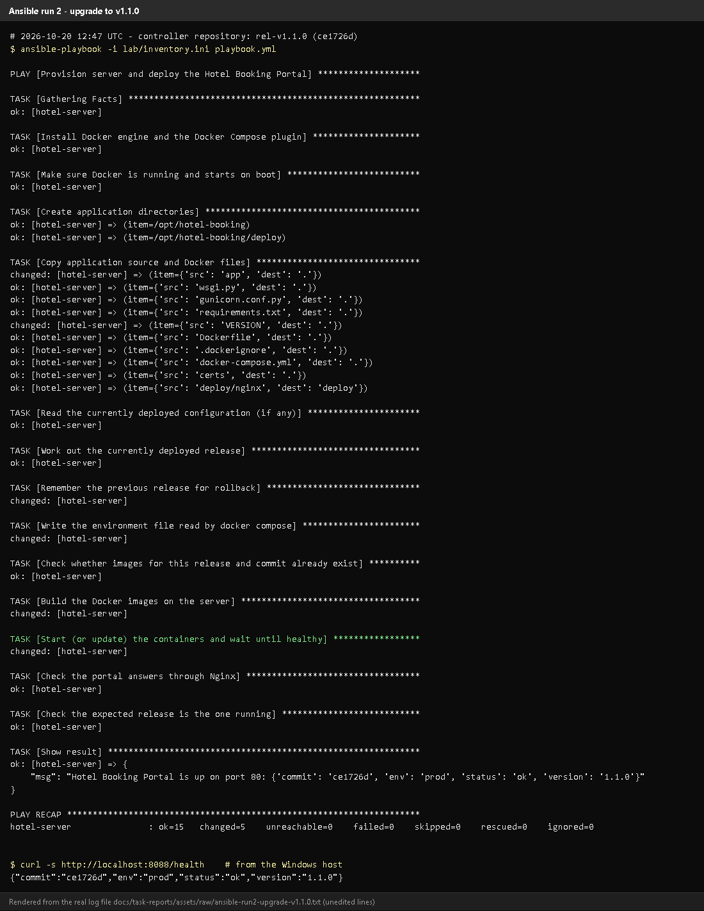
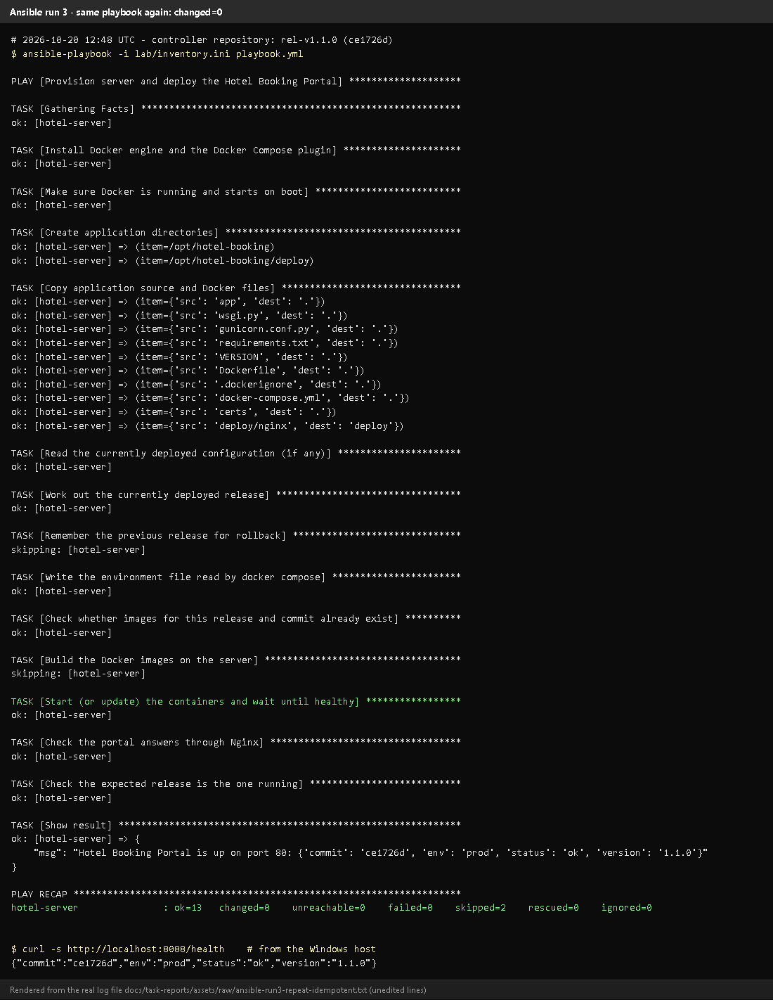
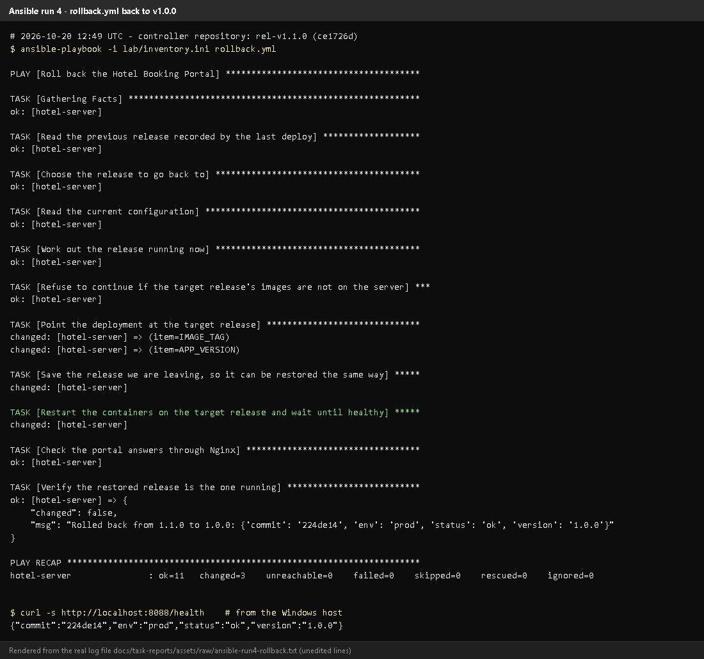
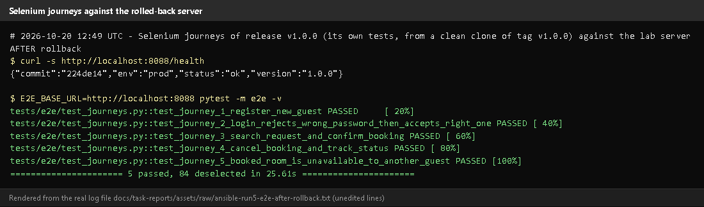
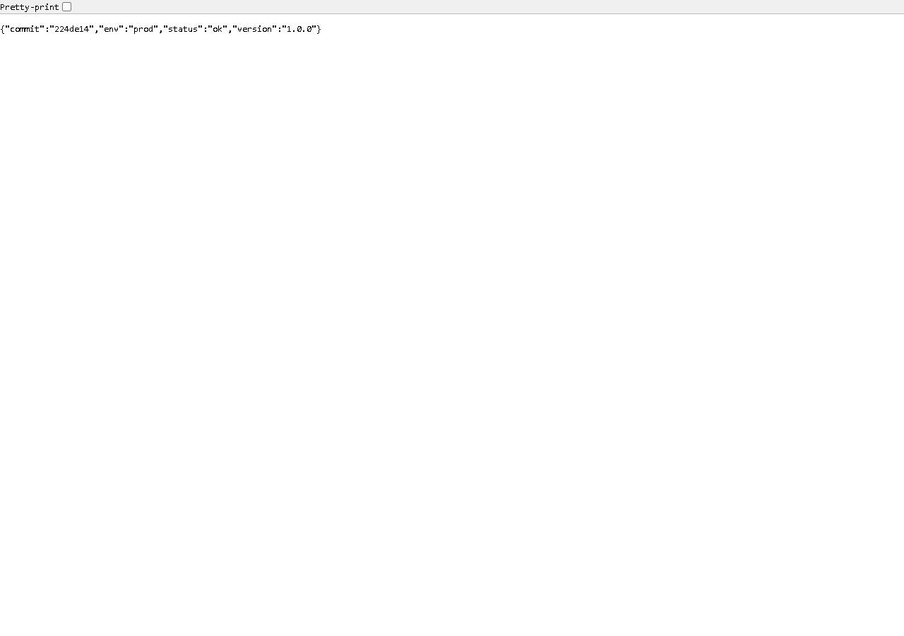
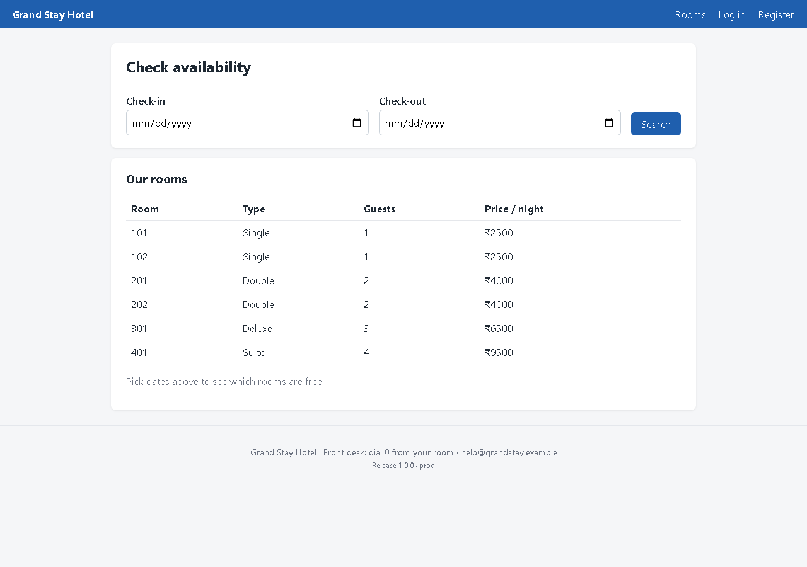
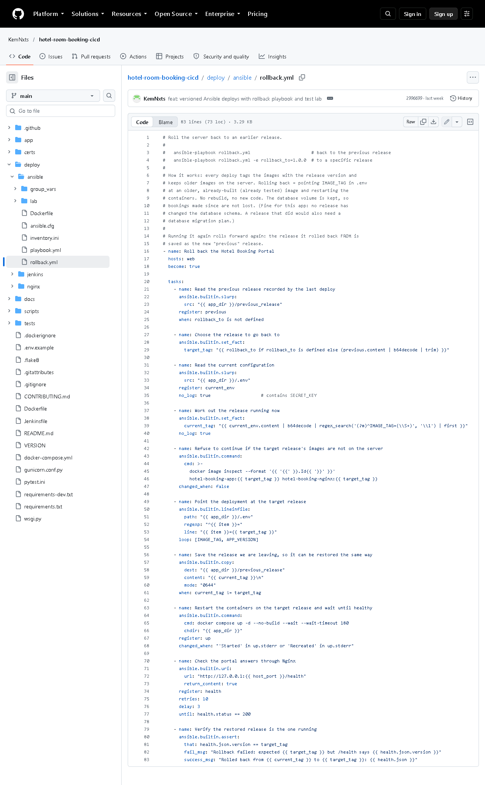

# Task 14 - Automated Provisioning and Reliability Validation (Idempotency and Rollback)

## A. Task title and objective

**Task 14: Automated Provisioning, Idempotency and Reliability Validation**

**Objective:** prove that automated provisioning is safe to repeat
(idempotent), that health checks confirm the application works, and that a
bad release can be rolled back to a previous stable release - and that the
restored release really works.

**Professor's required deliverables**

- First Ansible execution
- Second execution with evidence of idempotency
- Application health checks
- Recovery / rollback to a previous stable release
- Verification that the restored release actually works
- Commands, outcomes and limitations recorded (no unproven claims of zero downtime)

**Current status: Implemented and verified (container-based lab).** The
whole sequence was run again on 2026-10-20 on a **fresh** lab server:

| Run | What | PLAY RECAP | `/health` afterwards |
|---|---|---|---|
| 1 | first provisioning, release v1.0.0 | `ok=14 changed=7 failed=0` | 1.0.0 (`224de14`) |
| 2 | upgrade to v1.1.0 | `ok=15 changed=5 failed=0` | 1.1.0 (`ce1726d`) |
| 3 | **same playbook again** | `ok=13 changed=0 failed=0 skipped=2` | 1.1.0 |
| 4 | `rollback.yml` | `ok=11 changed=3 failed=0` | **1.0.0** (`224de14`) |
| 5 | v1.0.0's own Selenium journeys against the restored server | **5 passed** | - |

Limitation: the target is a privileged Ubuntu 24.04 **container**, not a
separate VM. Rollback re-creates the containers, so there is a short
interruption - **zero downtime is not claimed**.

## B. Explanation for a complete beginner

**An everyday picture.** A light switch labelled "ON": pressing it when the
light is already on changes nothing. A good provisioning script works the
same way - running it twice gives the same result as running it once.

| Term | Meaning | In this project |
|---|---|---|
| **Provisioning** | preparing a server from nothing to ready (software, folders, config, app) | `playbook.yml` on a fresh server |
| **Idempotency** | applying the same operation again changes nothing if the state is already correct | run 3: `changed=0` |
| **Idempotency vs repeatability** | *repeatable* = gives the same end result each time; *idempotent* = additionally makes **no changes** when nothing needs changing | our playbook is both |
| **`changed=N`** | Ansible's count of tasks that actually modified the server | 7 -> 5 -> **0** |
| **Health check** | asking the running app whether it works and which version it is | `GET /health` through Nginx + `assert` |
| **Stable release** | a tested, tagged version that is known to work | `v1.0.0`, `v1.1.0` |
| **Rollback** | switching back to a previous stable release | `rollback.yml` |
| **Deployment vs rollback** | deployment moves to a *new* version; rollback returns to an *older*, already-tested one, without rebuilding | - |

**Why `changed=0` matters:** it proves the playbook *checks* before acting.
Nothing was reinstalled, rewritten or restarted, so a repeat run is safe -
you can run it any time to make sure the server is still correct.

## C. What was actually implemented

**Making the playbook idempotent**

- Built-in modules are idempotent by design: `apt state=present` does nothing
  if Docker is installed; `copy` does nothing if the file content is identical; `file`/`service` likewise.
- **Special case - images:** even a fully cached `docker build` produces a
  new image ID, which would make compose restart containers every time. So
  the playbook first checks the image label (lines 109-119):

```yaml
- name: Check whether images for this release and commit already exist
  ansible.builtin.command:
    cmd: docker image inspect --format '...org.opencontainers.image.revision...' hotel-booking-app:{{ image_tag }} hotel-booking-nginx:{{ image_tag }}
  register: existing_image
  changed_when: false          # only reads, never counts as a change
  failed_when: false

- name: Build the Docker images on the server
  ansible.builtin.command: { cmd: docker compose build, chdir: "{{ app_dir }}" }
  when: existing_image.rc != 0 or existing_image.stdout_lines[0] != git_commit   # build only if missing
```

(Excerpt simplified: the real `cmd` uses a Jinja-escaped Go template.)

- `docker compose up` reports `changed` only if its output contains
  `Started` or `Recreated`.

**Health checks** - every run ends with `uri http://127.0.0.1:{{ host_port }}/health`
(10 retries) and `assert health.json.version == app_version`.

**Rollback mechanism** (`deploy/ansible/rollback.yml`)

1. Each deploy tags images with the release (`hotel-booking-app:1.1.0`) and **keeps older images** on the server.
2. Before switching releases, the playbook writes the running release to `/opt/hotel-booking/previous_release`.
3. `rollback.yml` reads that file (or `-e rollback_to=1.0.0`), **refuses** if
   the target images are not on the server, sets `IMAGE_TAG` in `.env`,
   saves the release it is leaving (so running it again rolls forward), runs
   `docker compose up -d --no-build --wait`, then asserts `/health` shows the target version.
4. The database volume is kept, so bookings survive (no release changed the schema).

**What each run changed** (from the saved logs):

| Run | Changed tasks |
|---|---|
| 1 (7) | install Docker; start/enable Docker; create directories; copy files; write `.env`; build images; start containers |
| 2 (5) | copy files (new code); remember previous release (1.0.0); write `.env`; build images; recreate containers |
| 3 (0) | nothing - build skipped, previous-release skipped, everything `ok` |
| 4 (3) | point `.env` at 1.0.0; save 1.1.0 as previous; restart containers on 1.0.0 |

**Verification that the restored release works:** after run 4, the Selenium
journeys **of release v1.0.0** (from a clean clone of the tag - the current
tests expect the newer UI) were run against `http://localhost:8088`: 5 of 5 passed.

**Rollback without Ansible (Docker level)** - also demonstrated on
2026-10-11 for prod: `IMAGE_TAG=1.0.0-661751d docker compose up -d --no-build --wait`
switched prod 1.1.0 -> 1.0.0 and back (`docs/evidence/docker/rollback-prod.txt`).

## D. Screenshots and evidence



*Figure 14.1 - Run 2 (upgrade to v1.1.0): `changed=5`, `/health` 1.1.0 (rendered from the real run, 2026-10-20).*



*Figure 14.2 - Run 3, the same playbook again: every task `ok` or `skipping`, `PLAY RECAP ... changed=0`.*
**Proves:** idempotency.



*Figure 14.3 - `rollback.yml`: "Rolled back from 1.1.0 to 1.0.0", `changed=3`, `/health` 1.0.0.*



*Figure 14.4 - The five v1.0.0 Selenium journeys pass against the rolled-back server.*
**Proves:** the restored release actually works, not only `/health`.



*Figure 14.5 - http://localhost:8088/health: version 1.0.0, commit `224de14`.*



*Figure 14.6 - The portal served by the lab server after the rollback (v1.0.0 interface).*



*Figure 14.7 - `deploy/ansible/rollback.yml` on GitHub.*

## E. How to demonstrate this task to the professor (about 6 minutes)

**Before the demo:** Docker Desktop running; the lab target up
(`docker compose up -d target` in `deploy\ansible\lab`). These commands were run exactly like this on 2026-10-20.

```powershell
cd D:\DevOPS\CICD_FOR_HOTEL_ROOM_BOOKING\deploy\ansible\lab

# 1. deploy (if the server is fresh this is the first provisioning)
docker compose run --rm controller ansible-playbook -i lab/inventory.ini playbook.yml

# 2. run it again - idempotency
docker compose run --rm controller ansible-playbook -i lab/inventory.ini playbook.yml
```

*Point at:* `PLAY RECAP ... changed=0`. *Say:* "The second run checked
every task and found nothing to change - that is idempotency." (If the lab
server was already up to date, even run 1 shows `changed=0` - verified on
2026-10-20. To show a first run with changes, start from a fresh server as in
Task 13, step 1.)

```powershell
# 3. simulate a new release (same code, new version number)
docker compose run --rm controller ansible-playbook -i lab/inventory.ini playbook.yml -e app_version=1.1.1-demo
curl.exe -s http://localhost:8088/health
```

*Expected:* `"version":"1.1.1-demo"`. *Say:* "Pretend this release is bad."

```powershell
# 4. roll back
docker compose run --rm controller ansible-playbook -i lab/inventory.ini rollback.yml
curl.exe -s http://localhost:8088/health
```

*Expected:* "Rolled back from 1.1.1-demo to 1.1.0" and `"version":"1.1.0"`.
*Say:* "The previous image was still on the server, so rollback is just a switch - no rebuild."

5. **Prove the restored version works:** open http://localhost:8088, register and
   make a booking - or run the Selenium journeys (from the project folder):
   ```powershell
   cd D:\DevOPS\CICD_FOR_HOTEL_ROOM_BOOKING
   $env:E2E_BASE_URL="http://localhost:8088"
   .venv\Scripts\python -m pytest -m e2e -q
   Remove-Item Env:E2E_BASE_URL
   ```
   (The local tests match the interface of the working tree; for the
   v1.0.0 interface use the tests from that tag, as in Figure 14.4.)

**Recovery:** `rollback.yml` fails "No such image" - that release was never
deployed on this server; deploy it first or pass an existing
`-e rollback_to=...`. `UNREACHABLE` - start the target container.

## F. Expected screenshots for the final submission

1. `assets/task-14/ansible-run2-upgrade-v1.1.0.png` - **exists, 2026-10-20**.
2. `assets/task-14/ansible-run3-repeat-idempotent.png` - **exists, 2026-10-20**.
3. `assets/task-14/ansible-run4-rollback.png` - **exists, 2026-10-20**.
4. `assets/task-14/ansible-run5-e2e-after-rollback.png` - **exists, 2026-10-20**.
5. `assets/task-14/lab-server-health-after-rollback.png` - **exists, 2026-10-20**.
6. `assets/task-14/lab-server-after-rollback-v1.0.0.png` - **exists, 2026-10-20**.
7. `assets/task-14/github-file-deploy_ansible_rollback.yml.png` - **exists, 2026-10-20**.
8. Run 1 (first provisioning) is in Task 13: `assets/task-13/ansible-run1-first-deploy-v1.0.0.png` - **exists, 2026-10-20**.

## G. Probable viva questions and answers

1. **What is idempotency?** Running the same automation again makes no
   changes when the system is already in the desired state. Our run 3 reported `changed=0`.
2. **Idempotency vs repeatability?** Repeatable = same end result each time;
   idempotent = also no unnecessary changes (nothing reinstalled or restarted).
3. **Why did run 1 change 7 things but run 3 none?** Run 1 started from an
   empty server; run 3 found Docker installed, files identical and images for
   this release and commit already present, so it skipped the build.
4. **How did you make the image build idempotent?** By checking the image's
   revision label first and building only if the release/commit is missing.
5. **How does rollback work?** Old images stay on the server; `rollback.yml`
   points `.env` to the previous tag, restarts with `--no-build` and asserts `/health` shows that version.
6. **(Project-specific) How do you know the rollback really worked?**
   `/health` returned 1.0.0 (`224de14`) and the five v1.0.0 Selenium journeys passed against the server.
7. **(Project-specific) What happens to bookings during rollback?** They are
   kept - the database is on a volume that rollback does not touch.
8. **Is there downtime?** A few seconds while containers are re-created; zero downtime would need blue/green deployment.
9. **What if the release changed the database schema?** Rollback would need a
   migration plan; no release here changed the schema, so it was not needed.
10. **Deployment vs rollback?** Deployment moves forward to a new version;
    rollback goes back to an earlier tested version without rebuilding.
11. **What are the limits of your test?** It used a container acting as a
    server, not a VM, and a rollback within one server.

## H. Common mistakes and troubleshooting

| Symptom | Cause | Inspect | Fix | Confirm |
|---|---|---|---|---|
| Second run shows `changed=1` | uncommitted changes since run 1 (commit label `-dirty` changed) or new code | the changed task | commit, then run twice | `changed=0` |
| `rollback.yml`: "No such image" | target release never deployed here | `docker compose exec target docker image ls` | deploy that release first / pick an existing one | rollback ok |
| `/health` still shows the new version | rollback task failed | rollback output | rerun; check `previous_release` | version = old |
| Selenium fails after rollback | tests from a newer UI | test version | use tests from the same tag | 5 passed |
| Lab gone after `down -v` | `-v` deletes volumes | - | `docker compose up -d --build target` + playbook | portal back |

## I. Quick revision notes

**Five key points**

1. Run 1 `changed=7`, run 2 `changed=5`, run 3 **`changed=0`** = idempotent.
2. Images are built only when the release/commit is missing (label check).
3. Each deploy remembers the previous release; images are kept.
4. `rollback.yml` switches `IMAGE_TAG`, restarts without rebuilding, asserts `/health`.
5. Restored v1.0.0 verified by `/health` **and** 5/5 Selenium journeys.

**30-60 second explanation**
"On a fresh lab server the playbook made seven changes - installing Docker,
copying the app, building images and starting containers. Upgrading to v1.1.0
made five. Running the same playbook again made zero changes, which proves
it's idempotent and safe to repeat. Every deploy keeps the old images and
remembers the previous release, so rollback.yml just switches the image tag
and restarts. After rolling back to 1.0.0, `/health` showed 1.0.0 and that
release's Selenium journeys all passed."

**Caveat:** container-based lab, not a VM; rollback has a short interruption.

**Readiness checklist**
- [ ] I can run the playbook twice and point at `changed=0`.
- [ ] I can simulate a release with `-e app_version=...` and roll back.
- [ ] I can explain why run 3 skipped the build.
- [ ] I can state the limitations honestly.
