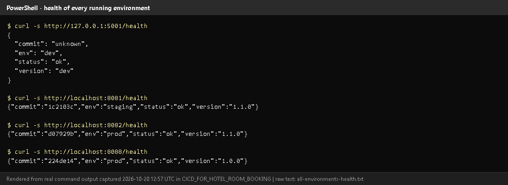
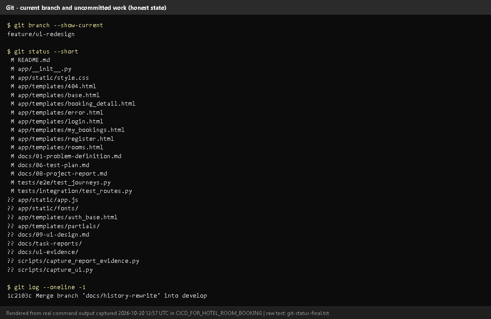
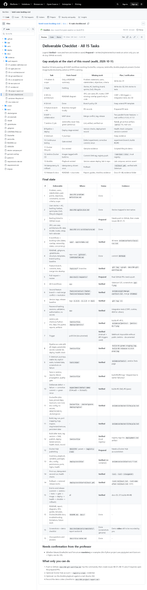
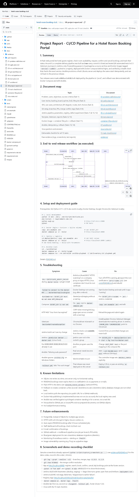

# Task 15 - Final End-to-End Release, Documentation and Viva

## A. Task title and objective

**Task 15: Final Release, Documentation and Viva**

**Objective:** show the complete journey from a code change to a tested,
packaged, deployed, health-checked and recoverable release, and deliver the
documentation and viva preparation for the whole project.

**Professor's required deliverables**

- End-to-end workflow: Git commit -> Jenkins checkout/build -> automated tests -> quality gate -> Docker image -> deployment -> health check -> configuration management -> rollback/recovery
- Final README, project report, architecture diagrams, SRS summary
- Setup and deployment guide, Jenkins documentation, Selenium test plan and reports, Docker lifecycle commands, Ansible documentation
- Troubleshooting guide, known limitations, future enhancements
- Screenshots and a demo-recording checklist
- Viva questions and answers
- A final deliverable checklist mapped to all 15 tasks

**Current status: Implemented and verified, with pending external items.**
Every step of the workflow was run on 2026-10-20 (Jenkins build #11, Ansible
runs 1-4, Selenium after rollback). The documentation set exists (section C).
Pending - outside this machine or needing your accounts/decisions:

1. GitHub issues (0) and pull requests (0)
2. Docker Hub publishing (local registry used)
3. A run against a real VM (container lab used)
4. Professor's confirmation that Python tooling replaces Maven/Tomcat
5. Recording the demo video
6. Committing and deploying the UI redesign (currently uncommitted on `feature/ui-redesign`)

## B. Explanation for a complete beginner

**An everyday picture.** A car factory: a design change is approved (Git),
the assembly line builds the car automatically (Jenkins), inspectors test it
and reject faulty ones (tests = quality gate), approved cars are shipped in
standard containers (Docker images in a registry), dealers prepare their
showroom the same way every time (Ansible), each car gets a final check before
handover (health check), and if a model has a problem, the previous model is
put back in the showroom (rollback).

**The whole DevOps flow in this project**

| Step | Tool | What happens | Evidence |
|---|---|---|---|
| 1. Change | Git | commit on a feature branch, merge into `develop`, tag releases on `main` | Tasks 4-6 |
| 2. Build | Jenkins | checkout, fresh venv, pinned dependencies | build #11 |
| 3. Test | flake8, pytest, Selenium | lint + 59 unit + 26 integration + 5 browser tests | build #11: 90 passed |
| 4. Quality gate | Jenkinsfile stage order | any failure skips everything after it | builds #2, #9 |
| 5. Package | git archive, Docker | source tarball + checksum; images `1.1.0-1c2103c` | build #11 artifacts |
| 6. Publish | registry | images pushed to `localhost:5000` | registry tag list |
| 7. Deploy | Docker Compose | pull + `up --wait` (staging :8081 / prod :8082) | `docker ps` |
| 8. Verify | `/health` | version **and** commit must match | build #11 health stage |
| 9. Configure servers | Ansible | provision a fresh server, idempotent | lab runs 1-3 |
| 10. Recover | Ansible / Compose | rollback to the previous release, verified | lab run 4 + Selenium |

## C. What was actually implemented

**Release sequence as it really happened**

1. Features merged into `develop` (Tasks 5-6); Jenkins #4 green on develop.
2. `git checkout main; git merge --no-ff develop` -> `224de14`, tag **v1.0.0**; Jenkins #5 deployed `main` to **prod**.
3. New feature (nights column) + `VERSION` 1.1.0 on develop; Jenkins #6/#7 green.
4. Merge to `main` -> `ce1726d`, tag **v1.1.0**; Jenkins #8 deployed it to prod - still running today (`1.1.0-d07929b`).
5. Rollback demonstrated with Compose (prod 1.1.0 -> 1.0.0 -> 1.1.0, 2026-10-11) and Ansible (lab, 2026-10-20).
6. 2026-10-20: Jenkins #11 rebuilt and redeployed `develop` (`1c2103c`) to staging; the lab was re-provisioned and rolled back.

**Documentation delivered**

| Required item | Where |
|---|---|
| README | `README.md` |
| Project report (with troubleshooting, limitations, future work, demo checklist) | `docs/08-project-report.md` |
| Problem definition, agile plan, SRS + architecture/ER/use-case diagrams | `docs/01`, `docs/02`, `docs/03` |
| Git workflow, PR records | `docs/04-git-workflow.md`, `docs/pull-requests/` |
| Jenkins pipeline documentation | `docs/05-ci-cd-pipeline.md` |
| Selenium test plan + reports | `docs/06-test-plan.md`, `docs/evidence/tests/` |
| Docker lifecycle commands | `docs/container-lifecycle.md` |
| Ansible documentation | `docs/07-ansible.md` |
| UI design + before/after screenshots | `docs/09-ui-design.md`, `docs/ui-evidence/` |
| Deliverable checklist for all 15 tasks | `docs/15-task-checklist.md` |
| Viva Q&A | `docs/viva-notes.md`, `docs/task-reports/VIVA_CHEAT_SHEET.md` |
| Evidence (logs, screenshots) | `docs/evidence/`, `docs/task-reports/assets/` |
| These 15 task reports + audit | `docs/task-reports/` |

**Final state of all environments (2026-10-20, Figure 15.1)**

| Environment | URL | Version / commit |
|---|---|---|
| development (working tree, redesigned UI) | http://127.0.0.1:5001 | `dev` |
| staging (Jenkins #11) | http://localhost:8081 | 1.1.0 / `1c2103c` |
| prod (Jenkins #8, release v1.1.0) | http://localhost:8082 | 1.1.0 / `d07929b` |
| Ansible lab server | http://localhost:8088 | 1.0.0 / `224de14` right after the rollback (Figure 15.1); 1.1.0 / `1c2103c-dirty` after the Task 14 demo commands were re-checked later the same day |

**Future enhancements** (from `docs/08-project-report.md`): PostgreSQL for
several servers; HTTPS with secure cookies; auto-expiry of PENDING bookings;
a staff dashboard; e-mail confirmations; GitHub webhook + multibranch pipeline;
blue/green deployment and database migrations; monitoring and alerting;
image vulnerability scanning.

## D. Screenshots and evidence



*Figure 15.1 - `/health` of development, staging, prod and the lab server (rendered from real output, 2026-10-20).*



*Figure 15.2 - Current branch and uncommitted files (rendered from real output): the UI redesign and these reports are not yet committed.*


*Figure 15.3 - The customer journey's central page: availability with totals for the stay (redesigned UI, working tree).*



*Figure 15.4 - `docs/15-task-checklist.md` on GitHub: gap analysis and the final deliverable status.*



*Figure 15.5 - `docs/08-project-report.md` on GitHub: summary, document map, end-to-end sequence diagram, setup guide, troubleshooting, limitations, future work and the demo checklist.*

Key end-to-end evidence in other folders: `assets/task-07/jenkins-job-stage-view.png`,
`assets/task-08/jenkins-build-11-console.png`, `assets/task-12/registry-tags.png`,
`assets/task-14/ansible-run3-repeat-idempotent.png`, `assets/task-14/ansible-run4-rollback.png`.

## E. How to demonstrate the whole project (about 12 minutes)

**Before the viva (10 minutes earlier)**

1. Start **Docker Desktop**; wait for "Engine running".
2. PowerShell:
   ```powershell
   cd D:\DevOPS\CICD_FOR_HOTEL_ROOM_BOOKING
   docker ps --format "table {{.Names}}\t{{.Status}}"
   ```
   *Expected:* `hotel-jenkins-jenkins-1`, `hotel-jenkins-registry-1`,
   `hotel-staging-*`, `hotel-prod-*` up. If Jenkins is missing:
   `cd deploy\jenkins; docker compose up -d; cd ..\..`
3. Open browser tabs: http://localhost:8090 (log in), http://localhost:8082,
   the GitHub repository.

**The demonstration**

| Minute | Show | Say |
|---|---|---|
| 0-1 | `docs/01-problem-definition.md` | "The problem: double bookings and risky manual releases." |
| 1-3 | prod http://localhost:8082 - register, search, book, confirm, cancel, My bookings | "The six MVP workflows." |
| 3-4 | `git log --graph --oneline -12 develop`, `git tag -n1` | "Feature branches, merges, release tags." |
| 4-7 | Jenkins -> *Build with Parameters* (`develop`, `staging`) -> stage view | "Lint and 90 tests, then images, registry, deploy, health check." |
| 7-8 | build #2 Tests + Console (`skipped due`) | "A failing test blocks deployment." |
| 8-9 | http://localhost:5000/v2/hotel-booking-app/tags/list and `curl.exe -s http://localhost:8081/health` | "Every image is tagged version-commit; the deployed commit matches." |
| 9-11 | `cd deploy\ansible\lab`; playbook twice (`changed=0`); `-e app_version=1.1.1-demo`; `rollback.yml`; `curl.exe -s http://localhost:8088/health` | "Ansible configures servers idempotently and rolls back." |
| 11-12 | `docs/15-task-checklist.md` | "All 15 tasks with evidence; these items are still pending." |

(Exact Ansible commands: Task 14 section E. If the lab target is not running:
`cd deploy\ansible\lab; docker compose up -d target`.)

**Demo-video checklist:** record the same 12 minutes with a screen recorder
(e.g. Windows *Snipping Tool -> Record*), narrating as above; keep
`deploy\jenkins\.env` and any password off screen.

## F. Expected screenshots for the final submission

1. `assets/task-15/all-environments-health.png` - **exists, 2026-10-20**.
2. `assets/task-15/git-status-final.png` - **exists, 2026-10-20**.
3. `assets/task-15/app-desktop-06-availability-logged-in.png` - **exists, 2026-10-20**.
4. `assets/task-15/github-doc-15-task-checklist.png` - **exists, 2026-10-20**.
5. `assets/task-15/github-doc-08-project-report.png` - **exists, 2026-10-20**.
6. Demo video file - **requires manual recording** (pending).

## G. Probable viva questions and answers

1. **Walk me through your pipeline in one sentence.** Commit -> Jenkins checkout
   -> lint + 90 tests -> source archive and Docker images tagged version-commit
   -> push to registry -> deploy with Compose -> `/health` must match -> Ansible
   configures servers and can roll back.
2. **Where exactly is the quality gate?** In the stage order of the
   Jenkinsfile: Package/Build/Publish/Deploy run only if lint and all tests passed.
3. **How do you know prod runs a tested version?** It runs image
   `1.1.0-d07929b` from build #8, which passed all tests; `/health` reports that commit.
4. **What happens if a bad release reaches prod?** Roll back by switching to
   the previous image tag (Compose or `rollback.yml`); no rebuild.
5. **What role does Ansible play compared to Jenkins?** Jenkins builds, tests
   and deploys to its own host; Ansible prepares and deploys to (other) servers in a repeatable way.
6. **(Project-specific) What are the four stories you'd tell?** No double
   bookings (three layers); failed quality gate (build #2); the merge conflict
   (two footers, resolved keeping both); rollback (1.1.0 -> 1.0.0 verified by Selenium).
7. **(Project-specific) What is still pending?** GitHub issues/PRs, Docker
   Hub, a real VM, the professor's Maven/Tomcat confirmation, the demo video,
   and committing the UI redesign.
8. **Why Python tools instead of Maven/Tomcat?** It's a Python project; pip,
   pytest/flake8, Gunicorn and Nginx do those jobs. Needs the professor's approval.
9. **Biggest technical challenge?** Antivirus HTTPS scanning broke downloads in
   containers; solved with an optional `certs/` folder trusted by every image.
10. **What would you improve next?** HTTPS, PostgreSQL, a GitHub webhook with
    PR builds, blue/green deploys and monitoring.
11. **Is all your evidence genuine?** Yes - logs and screenshots come from
    real runs; rendered terminal images say so; pending items are labelled pending.

## H. Common mistakes and troubleshooting

| Symptom | Cause | Inspect | Fix | Confirm |
|---|---|---|---|---|
| Nothing loads | Docker Desktop not started after reboot | tray icon | start it, wait 1 min | `docker ps` lists containers |
| Dev server won't start on 5000 | registry uses port 5000 | - | `python -m flask --app wsgi run --port 5001` | page opens |
| Jenkins build doesn't show new code | not committed | `git status` | commit, then build the branch | console commit ID |
| Selenium fails against staging/prod | deployed UI older than the local tests | `/health` version | use tests of the deployed version | 5 passed |
| Lab rollback "No such image" | release never deployed there | lab image list | deploy first | rollback ok |

## I. Quick revision notes

**Five key points**

1. Flow: Git -> Jenkins -> tests (gate) -> images -> registry -> deploy -> `/health` -> Ansible -> rollback.
2. Every step was run on 2026-10-20 (build #11, Ansible runs 1-4, Selenium 5/5).
3. Versions are traceable: `VERSION` + commit in tags, `/health` and the page footer.
4. All documentation is in `docs/` and `docs/task-reports/`.
5. Pending: issues/PRs, Docker Hub, VM, Maven approval, video, committing the redesign.

**30-60 second explanation**
"A change starts as a commit on a feature branch. Jenkins checks it out,
installs pinned dependencies and runs flake8 plus 90 tests. Only if all pass
does it package the source, build Docker images tagged with version and
commit, push them to our registry and deploy them with Docker Compose; the
health check confirms the right commit is running. Releases are merged to
main and tagged. Ansible provisions servers the same way every time - a second
run changes nothing - and rollback.yml returns to the previous release, which
I verified with Selenium."

**Caveat:** several external steps (GitHub issues/PRs, Docker Hub, real VM) are still pending.

**Readiness checklist**
- [ ] Docker Desktop started; all containers up.
- [ ] Jenkins logged in; GitHub tab open.
- [ ] I can do the 12-minute demo without notes.
- [ ] I can list the pending items honestly.
- [ ] I have read `VIVA_CHEAT_SHEET.md`.
